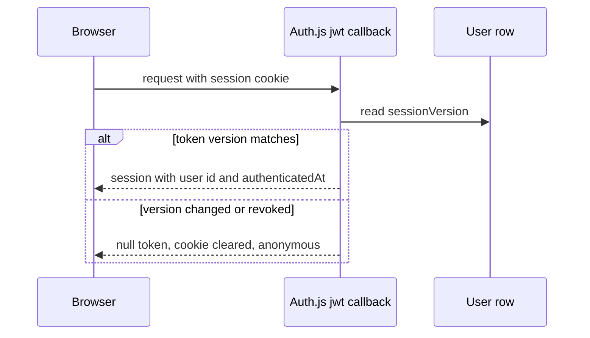

# Auth and sessions

Yuyu authenticates people with Auth.js v5 (`next-auth`). It supports email and password credentials and, when the super-admin has configured it, Google sign-in. Sessions are encrypted JWT cookies. Each one is bound to a per-user `sessionVersion` counter, so bumping the counter revokes every web and mobile session at once. On top of that sit optional TOTP MFA with recovery codes, a 10-minute "recent sign-in" requirement for sensitive changes, and a separate TOTP step-up for the super-admin area. The mobile apps use their own hashed bearer tokens but share the same credential verifier and the same `sessionVersion`.

## Key files

| Path | Role |
| --- | --- |
| `lib/auth.ts` | `NextAuth(...)` config; exports `handlers`, `auth`, `signIn`, `signOut` |
| `app/api/auth/[...nextauth]/` | Auth.js route handlers |
| `lib/authAdapter.ts` | Prisma adapter with a linking guard and token-free `linkAccount` |
| `lib/credentialsAuth.ts` | `verifyPasswordCredentials`, shared by web and mobile sign-in |
| `lib/googleSignIn.ts` | `loadGoogleSsoSettings`, `evaluateGoogleSignIn`, mobile `verifyGoogleIdToken`, `completeGoogleSignIn` |
| `lib/mfa.ts` | TOTP seeds (AES-256-GCM), `consumeMfaCode`, recovery codes |
| `lib/reauth.ts` | `hasRecentAuthentication()` (10 minutes) |
| `lib/superAdminMfa.ts` | Signed super-admin step-up cookie |
| `lib/permissions.ts` | `requireAuth`, `requireSuperAdmin`, `requireSuperAdminMfa` |
| `lib/passwordPolicy.ts` | `newPasswordSchema` |
| `lib/emailVerification.ts` | Inbox verification tokens (hashed, 1 hour) |
| `lib/authRedirect.ts` | `safeAuthRedirect`: only local paths after sign-in |
| `lib/mobileAuth.ts`, `lib/mobile/tokens.ts` | Mobile sessions: issue, refresh, require, revoke |
| `app/actions/auth.ts`, `password-reset.ts`, `security.ts`, `account.ts`, `super-admin-mfa.ts` | Sign-up, verification, reset, MFA, password change, step-up |
| `lib/core/accountSecurity.ts` | `revokeAllSessionsForUser`, shared with mobile "sign out everywhere" |

## How it works

### Auth.js configuration

`lib/auth.ts` passes an **async config function** to `NextAuth`. It runs on every Auth.js request and `auth()` call, so it reads Google SSO settings from the database (`loadGoogleSsoSettings`) at request time. Adding or removing Google in `/super-admin/settings` takes effect without a restart. Settings:

- `session: { strategy: "jwt" }` (required by the Credentials provider). OAuth accounts still persist through the adapter.
- `cookies.sessionToken.name = "yuyu.session-token.v2"`. The versioned name retires incompatible old cookies. `proxy.ts` uses it to mark signed-in responses `no-store`.
- `pages: { signIn: "/login", error: "/login" }`, `trustHost: true`, and `logger.error = logAuthError` (no exception payloads in logs).

### Password sign-in

The Credentials provider's `authorize` calls `verifyPasswordCredentials(raw)`:

1. Parse with `credentialsSchema` (email lower-cased, maximum 254; password maximum 128; optional `totp`).
2. `isActionRateLimited("auth", email)`: per IP and per hashed account.
3. `bcrypt.compare` against the stored hash, or a fixed `DUMMY_HASH` when the account is missing or Google-only, so timing reveals nothing.
4. If the email is unverified, return `email_verification_required` (only after a correct password).
5. If MFA is on and no code was sent, return `mfa_required`. Otherwise accept a TOTP (`consumeMfaCode`) or a recovery code (`consumeRecoveryCode`).

`authorize` turns these reasons into `CredentialsSignin` subclasses with `code = "mfa_required"` or `"email_verification_required"`, so the login screen can show the next step without revealing whether an arbitrary address has MFA.

New passwords use `newPasswordSchema`: at least 12 characters, at most 128, and at most 72 UTF-8 bytes (bcrypt's limit, never silently truncated). Older passwords that don't meet this still sign in.

### Google sign-in

- The provider uses `allowDangerousEmailAccountLinking: true`, scoped deliberately to Google only, so a verified Google identity can join an existing password account with the same email.
- `callbacks.signIn` calls `evaluateGoogleSignIn`. It denies when Google's `email_verified` is false, and denies when a password account with that email exists but is unverified (blocking pre-registration takeover). It returns `account_creation_disabled` when the instance has turned off new accounts.
- `authAdapter.getUserByEmail` repeats the unverified-password check at the adapter's linking lookup, to close the race with a registration.
- `authAdapter.linkAccount` stores only `provider`, `providerAccountId`, `type` and `userId`. OAuth access, refresh and ID tokens are never kept.
- `events.signIn` marks the user's email verified after a Google sign-in.

### Session versioning



The `jwt` callback reads `User.sessionVersion` on every call:

- **At sign-in** (`user` present), it rejects the token if the version checked with the password differs from the current one. A reset racing the sign-in cannot mint a session from old proof. It then stores `sub`, `authenticatedAt = Date.now()` and `sessionVersion`.
- **Afterwards**, a mismatch (or a missing user) returns `null`, and Auth.js clears the cookie.

The `session` callback copies `authenticatedAt` onto the session object for `lib/reauth.ts`.

Code that increments `sessionVersion`, which signs the user out everywhere:

| Where | Trigger |
| --- | --- |
| `app/actions/account.ts` | Password change or add |
| `app/actions/password-reset.ts` | Completed reset (also verifies the email) |
| `app/actions/security.ts` | MFA enabled or disabled |
| `lib/core/accountSecurity.ts` | "Sign out everywhere" (web and mobile) |

`revokeAllSessionsForUser` shows the full shape: lock the `User` row `FOR UPDATE`, increment the version, delete pending MFA setup tokens and adapter sessions, mark mobile sessions revoked (`revokeUserMobileSessions`), and write `SESSIONS_REVOKED`, all in one transaction.

### Recent authentication

`hasRecentAuthentication()` is true when the session's `authenticatedAt` is under 10 minutes old. Callers include:

- password change (`app/actions/account.ts`)
- MFA enrol, confirm and disable, and revoking sessions (`app/actions/security.ts`)
- membership changes (`app/actions/membership.ts`)
- API client management (`app/actions/api-clients.ts`)
- the venue station PIN (`app/actions/checkin-station.ts`)

On failure, return a clear error. Where the UI can offer a fresh sign-in, set `reauthRequired: true` on the `ActionResult` (the station PIN action does this).

### MFA

- `createMfaEnrollment(email)` makes a 20-byte base32 seed. TOTP is SHA1, 6 digits, 30-second period, validated with a window of 1.
- Seeds are stored as `User.mfaSecretEncrypted` in the form `v1.<iv>.<tag>.<ciphertext>`, AES-256-GCM, keyed by `MFA_ENCRYPTION_KEY` (base64, 32 bytes).
- **Replay protection:** `consumeMfaCode` inserts an HMAC of seed and time step into `VerificationToken` (identifier `mfa-replay`) with `createMany({ skipDuplicates: true })`. Only the first use across all replicas wins, including between sign-in and super-admin step-up. The code and seed are never stored.
- **Recovery codes:** 10 codes, stored as HMAC-SHA256 (keyed by `AUTH_SECRET`) in `User.recoveryCodeHashes`, consumed atomically with `array_remove` in one `UPDATE`.

### Super-admin step-up

- `requireSuperAdmin()` requires a session whose verified email equals `SUPER_ADMIN_EMAIL` (case-insensitive). Anyone else gets `notFound()`.
- `requireSuperAdminMfa()` additionally requires MFA to be enabled and a valid `yuyu.super-admin-mfa.v1` cookie. Without it, the user is redirected to `/super-admin-mfa`.
- `verifySuperAdminMfa` consumes a fresh TOTP and sets the cookie: an HMAC (keyed by `AUTH_SECRET`) over `{ userId, sessionVersion, expiresAt }`, valid 10 minutes, `httpOnly`, `sameSite: "strict"`, `path: "/super-admin"`. It audits `SUPER_ADMIN_MFA_VERIFIED`. A version bump invalidates the proof.

### Mobile sessions

`/api/mobile/v1/auth/login` and `/auth/google` (both on the proxy's `auth` bucket) verify with the same `verifyPasswordCredentials` or `verifyGoogleIdToken` plus `completeGoogleSignIn`, then call `issueMobileSession`. Tokens are 32 random bytes. Only SHA-256 digests are stored in `MobileSession`. Access tokens last 15 minutes and refresh tokens 60 days (`lib/mobile/tokens.ts`). Refresh rotates the pair. Replaying the previous refresh token within `REFRESH_REUSE_GRACE_MS` (30 seconds) is refused without revoking, and later replay revokes the session. `requireMobileUser` rejects a session whose stored `sessionVersion` no longer matches the user's. See [Mobile API](/api/mobile-api).

## Invariants

- **Bump `sessionVersion` in the same transaction as any credential or MFA change**, and call `revokeUserMobileSessions(tx, userId)` there too. Lock the `User` row first. Security transactions use this lock order to avoid deadlocks.
- **Sensitive account and organisation changes require `hasRecentAuthentication()`** in the action, not only in the UI.
- **Never store OAuth tokens, raw TOTP codes, seeds in plaintext, or raw bearer tokens.** Only hashes or ciphertext reach the database.
- **Every `app/super-admin/**/page.tsx` calls `await requireSuperAdminMfa()` itself.** Layout checks do not re-run on client navigation. `tests/unit/super-admin-page-guards.test.ts` enforces this.
- **Sign-in responses don't leak account existence.** Wrong email and wrong password both return `invalid`. Sign-up answers the same for new and existing identities.
- **Post-login redirects go through `safeAuthRedirect`**, which accepts only local paths without backslashes or control characters.
- **Never rotate `MFA_ENCRYPTION_KEY` without a re-encryption plan.** It also derives the keys for instance SMTP and Google secrets and webhook signing secrets. `scripts/check-instance-secrets.mjs` verifies decryptability.

## Making changes

- **A new sensitive action:** call `requireAuth()` (or read `auth()`), then `hasRecentAuthentication()`, then `isActionRateLimited("auth", userId)`. Audit with an action name, and if it should appear on the account Security page, add it to `SECURITY_ACTIVITY_LABELS` in `lib/accountSecurity.ts`.
- **Anything that should sign the user out everywhere:** increment `sessionVersion` inside the transaction, or reuse `revokeAllSessionsForUser`.
- **A new super-admin page:** start the page component with `await requireSuperAdminMfa()`.
- **Changing the session payload:** consider bumping the cookie name in `lib/auth.ts` and the regex in `proxy.ts` (`hasSessionCookie`) together.

## Testing

| Area | Files |
| --- | --- |
| JWT and session callbacks | `tests/unit/auth-session.test.ts`, `tests/unit/auth-adapter.test.ts`, `tests/unit/auth-inputs.test.ts` |
| Google | `tests/unit/google-auth.test.ts`, `tests/unit/google-signin.test.ts`, `tests/unit/auth-google-runtime.test.ts` |
| MFA and reset | `tests/unit/mfa.test.ts`, `tests/unit/password-reset.test.ts`, `tests/unit/security-actions.test.ts` |
| Super-admin | `tests/unit/super-admin-mfa.test.ts`, `tests/unit/super-admin-mfa-action.test.ts`, `tests/unit/super-admin-page-guards.test.ts` |
| Mobile tokens | `tests/unit/mobile-auth.test.ts`, `tests/unit/mobile-tokens.test.ts` |
| Races on PostgreSQL | `tests/integration/auth-hardening.db.test.ts`, `tests/integration/mfa-recovery.db.test.ts` |

```bash
npm run test:unit
npm run test:integration
npm run test:e2e:production   # login, cookie flags, CSRF, revoked sessions
```

## Further reading

- [SECURITY.md](https://github.com/twilighty-abhi/yuyu/blob/main/docs/SECURITY.md) (Authentication, Mobile sessions), [AUTH_REVIEW.md](https://github.com/twilighty-abhi/yuyu/blob/main/docs/AUTH_REVIEW.md) (historical hardening record), [MOBILE_API.md](https://github.com/twilighty-abhi/yuyu/blob/main/docs/MOBILE_API.md)
- [Permissions](/architecture/permissions), [Mobile API](/api/mobile-api), [Super admin](/features/super-admin), [Security checklist](/reference/security-checklist)
