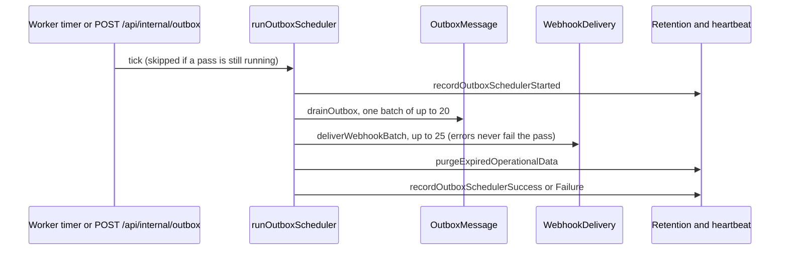

# Background jobs

Yuyu has no separate worker service. Every Node.js app process starts a one-minute in-process scheduler that sends queued email from the `OutboxMessage` table, delivers organisation webhooks from `WebhookDelivery`, purges expired operational rows and records a heartbeat. Request handlers only enqueue rows (inside their own transaction) and never wait for SMTP or a webhook receiver. Every claim is a guarded row update, so any number of replicas, plus an optional external scheduler calling `POST /api/internal/outbox`, can run passes at the same time without double-sending.

## Key files

| Path | Role |
| --- | --- |
| `instrumentation.ts` | Calls `startOutboxWorker()` once per Node.js process |
| `lib/outboxWorker.ts` | `startOutboxWorker`, `runOutboxScheduler`, `drainOutbox`; batch and budget constants |
| `lib/outbox.ts` | `enqueue*` helpers, `deliverOutboxBatchWithCount`, kind dispatch, retries, `BULK_OUTBOX_KINDS`, `OUTBOX_KINDS_ADDED_AFTER_1_0` |
| `lib/webhooks/delivery.ts` | `deliverWebhookBatch`, claim with `FOR UPDATE SKIP LOCKED`, retry schedule, auto-disable |
| `lib/webhooks/emit.ts` | `emitWebhookEvent`: queue rows after a commit |
| `lib/retention.ts` | `purgeExpiredOperationalData` |
| `lib/operationalHeartbeat.ts` | One-row `OperationalHeartbeat` (`outbox-scheduler` key) |
| `app/api/internal/outbox/route.ts` | Protected external trigger for the same pass |
| `lib/email/transporter.ts` | Nodemailer transport, deliberately built per message |

## How it works

### One scheduler pass



`startOutboxWorker()` keeps its state on `globalThis.__yuyuOutboxWorker`, so dev HMR and duplicate module copies never start a second timer. It ticks immediately and then every 60 seconds (`setInterval(...).unref()`), skipping a tick while the previous pass is still running. Failures go to `logOpsError`. Heartbeat writes are wrapped in `.catch()`, so a heartbeat-table problem never stops delivery. Broadcast cores also call `startOutboxWorker()` after queueing, which is a no-op once started.

### Email outbox

**Enqueue.** Use the typed helpers in `lib/outbox.ts` (`enqueueRsvpStatusNotification`, `enqueueEventBroadcastRecipients`, `enqueueTeamCreated`, `enqueuePasswordReset` and so on). Each takes a Prisma client or transaction client and writes one row with a `kind` and a JSON `payload`. Call them inside the transaction that makes the change, so the email exists exactly when the change commits.

**Drain.** `drainOutbox` calls `deliverOutboxBatchWithCount(OUTBOX_DRAIN_BATCH)` and stops when the queue is empty, after `OUTBOX_DRAIN_MAX_BATCHES` batches, when a whole batch failed, or after `OUTBOX_DRAIN_BUDGET_MS`. The current values are 20 per batch and 1 batch per pass, so about 20 emails a minute per scheduler. That rate is deliberate: each message opens its own SMTP login, and faster draining made Gmail and Google Workspace refuse logins (`docs/DECISIONS.md`, 2026-11-03).

**Inside a batch:**

1. Return stale claims (`PROCESSING` with `lockedAt` older than 15 minutes) to `PENDING`.
2. Requeue once any rows of `OUTBOX_KINDS_ADDED_AFTER_1_0` that an older release marked `FAILED` with `PermanentOutboxError` during a rolling update.
3. Select due rows, oldest first, **transactional kinds before `BULK_OUTBOX_KINDS`** (`event-broadcast`, `attendance-check`, `results-published`, `event-invite`). A 10,000-recipient broadcast never delays a password reset.
4. Claim each row with `updateMany({ where: { id, status: PENDING }, data: { status: PROCESSING, lockedAt, attempts: +1 } })`. If the count is not 1, another worker has it.
5. Dispatch on `kind`. Most kinds re-read current state and drop the message if it no longer applies. Examples: an RSVP whose status changed, a team whose management token was regenerated, or an attendance link that was rotated.
6. On success, capability-bearing kinds (`rsvp-confirmation`, `password-reset`, `email-verification`, `collaborator-invite`, `team-created`, `team-member-added`, `submission-link`, `attendance-check`, and `rsvp-status` with a ticket token) are **deleted**. Others become `SENT`.
7. On failure, retry after `2^attempts` minutes, capped at 60 minutes (8 minutes for `password-reset` and `email-verification`, whose links expire after an hour). The failure is terminal after 8 attempts or on `PermanentOutboxError`. Terminal capability rows are deleted. `lastError` stores only a normalised error class. An ops alert is raised either way.

Each send uses a stable `Message-ID` (`<yuyu-<id>@outbox.invalid>`), so a retry after a lost acknowledgement is recognisable as the same message.

### Webhook delivery

`deliverWebhookBatch()` claims up to 25 `PENDING` rows whose `nextAttemptAt` is due, with `UPDATE … WHERE id IN (SELECT … FOR UPDATE SKIP LOCKED)`, and finishes each under its `lockedAt` lease. Requests time out after 10 seconds (`WEBHOOK_TIMEOUT_MS`). Retries follow `WEBHOOK_RETRY_DELAYS_MS` (1 minute up to 12 hours) with ±20% jitter, up to `WEBHOOK_MAX_ATTEMPTS = 8`. An endpoint is switched off after `WEBHOOK_AUTO_DISABLE_AFTER = 20` consecutive failures. Payloads, signing and SSRF rules are on [Webhooks](/api/webhooks).

### Retention

`purgeExpiredOperationalData(now)` deletes, in one transaction:

| Rows | Rule |
| --- | --- |
| `VerificationToken` | `expires < now` |
| `Session` | `expires < now` |
| `OrganisationInvite`, `EventCollaboratorInvite` | Unused and expired |
| `RsvpDeletionUndo` | `expiresAt < now` |
| `OutboxMessage` `SENT` | `sentAt` older than `OUTBOX_RETENTION_DAYS` (default 30, clamped 1–365) |
| `OutboxMessage` `FAILED` | `createdAt` older than the same window |
| `MobileSession` | Refresh expired, or revoked more than 30 days ago |
| `WebhookDelivery` | Older than 30 days and not `PROCESSING` |

It never deletes business or audit data.

### External trigger

`POST /api/internal/outbox` with `Authorization: Bearer $CRON_SECRET` runs `runOutboxScheduler()` and returns `{ ok, sent, failed, webhooks, purged }` with `private, no-store`. A wrong or missing bearer gets a plain 404. `docs/production-operations.md` recommends calling it every minute as a recovery path, with an HTTP timeout of at least 60 seconds. The super-admin Operations page reads the heartbeat.

## Invariants

- **Never send email or call webhooks from a request path.** Enqueue an outbox row in the transaction, or call `emitWebhookEvent` after commit.
- **Every state change on a claimed row is guarded by `status: PROCESSING` and the same `lockedAt`.** That is what makes overlapping passes safe. `OutboxMessage_state_shape` enforces the column shape.
- **Capability payloads (tokens, links) are deleted after delivery, expiry or terminal failure.** Add new capability kinds to `containsCapability`.
- **Organiser-to-audience kinds belong in `BULK_OUTBOX_KINDS`.**
- **New kinds go in `OUTBOX_KINDS_ADDED_AFTER_1_0`** (or its successor). The previous release fails unknown kinds permanently while both releases run, and this list lets the new release requeue them once.
- **Hackathon emails and attendance confirmation are never sent automatically.** The scheduler knows nothing about attendance checks, and an integration test asserts that running it creates none.
- **A webhook failure never fails the email pass**, and heartbeat failures never stop delivery.
- **Don't raise the drain rate** without the pooled-SMTP work described in `docs/DECISIONS.md`.

## Making changes

- **New email kind:** follow [Add an email](/guides/add-an-email). In short: add a payload type and `enqueue…` helper in `lib/outbox.ts`, a payload guard (`as…Payload`), a branch in the dispatch that re-validates current state, the bulk, capability and version-compat lists as needed, and tests in `tests/unit/outbox.test.ts`.
- **New retention rule:** add a `deleteMany` to the transaction in `lib/retention.ts`, return its count, and extend `tests/unit/retention.test.ts`.
- **New webhook event:** see [Add a webhook event](/guides/add-a-webhook-event).

## Testing

| What | File |
| --- | --- |
| Outbox dispatch, retries, ordering | `tests/unit/outbox.test.ts`, `tests/unit/team-outbox.test.ts`, `tests/unit/judging-outbox.test.ts` |
| Worker and drain loop | `tests/unit/outbox-worker.test.ts` |
| Retention | `tests/unit/retention.test.ts` |
| Internal and health routes | `tests/unit/operations-routes.test.ts` |
| Webhook queue on PostgreSQL | `tests/integration/webhooks.db.test.ts` |
| No automatic attendance sends | `tests/integration/attendance-check.db.test.ts` |

```bash
npx vitest run tests/unit/outbox.test.ts tests/unit/outbox-worker.test.ts tests/unit/retention.test.ts
npm run test:integration
```

## Further reading

- [ARCHITECTURE.md, "Background and scheduled work"](https://github.com/twilighty-abhi/yuyu/blob/main/docs/ARCHITECTURE.md), [DECISIONS.md](https://github.com/twilighty-abhi/yuyu/blob/main/docs/DECISIONS.md), [production-operations.md](https://github.com/twilighty-abhi/yuyu/blob/main/docs/production-operations.md), [WEBHOOKS.md](https://github.com/twilighty-abhi/yuyu/blob/main/docs/WEBHOOKS.md)
- [Email and broadcasts](/features/email-and-broadcasts), [Webhooks](/api/webhooks), [Deployment](/reference/deployment), [Troubleshooting](/reference/troubleshooting)
