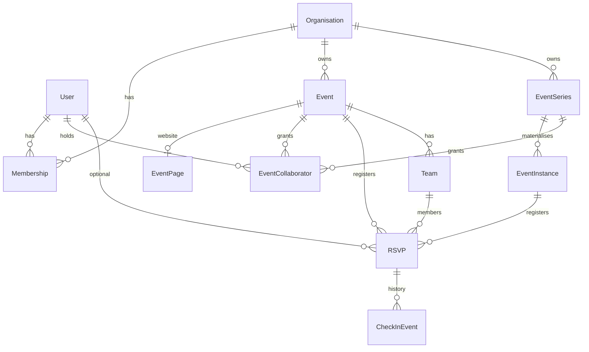

# Data model

Yuyu's data lives in PostgreSQL, described by `prisma/schema.prisma` (about 70 models) and an ordered set of hand-reviewed migrations in `prisma/migrations/`. The schema file is authoritative for fields, relations and cascades, so don't infer them from a component. The migrations add what Prisma cannot express: CHECK constraints, partial unique indexes and audit triggers. These database rules are the last integrity layer under the application's own checks, so a buggy or bypassed code path still cannot write a malformed row.

## Key files

| Path | Role |
| --- | --- |
| `prisma/schema.prisma` | Models, enums, relations, cascades, indexes |
| `prisma/migrations/<timestamp>_<name>/migration.sql` | Ordered production migrations, including constraints and triggers Prisma cannot model |
| `lib/db.ts` | The shared `prisma` client |
| `lib/sqlTimestamp.ts` | `sqlUtcTimestamp(date)` and `SQL_UTC_NOW` for raw SQL timestamps |
| `scripts/verify-production-schema.mjs` | `npm run db:verify`: checks a live database's columns, constraints, indexes and triggers |
| `tests/integration/schema-invariants.db.test.ts` | Proves the database rejects invalid rows |
| `tests/unit/migration-safety.test.ts` | Pins ordering and content of risky migrations |

## How it works

### Model map

| Area | Models |
| --- | --- |
| Identity | `User`, `Account`, `Session`, `VerificationToken`, `MobileSession` |
| Tenancy | `Organisation`, `Membership`, `OrganisationInvite`, `EventCollaborator`, `EventCollaboratorInvite` |
| Machine access | `ApiClient`, `ApiClientScope`, `ApiCredential` |
| Events and series | `Event`, `EventInvite`, `EventSeries`, `SeriesInvite`, `EventInstance`, `EventScheduleItem` |
| Event website | `EventPage`, `EventPageSection`, `EventHighlight`, `EventVenue`, `EventVenueRoom`, `EventScheduleTrack`, `EventSession`, `EventSpeaker`, `EventSessionSpeaker`, `EventSponsor`, `EventFaq`, `EventResource` |
| Registration | `RSVP`, `EventRegistrationForm`, `EventRegistrationField`, `RsvpAnswer`, `RsvpDeletionUndo` |
| Teams and crew | `Team`, `TeamSeekerProfile`, `TeamJoinRequest`, `EventCrewMember`, `EventCrewJoinLink` |
| Hackathon judging | `Submission`, `SubmissionLink`, `JudgingCriterion`, `JudgeAssignment`, `JudgeScore`, `JudgeReview`, `EventAward`, `EventAwardWinner` |
| Check-in | `CheckInEvent`, `CheckInList`, `CheckInListRecord`, `CheckInListEvent` |
| Communications | `EventBroadcast`, `EventBroadcastDraft`, `AttendanceCheck`, `OutboxMessage` |
| Feedback | `EventFeedbackForm`, `EventFeedbackField`, `EventFeedbackResponse`, `EventFeedbackAnswer` |
| Webhooks | `WebhookEndpoint`, `WebhookDelivery` |
| Operations | `AuditEvent`, `OperationalHeartbeat`, `InstanceSetting`, `Asset`, `SavedView` |

### Core entities



How to read it:

- **`Organisation` is the tenant.** `Event`, `EventSeries`, `Asset`, `ApiClient`, `WebhookEndpoint`, `SavedView` and `AuditEvent` carry `organisationId`. Everything else reaches the tenant through one of those.
- **`Membership`** is unique on `(userId, organisationId)`, with role `OWNER | ADMIN | MEMBER`.
- **`EventCollaborator`** targets exactly one event or one series, with `permissions EventPermission[]` (`EDIT_DETAILS`, `MANAGE_REGISTRATIONS`, `MANAGE_INVITATIONS`, `CHECK_IN`, `PUBLISH_AND_SCHEDULE`, `JUDGE`).
- **`RSVP`** belongs to exactly one target, either `eventId` (a standalone event) or `eventInstanceId` (one occurrence of a series). It is either a user's (`userId`) or a guest's (`guestEmail`, `guestName`). `attendeeKey` (`user:<id>` or `guest:<normalised email>`) is the dedupe key. `checkInToken` is the ticket bearer value. `checkedInAt` is the current check-in projection, and `CheckInEvent` is its immutable history.
- **`Team`** is a capacity unit on a `TEAM` event. Its `status` mirrors every member RSVP's status.
- **`EventPage.isPublished`** always mirrors `Event.status = PUBLISHED`. Both are written in one transaction ([Events and websites](/features/events-and-websites)).

### Key enums

| Enum | Values |
| --- | --- |
| `MembershipRole` | `OWNER`, `ADMIN`, `MEMBER` |
| `EventPrivacyType` | `PUBLIC`, `HIDDEN_LINK`, `APPROVAL_REQUIRED`, `INVITE_ONLY` |
| `RsvpStatus` | `CONFIRMED`, `WAITLISTED`, `PENDING_APPROVAL`, `REJECTED` |
| `EventStatus` | `DRAFT`, `PUBLISHED`, `HIDDEN`, `CANCELLED` |
| `OutboxStatus` | `PENDING`, `PROCESSING`, `SENT`, `FAILED` |
| `WebhookDeliveryStatus` | `PENDING`, `PROCESSING`, `SUCCEEDED`, `FAILED` |
| `RegistrationMode` | `INDIVIDUAL`, `TEAM` |
| `SoloPolicy` | `TEAMS_ONLY`, `SOLO_ALLOWED`, `SOLO_WITH_MATCHING` |

### Database-level invariants

CHECK constraints (migration in brackets):

| Constraint | Rule | Migration |
| --- | --- | --- |
| `RSVP_exactly_one_target` | Exactly one of `eventId`, `eventInstanceId` | `20260824000000_production_hardening` |
| `RSVP_crew_shape` | A crew RSVP is event-bound, team-less and `CONFIRMED` | `20261029000000_event_crew` |
| `Event_valid_time_range`, `EventInstance_valid_time_range`, `EventSession_valid_time_range`, `EventScheduleItem_valid_time_range` | `endDateTime > startDateTime` | `20260829180000_production_readiness_integrity` |
| `Event_positive_capacity`, `EventSeries_positive_capacity` | Capacity null or greater than 0 | same |
| `EventSession_valid_delay`, `EventScheduleItem_valid_delay` | Live-delay bounds | same |
| `OrganisationInvite_usage_pair`, `EventCollaboratorInvite_usage_pair` | `usedByUserId` implies `usedAt` | same |
| `Event_registration_cutoff_mode` | Not both `registrationClosesAt` and `registrationLeadMinutes` | `20260828120000_event_collaboration_schedules_cutoffs` |
| `EventCollaborator_one_target`, `EventCollaboratorInvite_one_target`, `EventScheduleItem_one_target` | Exactly one of event or series | same |
| `Event_manual_close_snapshot_mode` | Only one manual-close snapshot field set | `20261020000000_mobile_sessions` |
| `CheckInEvent_known_action`, `CheckInEvent_known_source` | Action and source allow-lists. Source is now `online`, `offline-sync`, `venue-station`, `mobile-scan`, `mobile-manual` | `20260830010000_checkin_history_integrity`, widened in `20261020000000_mobile_sessions` |
| `OutboxMessage_state_shape`, `OutboxMessage_attempts_nonnegative` | `PROCESSING` has `lockedAt`, `SENT` has `sentAt`, others neither | `20260830030000_outbox_state_integrity` |
| `AuditEvent_single_actor` | Not both a user and an API client actor | `20260827040000_machine_api_v1` |
| `ApiCredential_secret_hash_length` | 32-byte secret digest | same |
| `EventFeedbackResponse_identity_capability_pair`, `EventFeedbackAnswer_typed_value` | Identity and certificate token both set or both null; one typed value column per field type | `20260830020000_feedback_answer_snapshots` |
| `Event_team_*`, `TeamSeekerProfile_skills_limit` | Team size bounds; `TEAM` mode requires `teamMaxSize` | `20261024000000_team_registration` |
| `Submission_exactly_one_entrant`, `SubmissionLink_token_hash_shape`, `JudgeScore_score_range` and other judging checks | One of `teamId`/`rsvpId`; 64-hex digests; bounded scores and text | `20261024010000_hackathon_judging` |
| `AttendanceCheck_token_hash_shape`, `AttendanceCheck_note_length`, `AttendanceCheck_response_pair` | 64-hex digest; note at most 500 characters; `response` and `respondedAt` set together | `20261028000000_attendance_confirmation` |
| `CheckInList_*`, `CheckInListRecord_known_source`, `CheckInListEvent_known_*` | Name shape, sort range, allow-lists | `20261023000000_check_in_lists` |
| `WebhookEndpoint_*`, `WebhookDelivery_*` | URL and description length, bounded event types, lease shape | `20261023010000_org_webhooks` |

Partial unique indexes (declared only in SQL, because Prisma cannot model them):

| Index | Rule | Migration |
| --- | --- | --- |
| `RSVP_event_attendee_unique`, `RSVP_instance_attendee_unique` | One RSVP per `attendeeKey` per event or per occurrence: the duplicate-RSVP guard | `20260819200000_release_integrity` |
| `CheckInList_eventId_active_name_key` | List names unique per event, case-insensitive, among non-archived lists | `20261023000000_check_in_lists` |
| `TeamJoinRequest_one_pending_per_team_rsvp` | At most one pending request per team and RSVP | `20261024000000_team_registration` |

Triggers: `write_security_audit_fallback()` (`20260827020000_database_audit_fallback`, made `AFTER` row triggers in `20260827021000_fix_audit_trigger_timing`, with cascade and API-client fixes through `20260827042000_fix_api_audit_delete_cascade`) writes a PII-free `AuditEvent` with action `DB_<TABLE>_<OP>` and metadata `{"source":"database-trigger"}` for every insert, update and delete on `Organisation`, `Membership`, `Event`, `EventSeries`, `OrganisationInvite`, `EventInvite`, `SeriesInvite` and `RSVP`. `20260829180000_production_readiness_integrity` extends it to `EventCollaborator` and `EventCollaboratorInvite`. This catches changes that bypass the application, such as manual SQL. Application code still writes the descriptive audit events.

## Conventions

- **Ids** are `String @id @default(cuid())` on almost every model. Exceptions use natural keys: composite ids such as `ApiClientScope (apiClientId, scope)`, `EventCrewJoinLink.eventId`, and `OperationalHeartbeat.key`. `RSVP.checkInToken` uses `cuid(2)`.
- **Timestamps** are `createdAt DateTime @default(now())`, plus `updatedAt @updatedAt` where edits matter. Prisma stores `DateTime` as `timestamp(3)` holding UTC wall-clock time.
- **Raw SQL timestamps go through `lib/sqlTimestamp.ts`.** A JS `Date` bound into `$queryRaw` is sent as `timestamptz` and shifted by the session `TimeZone`. Use `sqlUtcTimestamp(date)` and `SQL_UTC_NOW` instead (used in `lib/core/attendanceCheck.ts`, `lib/core/judging.ts`, `lib/webhooks/delivery.ts`). `tests/integration/raw-sql-timezone.db.test.ts` covers it.
- **Secrets are stored as digests or ciphertext only.** Examples include `Team.manageTokenHash`, `AttendanceCheck.tokenHash`, `MobileSession` token hashes (SHA-256), `User.mfaSecretEncrypted` (AES-256-GCM) and `User.recoveryCodeHashes` (HMAC). Field doc comments in the schema say "never expose or log".
- **Event timezone** is an IANA string on `Event.timezone` and `EventSeries.timezone`. Format through `lib/format/*`, never ad hoc.
- **Row locks for capacity:** `SELECT … FOR UPDATE` on the `Event` row (or `EventSeries` plus `EventInstance`) before counting. See [Mutation cores](/architecture/mutation-cores).
- **Cascades** come from the schema. For example, deleting an `Event` cascades its RSVPs, while deleting a `User` sets `RSVP.userId` and `CheckInEvent.actorUserId` to null so history survives.

## Invariants

- **Never write a row the constraints above forbid, and never drop one to make code simpler.** Integration tests and `db:verify` rely on their names.
- **Keep `Event.status` and `EventPage.isPublished` in step.** Data migrations `20260915000000_unify_event_publication` and `20261021010000_realign_event_publication` had to repair drift.
- **A team's status equals every member RSVP's status.** It is updated in the same transaction with a guarded `updateMany` (`lib/core/teams.ts`).
- **Migrations are additive and reviewed.** Don't use `db:push` for deployable changes. Add CHECKs as `NOT VALID` and then `VALIDATE` separately, to avoid a long `ACCESS EXCLUSIVE` scan (see `RSVP_crew_shape`). Record new enum values in the rollback notes of `docs/PRODUCTION_RELEASE.md`, because the previous release cannot read rows that use them.

## Making changes

- **Add a column or model:** edit `prisma/schema.prisma`, run `npm run db:migrate` to generate SQL, then read the SQL for locks, nullability, backfills and cascades. Full checklist in [Change the schema](/guides/change-the-schema).
- **Add a constraint Prisma cannot express:** append it to the generated `migration.sql` (with `NOT VALID` and `VALIDATE`), add a rejection case to `tests/integration/schema-invariants.db.test.ts`, and add it to `scripts/verify-production-schema.mjs` if production must have it.
- **Write raw SQL with dates:** import `sqlUtcTimestamp`/`SQL_UTC_NOW`.

## Testing

```bash
npm run test:integration   # schema-invariants, raw-sql-timezone and all *.db.test.ts (disposable TEST_DATABASE_URL only)
npx vitest run tests/unit/migration-safety.test.ts
npm run db:status
npm run db:verify          # against a migrated database
```

## Further reading

- [ARCHITECTURE.md, "Main data areas"](https://github.com/twilighty-abhi/yuyu/blob/main/docs/ARCHITECTURE.md), [PERFORMANCE.md](https://github.com/twilighty-abhi/yuyu/blob/main/docs/PERFORMANCE.md) (large-event indexes), [PRODUCTION_RELEASE.md](https://github.com/twilighty-abhi/yuyu/blob/main/docs/PRODUCTION_RELEASE.md)
- [Change the schema](/guides/change-the-schema), [Mutation cores](/architecture/mutation-cores), [Permissions](/architecture/permissions), [Glossary](/reference/glossary)
