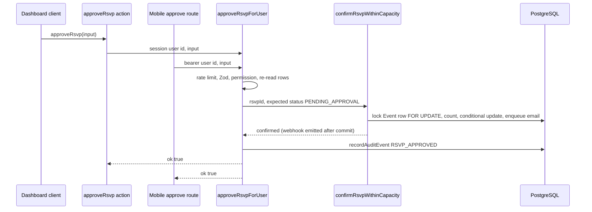

# Mutation cores

A mutation core is a server-only function in `lib/core/` that owns one business operation end to end: input validation, permission check, rate limit, transaction, audit record and webhook emission. The dashboard's Server Actions and the mobile API (`/api/mobile/v1`) both call the same core, so an approval, a check-in or a broadcast behaves identically whichever client sent it. If you change a rule, change it in the core and never in one surface. `AGENTS.md` makes this a project rule ("change behaviour here, not in one surface").

## Key files

| Path | Role |
| --- | --- |
| `lib/core/*.ts` | The cores. Every file starts with `import "server-only"` |
| `app/actions/*.ts` | Server Actions. For core-backed areas these are thin wrappers that read the session and call the core |
| `app/api/mobile/v1/**/route.ts` | Mobile routes that call the same cores |
| `lib/mobile/route.ts`, `lib/mobile/eventRoute.ts` | Mobile wrappers: bearer auth, per-user rate limit, event resolution |
| `lib/mobile/http.ts` | `mobileOk`, `mobileError`, `mobileActionError` (maps a failed `ActionResult` to the mobile envelope) |
| `app/actions/org.ts` | `ActionResult<T>` and `ActionErrorCode`, the return type of every core |
| `app/actions/utils.ts` | `flattenZodErrors` for `fieldErrors` |
| `lib/validators.ts` | Zod input schemas |
| `lib/actionRateLimit.ts` | `isActionRateLimited(bucket, subject)` |
| `lib/audit.ts` | `recordAuditEvent` |
| `lib/webhooks/emit.ts` | `emitWebhookEvent`, fire-and-forget after commit |

### The cores

| Core | Responsibility |
| --- | --- |
| `checkin.ts` | Preview, check in and undo by token or RSVP id; offline roster and sync; lookup; recent check-ins |
| `checkinLists.ts` | Custom check-in lists: create, update, reorder, check in, undo, lookup, roster |
| `rsvpLifecycle.ts`, `rsvpAdmin.ts`, `rsvpCancel.ts` | Approve, reject, re-accept, promote; organiser add, edit, remove and undo; attendee cancel |
| `teams.ts`, `teamOrganiser.ts` | Team registration, leader actions, organiser team moderation; `resolveOrganiserEvent` |
| `crew.ts` | Event crew |
| `judging.ts`, `judgingOps.ts`, `judgingEntrants.ts`, `submissionLifecycle.ts` | Submissions, rubric, judging, assignment, results |
| `broadcasts.ts` | Organiser emails and drafts |
| `attendanceCheck.ts` | "Are you still coming?" sends, reminders, replies |
| `eventProgramme.ts` | Programme context and live session delays |
| `feedbackSettings.ts`, `registrationWindow.ts` | Feedback settings; closing and reopening sign-ups |
| `savedViews.ts` | Saved list filters |
| `accountProfile.ts`, `accountSecurity.ts` | Profile updates; "sign out everywhere" |

## How it works

### The pattern end to end

The worked example is approving a pending registration.

**1. The core** (`lib/core/rsvpLifecycle.ts`) takes the actor's user id and untyped input, and returns `ActionResult`:

```ts
export async function approveRsvpForUser(actorUserId: string | null, input: unknown): Promise<ActionResult> {
  if (!actorUserId) {
    return { ok: false, error: "You must be signed in." };
  }
  const session = { user: { id: actorUserId } };
  if (await isActionRateLimited("rsvp", session.user.id)) return { ok: false, error: "Too many attendee updates. Try again shortly." };

  const parsed = rsvpTransitionSchema.safeParse(input);
  if (!parsed.success) {
    return {
      ok: false,
      error: "Invalid input.",
      fieldErrors: flattenZodErrors(parsed.error),
    };
  }

  const { organisationSlug, rsvpId, eventId, eventInstanceId } = parsed.data;
  const ctx = await loadRsvpContext(
    organisationSlug,
    session.user.id,
    rsvpId,
    eventId,
    eventInstanceId,
  );
```

`loadRsvpContext` resolves the organisation from the slug, calls `canManageRegistrationsFor` (`lib/eventAccess.ts`) and re-reads the event and RSVP inside that organisation. The core then calls `confirmRsvpWithinCapacity` (`lib/rsvpCapacity.ts`) and, on success, records the audit event and revalidates paths:

```ts
    if (result !== "confirmed") return { ok: false, error: "This RSVP was changed by another organiser." };
    await recordAuditEvent({ action: "RSVP_APPROVED", actorUserId: session.user.id, organisationId: org.id, targetType: "RSVP", targetId: rsvp.id });
    revalidateRsvpPaths({
      orgSlug: org.slug,
      eventSlug: ctx.event.slug,
      eventId: ctx.event.id,
    });
    return { ok: true };
```

**2. The Server Action** (`app/actions/rsvp-lifecycle.ts`) only supplies the session user:

```ts
"use server";

import { auth } from "@/lib/auth";
import type { ActionResult } from "./org";
import { approveRsvpForUser, promoteFromWaitlistForUser, reacceptRsvpForUser, rejectRsvpForUser } from "@/lib/core/rsvpLifecycle";

async function currentUserId() {
  const session = await auth();
  return session?.user?.id ?? null;
}

export async function approveRsvp(input: unknown): Promise<ActionResult> {
  return approveRsvpForUser(await currentUserId(), input);
}
```

The client component (`components/event-dashboard/overview/WaitingForYou.tsx`) calls `approveRsvp({ organisationSlug, rsvpId, eventId })`, shows `result.error` in a toast when `ok` is false, and calls `router.refresh()` on success.

**3. The mobile route** (`app/api/mobile/v1/orgs/[orgSlug]/events/[eventId]/guests/[rsvpId]/approve/route.ts`) calls the same core with the bearer-authenticated user:

```ts
/** Same capacity transaction, notification email and audit as the dashboard. */
export const POST = eventRoute<Params>("POST /api/mobile/v1/orgs/:orgSlug/events/:eventId/guests/:rsvpId/approve", null, async (_request, { rsvpId }, { auth, event }) => {
  const result = await approveRsvpForUser(auth.userId, { organisationSlug: event.organisation.slug, eventId: event.event.id, rsvpId });
  if (!result.ok) return mobileActionError(result);
  const guest = await loadGuest(event, rsvpId);
  return guest ? mobileOk(guest) : notFound();
});
```

`eventRoute` wraps `authedMobileRoute`, which authenticates the bearer (`requireMobileUser`), applies the per-user `mobileApi` limit, and resolves the event. Events the caller cannot see on the dashboard answer `NOT_FOUND`. The core still re-checks the permission itself. `mobileActionError` turns `ActionResult.code` (for example `TEAM_MEMBER`) into a mobile error code.



### Where each concern lives

| Concern | Where | In the example |
| --- | --- | --- |
| Coarse IP limit | `proxy.ts` | `action` bucket for Server Action POSTs; `global` for `/api/*` |
| Authentication | Caller | Action: `auth()` from `lib/auth.ts`. Mobile: `requireMobileUser` in `authedMobileRoute`. The core refuses a `null` actor |
| Per-operation rate limit | Core | `isActionRateLimited("rsvp", userId)` keys on the client IP (from `headers()`) and a SHA-256 fingerprint of the subject, so it works in both actions and route handlers. Mobile adds `mobileApi` per user |
| Input validation | Core | `rsvpTransitionSchema.safeParse(input)`; failures return `fieldErrors`. Mobile routes also parse their own JSON body with a strict schema (`parseJsonBody`) |
| Tenancy and permission | Core | `canManageRegistrationsFor` after resolving the organisation from the slug; every row re-read with its `organisationId` or `eventId` |
| Transaction and locking | Domain service called by the core | `confirmRsvpWithinCapacity`: `SELECT … FOR UPDATE` on the `Event` row, count, `updateMany` guarded by the expected status |
| Email | Inside the transaction | `enqueueRsvpStatusNotification(tx, …)` writes an `OutboxMessage`. Never wait for SMTP |
| Webhook | After commit | `emitWebhookEvent({ type: "registration.status_changed", … })` |
| Audit | Core, after success (or inside the transaction) | `recordAuditEvent(...)`. Pass `client: tx` to write it in the same transaction, as `lib/core/checkinLists.ts` and `lib/core/judgingOps.ts` do |
| Cache revalidation | Core | `revalidatePath` for the public and dashboard paths |
| Response shape | Caller | Action returns `ActionResult` as is. Mobile maps it to a DTO (`loadGuest`) or `mobileActionError` |

### Two core styles

- **`…ForUser(actorUserId, input, options?)` cores** (check-in, RSVP, broadcasts, attendance confirmation, check-in lists, registration window, feedback settings) do everything above. Their Server Actions are one-liners. Options carry surface-specific facts, for example `CheckInCoreOptions = { source?: "online" | "mobile-scan" | "mobile-manual" }`, which the mobile check-in route passes as `{ source: "mobile-scan" }`.
- **Context cores** (`crew.ts`, `judging.ts`, `judgingOps.ts`, parts of `teams.ts`) take an already-resolved context such as `OrganiserCrewContext` or `JudgingOrganiserContext`. The caller authenticates, rate limits and resolves it first with `resolveOrganiserEvent` (`lib/core/teams.ts`), `resolveJudgingOrganiser` or `resolveJudgeContext` (`lib/judgingAccess.ts`), and returns `null` when access is missing. In `app/actions/crew.ts` the action's `gate()` does that, then audits and revalidates around the core. The judging core writes its audit events inside its own transactions.

### The `ActionResult` contract

```ts
export type ActionResult<T = void> =
  | { ok: true; data?: T }
  | {
      ok: false;
      error: string;
      fieldErrors?: Record<string, string[]>;
      needsForce?: boolean;
      reauthRequired?: boolean;
      code?: ActionErrorCode;
    };
```

(Doc comments trimmed.) `error` is UI-safe text. Never put internal details, ids from other tenants or stack traces in it. `code` is for API clients; the web shows only `error`.

::: warning Error wording is part of the mobile contract
`classifyActionError` in `lib/mobile/http.ts` derives the mobile error code from `needsForce`, a pass-through `code`, `fieldErrors`, and then **regular expressions on the `error` text**. For example, "You must be signed in" maps to `UNAUTHENTICATED`, "Too many…" to `RATE_LIMITED`, "…not found." to `NOT_FOUND` and "…permission…" to `FORBIDDEN`. Anything unmatched becomes `CONFLICT`. Keep to these phrasings when you write or reword a core's errors, or set `code` explicitly.
:::

## Invariants

- **One rule, one place.** If web and mobile can both trigger a mutation, it goes through a core. Mobile mutations must never reimplement logic (`docs/MOBILE_API.md`, `AGENTS.md`).
- **Cores take `unknown` input and validate it.** Never trust a caller's types, because Server Actions are public HTTP endpoints.
- **Resolve the tenant server-side, then re-read every row inside it.** Take an organisation slug, look it up, and query ids with `organisationId`/`eventId` predicates. An id from another organisation must look like "not found".
- **Side effects after commit.** Realtime publishes and `emitWebhookEvent` run after the transaction commits and never throw (`lib/checkInMutations.ts`, `lib/rsvpCapacity.ts`). Email is enqueued inside the transaction as an outbox row.
- **Guard state transitions with conditional writes.** Use `updateMany` with the expected current status (`expectedStatuses`, `checkedInAt: null`) and treat a count of 0 as "changed by someone else".
- **Lock order for capacity.** Every capacity-changing path takes `SELECT … FOR UPDATE` on the `Event` (or series and instance) row before counting. See the "Team registration and capacity units" section of `docs/ARCHITECTURE.md`.
- **Audit metadata stays PII-free.** No emails, answers, tokens or passwords (`lib/audit.ts` doc comment).
- **Cores are `server-only`.** Never import one into a client component. Pure helpers that clients need live outside `lib/core/`, for example `lib/attendanceCheck.ts`.

## Making changes

**Change a rule** (for example, who may approve): edit the core, update its integration test in `tests/integration/`, and check that the mobile contract still holds (`npm run test:unit -- mobile-api-contract`).

**Add a new shared mutation:**

1. Add a Zod schema to `lib/validators.ts` (or next to the core if it is local).
2. Write `export async function doThingForUser(actorUserId: string | null, input: unknown): Promise<ActionResult<…>>` in the right `lib/core/*.ts`, with `import "server-only"` at the top. Follow the order: actor check, `isActionRateLimited`, `safeParse`, resolve organisation and permission, transaction, audit, `emitWebhookEvent` after commit, `revalidatePath`.
3. Add a thin `"use server"` wrapper in `app/actions/*.ts`.
4. If mobile needs it, add a route under `app/api/mobile/v1/` using `eventRoute` (or `authedMobileRoute`), update `docs/mobile-api.openapi.yaml` and its fixtures. See [Extend the APIs](/guides/extend-the-apis).
5. Add tests (below).

The full walkthrough is in [Add a Server Action](/guides/add-a-server-action).

## Testing

| Layer | Examples |
| --- | --- |
| Core logic against PostgreSQL | `tests/integration/rsvp-lifecycle.db.test.ts`, `check-in.db.test.ts`, `teams.db.test.ts`, `judging-core.db.test.ts`, `crew.db.test.ts` |
| Web and mobile parity | `tests/integration/mobile-api.db.test.ts`, `tests/integration/mobile-teams-judging.db.test.ts` |
| Mobile contract | `tests/unit/mobile-api-contract.test.ts` (OpenAPI and fixtures against the Zod schemas and routes) |
| Action wrappers | `tests/unit/broadcast-actions.test.ts`, `tests/unit/submission-actions.test.ts`, `tests/unit/saved-views-actions.test.ts` |

```bash
npm run test:unit
npm run test:integration   # needs TEST_DATABASE_URL pointing at a disposable database
```

## Further reading

- [ARCHITECTURE.md](https://github.com/twilighty-abhi/yuyu/blob/main/docs/ARCHITECTURE.md), [MOBILE_API.md](https://github.com/twilighty-abhi/yuyu/blob/main/docs/MOBILE_API.md), [SECURITY.md](https://github.com/twilighty-abhi/yuyu/blob/main/docs/SECURITY.md)
- [Permissions](/architecture/permissions), [Data model](/architecture/data-model), [Background jobs](/architecture/background-jobs)
- [Add a Server Action](/guides/add-a-server-action), [Mobile API](/api/mobile-api), [Webhooks](/api/webhooks)
