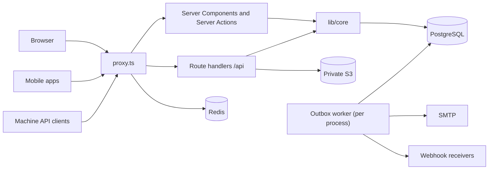

# Architecture overview

Yuyu is one Next.js 16 App Router application (React 19, TypeScript) backed by PostgreSQL through Prisma 6, with Redis for distributed rate limits and live check-in, a private S3-compatible bucket for files, and SMTP for email. The same process serves the public site, the organiser dashboard, the super-admin area, the machine API (`/api/v1`), the mobile API (`/api/mobile/v1`) and the background outbox worker. There is no separate worker container. This page explains how a request travels through that process and where each concern lives, so you know which layer to change.

## Key files

| Path | Role |
| --- | --- |
| `proxy.ts` | Next.js 16 proxy (the old "middleware"): coarse rate limits, CSP nonce, framing and cache headers |
| `instrumentation.ts` | Node.js startup: validates the environment, installs ops-alert forwarding, starts the outbox worker; `onRequestError` reports failures |
| `next.config.ts` | Standalone output, Server Action origins and body limit, security headers, MDX tracing |
| `app/` | Pages, layouts, route handlers (`app/api/**/route.ts`) |
| `app/actions/` | Server Actions for authenticated dashboard and account mutations |
| `lib/core/` | Mutation cores shared by Server Actions and `/api/mobile/v1` |
| `lib/auth.ts`, `lib/permissions.ts`, `lib/eventAccess.ts` | Session, organisation roles, per-event grants |
| `lib/validators.ts` | Zod schemas for boundary inputs |
| `lib/rateLimit.ts`, `lib/actionRateLimit.ts` | Redis-backed rate-limit buckets |
| `lib/outbox.ts`, `lib/outboxWorker.ts` | Email queue and the one-minute worker |
| `lib/env.ts` | `validateRuntimeEnvironment`, called at startup |
| `lib/opsAlerts.ts` | Redacted operational alerts sent to the configured webhook |

## How it works

### Runtime topology



Every replica runs the same image and starts its own worker. Database row claims make that safe (see [Background jobs](/architecture/background-jobs)). Production needs a shared `REDIS_URL` so rate limits and live ticket updates span replicas.

### Startup (`instrumentation.ts`)

On the Node.js runtime, `register()` runs once per process:

1. `validateRuntimeEnvironment()` from `lib/env.ts` checks configuration (in production: HTTPS `AUTH_URL`/`NEXT_PUBLIC_BASE_URL`, TLS PostgreSQL, `rediss://`, secret lengths and so on).
2. `installOpsAlertForwarding()` and an "Instance started" alert from `lib/opsAlerts.ts`.
3. `startOutboxWorker()` from `lib/outboxWorker.ts`.

`onRequestError` forwards render, route, action and proxy failures to the alert webhook. It reports the route pattern (`context.routePath`, for example `/ticket/[token]`), never the raw request path, because paths can carry bearer tokens. Client-disconnect noise is dropped.

### Request lifecycle

```text
Browser / API client
        |
        v
proxy.ts: rate-limit buckets, CSP nonce, Cache-Control, X-Frame-Options
        |
        +--> Server Component page  -> guards (lib/dashboardGuards.ts) -> loaders
        |
        +--> Server Action (app/actions/*) -> lib/core/* or inline logic
        |          auth -> rate limit -> Zod -> permission -> transaction -> audit -> revalidate
        |
        +--> Route handler (app/api/**)
                   machine API wrapper / mobile wrapper / public handler
                   -> rate limit -> validation -> lib/core/* or domain service -> DTO
```

What `proxy.ts` does, in order:

- Server Action POSTs (detected by the `next-action` header) hit the `action` bucket before the action runs its own per-subject limits.
- `/discover`, `/search` and `GET /api/search` use the `search` bucket.
- Every `/api/*` path except `/api/health` uses the `global` bucket, so liveness never depends on Redis.
- Mutating `/api/auth/*` requests and the mobile sign-in endpoints use the strict `auth` bucket. `GET` session polling does not.
- `/api/uploads` (non-GET) uses `upload`; `POST /api/rsvp` uses `rsvp`.
- API responses get `X-Frame-Options: DENY` and return early.
- Pages get a fresh nonce, a Content Security Policy with `'nonce-…' 'strict-dynamic'`, and `X-Frame-Options: DENY` except on `/embed/:org/:event`, whose `frame-ancestors` come from `ALLOWED_EMBED_ORIGINS`.
- Capability pages (`/ticket/*`, `/team/*`, `/submit/*`, `/attend/*`, `/crew/*`, team join links), signed-in areas and any request carrying the `yuyu.session-token.v2` cookie get `private, no-cache, no-store`.

The 429 body shape depends on the surface: `{ error: "…" }` for the web, `{ error: { code: "RATE_LIMITED" } }` for `/api/v1`, and the `{ ok: false, error: { code } }` envelope for `/api/mobile/`.

### Layers

| Layer | Lives in | Responsibility |
| --- | --- | --- |
| Edge of the app | `proxy.ts`, `next.config.ts` | Coarse IP rate limits, CSP, headers, Server Action origin allowlist (`ALLOWED_ACTION_ORIGINS`), 6 MB action body limit |
| Pages and layouts | `app/**/page.tsx`, `layout.tsx` | Server Components; access guards; call loaders in `lib/` |
| Server Actions | `app/actions/*.ts` | Read the Auth.js session and call a core, or run the mutation inline with the same steps |
| Route handlers | `app/api/**/route.ts` | Public JSON endpoints (RSVP, feedback, search), exports, tickets, uploads, machine and mobile APIs, health, scheduler |
| Mutation cores | `lib/core/*.ts` | Business rules shared by web and mobile: validation, permission, rate limit, transaction, audit, webhook emission |
| Domain services | `lib/*.ts` | Capacity (`lib/rsvpCapacity.ts`, `lib/rsvpCore.ts`), check-in commit (`lib/checkInMutations.ts`), email, storage, webhooks |
| Data | `prisma/schema.prisma`, `prisma/migrations/` | Constraints and triggers as the final integrity layer |

The mobile API reuses the cores ([Mutation cores](/architecture/mutation-cores)). The machine API resolves the tenant from the `ApiClient` credential and calls explicit readers that map rows through DTOs ([Machine API](/api/machine-api)).

### Rendering model

- Server Components by default; `"use client"` only for browser state, effects, handlers or browser APIs.
- The root layout calls `await connection()` so Next.js waits for a real request and can attach the proxy's nonce to framework scripts. As a result, application pages are dynamically rendered. `robots.txt` and `sitemap.xml` stay static.
- There is deliberately no root `app/loading.tsx`. A Suspense boundary at the root would stream a 200 before `notFound()` or `redirect()` run, which would break real 404s and the short-link 307.
- A dashboard `loading.tsx` may only sit below a layout that has already awaited the page's access check (`lib/dashboardGuards.ts`). See [Permissions](/architecture/permissions#dashboard-guards).

## Invariants

- **Authorisation is server-side.** Every page, action and route handler resolves the organisation from the slug or credential and checks access itself. Hidden UI is never authorisation.
- **Shared behaviour lives in `lib/core/`.** Do not fork a rule into one surface. `AGENTS.md` makes this a project rule.
- **Liveness stays dependency-free.** `/api/health` is excluded from the proxy's Redis-backed limit. `/api/health/db` (bearer `HEALTHCHECK_SECRET`) and `POST /api/internal/outbox` (bearer `CRON_SECRET`) answer a generic 404 to a wrong bearer.
- **Production rate limits fail closed.** If Redis is unavailable, `checkRateLimitById` returns "limited" in production (`lib/rateLimit.ts`, covered by `tests/unit/rate-limit-redis-outage.test.ts`).
- **Never log paths or bearer values in alerts.** `instrumentation.ts` sends route patterns, and `lib/opsAlerts.ts` redacts text.
- **No root loading boundary.** Enforced by `tests/unit/dashboard-loading-boundaries.test.ts`.
- **In-process singletons go on `globalThis` under `Symbol.for(...)`.** Next.js can load a module more than once per process (Server Action and route-handler bundles). Examples are the outbox worker state and the ticket check-in emitter.

## Making changes

- **A new rate-limited public route:** add a bucket to the `limits` table in `lib/rateLimit.ts` if none fits, then either add a path rule in `proxy.ts` (IP-only) or call `checkRateLimitById` inside the handler (custom key). Add a case to `tests/unit/proxy-headers.test.ts` if you touch the proxy.
- **A new no-store capability page:** extend `isNoStorePage` in `proxy.ts` and add a `Referrer-Policy: no-referrer` entry to `headers()` in `next.config.ts`. `tests/unit/next-config-headers.test.ts` covers the headers.
- **A new mutation:** follow [Add a Server Action](/guides/add-a-server-action). If the mobile app needs it too, write it as a core.
- **A new page:** follow [Add a page or route](/guides/add-a-page-or-route).

## Testing

| What | File |
| --- | --- |
| Proxy limits and headers | `tests/unit/proxy-headers.test.ts`, `tests/unit/next-config-headers.test.ts` |
| Startup error reporting | `tests/unit/instrumentation-request-error.test.ts`, `tests/unit/ops-alerts.test.ts` |
| Loading boundaries | `tests/unit/dashboard-loading-boundaries.test.ts` |
| Environment validation | `tests/unit/env.test.ts` |

```bash
npm run test:unit
npm run build
npm run test:e2e:production   # headers, auth and public flows against the standalone build
```

## Further reading

- [ARCHITECTURE.md](https://github.com/twilighty-abhi/yuyu/blob/main/docs/ARCHITECTURE.md), [ROUTES.md](https://github.com/twilighty-abhi/yuyu/blob/main/docs/ROUTES.md), [SECURITY.md](https://github.com/twilighty-abhi/yuyu/blob/main/docs/SECURITY.md)
- [Mutation cores](/architecture/mutation-cores), [Permissions](/architecture/permissions), [Background jobs](/architecture/background-jobs), [Frontend](/architecture/frontend)
- [Deployment](/reference/deployment), [Configuration](/reference/configuration)
