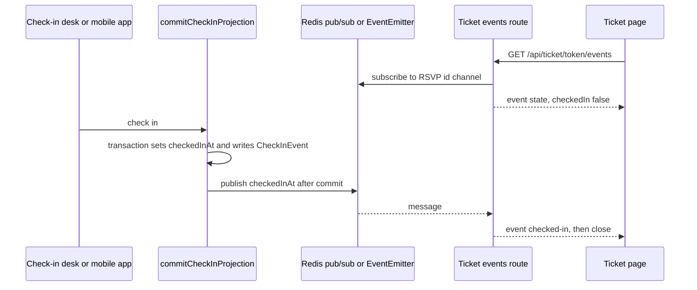

# Realtime

Yuyu has one realtime feature: when a guest is checked in, their open ticket page updates at once and "tears" without a reload. The server streams Server-Sent Events (SSE) from `GET /api/ticket/:token/events`. Check-in commits publish a message that reaches every replica through Redis pub/sub, or through an in-process `EventEmitter` when Redis is not configured. Delivery is deliberately best effort. The ticket page also re-reads its status on a timer, and publishing can never fail a check-in.

## Key files

| Path | Role |
| --- | --- |
| `lib/checkInMutations.ts` | `commitCheckInProjection`: the single write path that sets `RSVP.checkedInAt`, then publishes |
| `lib/ticketCheckInEvents.ts` | `publishTicketCheckedIn`, `subscribeTicketCheckedIn`; Redis or `EventEmitter` fan-out |
| `lib/ticketCheckInState.ts` | Token shape check, minimal state lookup, shared headers |
| `app/api/ticket/[token]/events/route.ts` | SSE stream |
| `app/api/ticket/[token]/status/route.ts` | JSON status fallback |
| `components/ticket/ticketCheckInWatcher.ts` | Framework-free client watcher: SSE, reconnect backoff, polling fallback |
| `components/ticket/useTicketCheckIn.ts`, `LiveTicket.tsx` | React hook and ticket UI |
| `lib/redisOptions.ts` | `REDIS_FAIL_FAST_OPTIONS`, shared with rate limiting |

## How it works



### Publishing

Every path that checks a guest in (online desk scan and manual check-in, offline-sync replay, venue station, and the mobile app's `mobile-scan` and `mobile-manual`) goes through `commitCheckInProjection`. In one transaction it does an `updateMany` where `checkedInAt` is null and the status is allowed, then inserts a `CheckInEvent`. Only when the result is a real transition (`state: "checked-in"`) does it, **after the commit**, call:

```ts
publishTicketCheckedIn({ rsvpId: params.rsvpId, checkedInAt: result.checkedInAt });
emitWebhookEvent({ type: "checkin.created", rsvpId: params.rsvpId, checkedInAt: result.checkedInAt });
```

`publishTicketCheckedIn` validates the RSVP id shape and publishes `{ "checkedInAt": "<ISO>" }` on channel `yuyu:ticket-checkin:<rsvpId>`. It never throws. A Redis publish failure logs a warning and falls back to local dispatch. Local dispatch uses `queueMicrotask`, so listener code never runs inside the check-in request.

Undo (`commitUndoCheckInProjection`) emits a `checkin.undone` webhook but publishes nothing on the ticket channel.

### Fan-out: Redis or `globalThis`

`usesRedis()` is true when `REDIS_URL` starts with `redis://` or `rediss://`.

- **With Redis:** one lazily created publisher and one subscriber connection per process. The subscriber subscribes to a channel when that channel's first local listener appears and unsubscribes when the last one leaves (reference counting through `emitter.listenerCount`). Incoming messages are parsed, validated and re-emitted on the local emitter.
- **Without Redis:** messages go straight to the local `EventEmitter`. This only reaches ticket pages connected to the same process.

The emitter lives on `globalThis` under `Symbol.for("yuyu.ticketCheckInEmitter")`, because Next.js can load the module twice in one process (Server Action and route-handler bundles). A module-scoped emitter would leave the check-in and the stream on different copies.

### The SSE route

`GET /api/ticket/:token/events`:

1. `parseTicketToken` (`/^[A-Za-z0-9_-]{8,128}$/`). A malformed token gets an empty 404.
2. `checkRateLimitById("ticketEvents", "ip:<client ip>")`. When limited, it returns an empty 429 with `Retry-After`.
3. `findTicketCheckIn(token)` returns only `{ rsvpId, checkedInAt }`. Unknown tokens get an empty 404.
4. If already checked in, it sends one `state` frame and closes.
5. If the per-process cap of `MAX_OPEN_STREAMS = 5000` is reached, it returns 503.
6. Otherwise it subscribes **before** reading state (waiting up to 2 seconds for the subscription), re-reads `checkedInAt`, sends `event: state`, and then either closes or waits. A message that arrives between subscribing and the first frame is held and sent right after it.
7. While waiting: `: ping` every 25 seconds. On check-in it sends `event: checked-in` and closes. The stream closes after 10 minutes, and `EventSource` reconnects.

Headers: `Content-Type: text/event-stream`, `Cache-Control: no-store, no-transform`, `X-Accel-Buffering: no`, `Referrer-Policy: no-referrer`.

`GET /api/ticket/:token/status` returns `{ checkedIn, checkedInAt }` with the same token check and its own `ticketStatus` rate limit.

### The client watcher

`watchTicketCheckIn` in `components/ticket/ticketCheckInWatcher.ts` takes an injectable environment (`EventSource`, `fetch`, `document`, timers), so it is unit-testable without a browser.

| Constant | Value | Meaning |
| --- | --- | --- |
| `TICKET_SAFETY_CHECK_MS` | 15 s | Re-read `/status` while the stream is open, to recover a dropped message |
| `TICKET_RECONNECT_BASE_MS` / `TICKET_RECONNECT_MAX_MS` | 1 s / 30 s | Exponential reconnect backoff |
| `TICKET_MAX_STREAM_FAILURES` | 4 | Consecutive failures before switching to polling |
| `TICKET_POLL_INTERVAL_MS` | 4 s | Poll interval without `EventSource` |

It also re-checks when the tab becomes visible again. The ticket token appears only in the request URL and is never logged or stored by the watcher.

## Invariants

- **Publish only from `commitCheckInProjection`, only after commit, only on a real transition.** Never call `publishTicketCheckedIn` from a core, action or route directly.
- **Channels are keyed by RSVP id, never by the ticket token.** The bearer token must not pass through Redis, its monitoring or logs.
- **Publishing never fails or slows a check-in.** It is fire-and-forget, never throws, and local listeners run in a microtask.
- **The public ticket routes return only `{ checkedIn, checkedInAt }`**, validate the token shape, are rate limited per IP (`ticketStatus`, `ticketEvents`), and send `no-store` and `no-referrer`.
- **Multi-replica deployments need `REDIS_URL`.** Without it, a ticket only updates live when the check-in hit the same instance (the 15-second safety check still catches up). Production startup requires Redis.
- **Shared singletons go on `globalThis` with `Symbol.for(...)`**, not module scope.
- **Reverse proxies must not buffer `text/event-stream`.** Set `proxy_buffering off` for `/api/ticket/` on nginx-style proxies and allow idle reads of at least 30 seconds.

## Making changes

- **A new check-in path** (another device or source): call `commitCheckInProjection` with a new `CheckInSource`. Then add the value to the `CheckInSource` type and widen the `CheckInEvent_known_source` CHECK constraint in a migration (see [Data model](/architecture/data-model)).
- **Another realtime topic:** follow the same shape. Use a separate channel prefix, an id-keyed channel, publish after commit, the `globalThis` emitter, an SSE route with a per-process stream cap, a rate limit and a polling fallback. Keep payloads to non-sensitive state.
- **Changing stream timings:** keep the ping interval under typical proxy idle timeouts, and update `docs/ARCHITECTURE.md` and [Deployment](/reference/deployment) if proxy settings change.

## Testing

| What | File |
| --- | --- |
| Pub/sub module, Redis and local modes | `tests/unit/ticket-check-in-events.test.ts` |
| Publish only after a committed transition | `tests/unit/ticket-check-in-publish.test.ts` |
| SSE and status routes | `tests/unit/ticket-check-in-routes.test.ts` |
| Client watcher and hook | `tests/unit/ticket-check-in-watcher.test.ts`, `tests/unit/use-ticket-check-in.test.ts` |
| Check-in transaction on PostgreSQL | `tests/integration/check-in.db.test.ts` |

```bash
npx vitest run tests/unit/ticket-check-in-events.test.ts tests/unit/ticket-check-in-routes.test.ts tests/unit/ticket-check-in-watcher.test.ts
npm run test:e2e:production   # includes the ticket flows
```

## Further reading

- [ARCHITECTURE.md, "Realtime ticket check-in"](https://github.com/twilighty-abhi/yuyu/blob/main/docs/ARCHITECTURE.md), [SECURITY.md, "Tokens and sensitive links"](https://github.com/twilighty-abhi/yuyu/blob/main/docs/SECURITY.md)
- [Tickets and check-in](/features/tickets-and-check-in), [Mutation cores](/architecture/mutation-cores), [Deployment](/reference/deployment), [Configuration](/reference/configuration)
