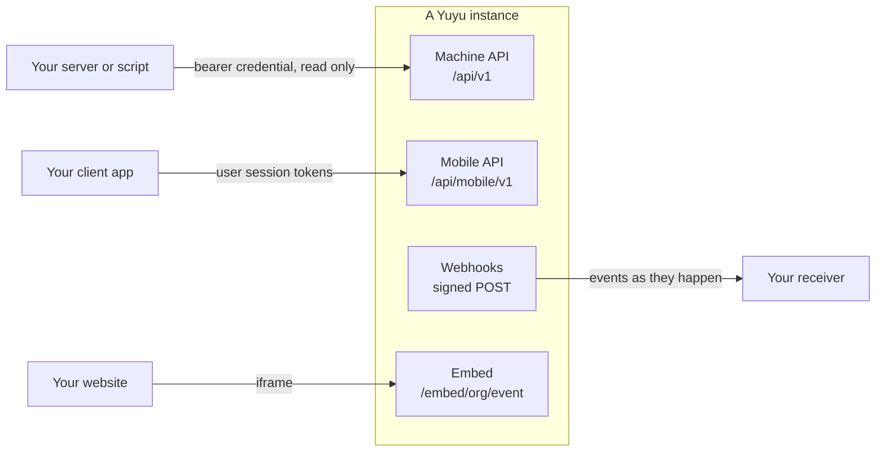

# Ways to build on Yuyu

Yuyu has four supported ways to extend or integrate with it, plus the option to fork the code. Each one has a different trust model, so the first choice is who is calling: a machine acting for one organisation, a signed-in person on a phone, Yuyu calling you, or a web page showing an event. This page maps those surfaces, helps you pick one, and records what the source says about stability.

## The extension surface



| Surface | Who calls | Identity | Direction | Contract | Page |
| --- | --- | --- | --- | --- | --- |
| Machine API | Your backend, scripts, spreadsheets | A tenant-bound API client with scopes, created by an organisation **owner** | You pull | `docs/API.md`. Read-only: events and a minimal confirmed-participant roster | [Machine API](/api/machine-api) |
| Mobile API | An app used by a person | An ordinary Yuyu user, with access tokens and rotating refresh tokens | You pull and act as that user | OpenAPI 3.1 file plus JSON fixtures, checked by a contract test | [Mobile API](/api/mobile-api) |
| Webhooks | Yuyu | A per-endpoint signing secret, configured by an organisation owner or admin | Yuyu pushes | `docs/WEBHOOKS.md`. Seven event types plus `ping` | [Webhooks](/api/webhooks) |
| Embed | A browser on another site | None. It is the public event page | You frame it | `/embed/:orgSlug/:eventSlug`, framable only by `ALLOWED_EMBED_ORIGINS` | [Embed](#embed) |
| Fork | You | Your own deployment | You change the code | The repository | [Fork and customise](/build/fork-and-customise) |

## I want to...

| I want to... | Use | Start at |
| --- | --- | --- |
| Show upcoming events on a club website | Machine API (`events:read`) from your server, or the [embed](#embed) for one event | [Integrations](/build/integrations) |
| Copy confirmed registrants into a membership system | Machine API (`participants:read`), plus webhooks to stay current | [Integrations](/build/integrations) |
| Print a roster or show live attendance on a screen | Machine API with `participants:attendance:read` | [Integrations](/build/integrations) |
| Post to chat or update a CRM when someone registers or checks in | Webhooks | [Integrations](/build/integrations) |
| Put one event's page and registration form in my own site | Embed | [Embed](#embed) |
| Build a phone or desktop client for attendees or door staff | Mobile API | [Build a client app](/build/client-apps) |
| Work on the Android or iOS app | The `yuyu-android` or `yuyu-ios` repository | [Android and iOS apps](/build/mobile-apps) |
| Read contact details, registration answers or feedback programmatically | Nothing yet. No machine API or webhook returns them. `docs/FUTURE_PHASES.md` lists it as possible future work | [Machine API](/api/machine-api) |
| Write to Yuyu from my own system (create events, register people) | Nothing for machines. The machine API is read-only. A mobile session can write, but only as a signed-in user and only the operations the mobile contract lists | [Mobile API](/api/mobile-api) |
| Add a feature, a field or a screen | Fork, or contribute upstream | [Tutorial](/build/feature-tutorial), [Contributing](/build/contributing) |
| Run Yuyu under my own name and look | Fork | [Fork and customise](/build/fork-and-customise) |
| Add an endpoint to the machine or mobile API | Change Yuyu itself | [Extend the APIs](/guides/extend-the-apis) |

## Embed

`/embed/:orgSlug/:eventSlug` renders the canonical public event page (`app/[orgSlug]/[eventSlug]/page.tsx`) inside a minimal frame, with a "Free event, powered by Yuyu" credit (`EmbedCredit` in `components/chrome/SiteFooter.tsx`). Access is still decided by the event page, so an unpublished or private event is not available through it. The embed page is `noindex`.

- **Who may frame it.** `proxy.ts` sets `frame-ancestors` for this one route from `ALLOWED_EMBED_ORIGINS` (comma-separated exact origins). With the variable blank, the value is `'none'` and no other site can frame it. In production, `lib/env.ts` requires each entry to be an exact HTTPS origin without a path.
- **Where the snippet comes from.** Owners and admins (`canEmbedEvent`) get it from the event's Settings tab, rendered by `components/dashboard/EventManageMore.tsx`, which offers a copyable button link and a copyable `<iframe>` of 100% width and 720px height.
- **What not to frame.** Every other page sends `X-Frame-Options: DENY` and `frame-ancestors 'none'`. `docs/SECURITY.md` says the embed route must not be used for tickets, account, dashboard or administrative content.

```html
<iframe src="https://yuyu.example/embed/acme/community-meetup"
        title="Community Meetup registration"
        style="width:100%;height:720px;border:0;"></iframe>
```

## Stability and compatibility

What the source commits to, and what it does not.

| Area | What is pinned | What to assume |
| --- | --- | --- |
| Machine API | The `/api/v1` path, the `yuyu_v1_` credential prefix, strict response DTOs (`lib/api/v1/schemas.ts`) tested in `tests/unit/api-contracts.test.ts`, and the error codes in `docs/API.md` | New capabilities arrive as new scopes in `API_SCOPES`. The repository states no formal deprecation policy for it. Query parameters are strict, so send only documented ones. Treat cursors as opaque |
| Mobile API | `docs/mobile-api.openapi.yaml` (`info.version` is `1.0.0`), `docs/mobile-api-fixtures/*.json`, and `tests/unit/mobile-api-contract.test.ts`, which fails when the spec, fixtures, Zod schemas and routes drift apart | Changes stay additive inside v1: new optional fields and new error codes. Older apps see an unknown code with its usual HTTP status. There is no version header: the version is in the path |
| Webhooks | Envelope `{ id, type, createdAt, organisation, data }`, the `x-yuyu-signature` format `t=<unix>,v1=<hex>`, the `Yuyu-Webhooks/1` user agent, and strict payload DTOs (`lib/webhooks/payloads.ts`) | Deliveries can be out of order and, rarely, duplicated. De-duplicate on the event id |
| Embed | The URL shape and the `ALLOWED_EMBED_ORIGINS` rule | The page content is the public event page and changes with it |
| Everything else | Nothing | Dashboard routes, Server Actions, other `/api/*` routes and Prisma models are internal. Do not build on them. The only non-mobile web routes the mobile contract reuses are `GET /api/ticket/:token/status`, `GET /api/ticket/:token/events`, `POST /api/feedback`, `GET /api/feedback/certificate/:token` and `POST /api/check-in/station` |

Other facts that affect planning:

- **Yuyu has no tagged releases.** `CHANGELOG.md` says releases are named by date and `package.json` stays at `0.1.0`. A client cannot ask the server for a Yuyu version. Use the OpenAPI file and the contract test as the version boundary.
- **Fixtures are the quickest compatibility check.** `docs/mobile-api-fixtures/` holds one JSON file per response shape. Both mobile clients decode their copy strictly in their test suites, so contract drift fails their builds. See [Build a client app](/build/client-apps).
- **Contract copies go stale.** The `yuyu-android` and `yuyu-ios` repositories keep their own copies of the spec and fixtures. At the time of writing, both lag the server repository: the server's fixtures include team and judging responses that neither app's copy has, and the iOS spec differs from the server's. Always refresh from the server repository before relying on a copy.
- **Plan for several instances.** Each Yuyu instance is self-hosted and may run a different build. Read `GET /api/mobile/v1/auth/config` and handle unknown codes and missing optional fields.

::: warning Security boundaries are part of the contract
None of these surfaces returns email addresses, answers or ticket tokens to a machine caller, and the mobile API returns other people's data only where the website would. Do not ask for a wider scope as a workaround. Changing that is a security decision, covered in [Contributing upstream](/build/contributing).
:::

## Further reading

- [Integrate with APIs and webhooks](/build/integrations)
- [Build a client app](/build/client-apps)
- [Fork and customise](/build/fork-and-customise)
- [docs/FUTURE_PHASES.md](https://github.com/twilighty-abhi/yuyu/blob/main/docs/FUTURE_PHASES.md)
- [docs/ROUTES.md](https://github.com/twilighty-abhi/yuyu/blob/main/docs/ROUTES.md)
