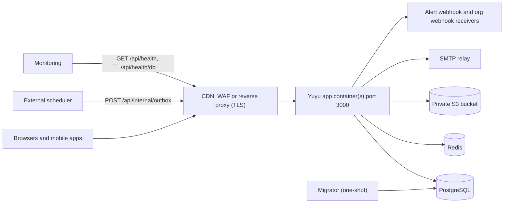
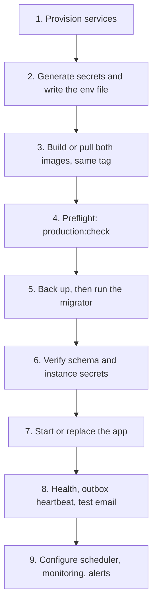

# Choose a deployment path

Yuyu ships as two container images and expects you to bring the backing services. This page helps you pick a path, lists what you must provide, and gives the order in which a release goes out. The compact facts are in the [Deployment reference](/reference/deployment). This section turns them into procedures.

## Pick a path

| Path | Use it when | Guide |
| --- | --- | --- |
| Docker on a single host | One VM or container host, no Kubernetes. You run `docker run` yourself and put a reverse proxy in front | [Docker on a single host](/deploy/docker) |
| Kubernetes with Helm | You already run a cluster and want rolling upgrades, probes, an optional HPA and PDB, and a migration hook | [Kubernetes with Helm](/deploy/kubernetes) |
| Staging with Compose | A disposable VM for testing a release. All services run in one Compose project | [Staging environment](/deploy/staging) |

::: warning There is no production Compose stack
The repository has no `docker compose up` installer for production. `docker-compose.yml` starts PostgreSQL for local development only. `compose.staging.yml` deliberately enables insecure CI exceptions. Do not use either with real attendee data.
:::

Both production paths run the same images and need the same services. Pick Kubernetes only if you already operate it. A single host with a proxy, a managed database and a tested backup routine is a supported setup.

## Services you must provide

The application image contains only the Next.js standalone server. There is no bundled database, cache, storage, mail server or TLS terminator.

| Service | Requirement in production | Configured by |
| --- | --- | --- |
| PostgreSQL | TLS (`sslmode=require`, `verify-ca` or `verify-full` in the URL). Encryption at rest, point-in-time recovery and tested backups are release requirements | `DATABASE_URL` |
| Redis | TLS (`rediss://`). Holds rate limits and live check-in pub/sub. Production fails closed for security-sensitive traffic when it is unreachable | `REDIS_URL` |
| S3-compatible storage | A private bucket. A custom endpoint must be HTTPS. Set both access keys, or neither when using a workload role | `S3_BUCKET`, `S3_REGION`, optional `S3_ENDPOINT`, `S3_ACCESS_KEY_ID`, `S3_SECRET_ACCESS_KEY`, `S3_FORCE_PATH_STYLE` |
| SMTP | Authenticated, with TLS and certificate verification, unless you declare a private unauthenticated relay. Saved in Super admin, Settings. Environment `SMTP_*` values are only a fallback | Panel, or `SMTP_*` and `EMAIL_FROM` |
| Reverse proxy or CDN | Terminates TLS, overwrites the trusted client-IP header, does not buffer the ticket event stream | [Reverse proxy and TLS](/deploy/reverse-proxy) |
| Scheduler (recommended) | An independent caller of `POST /api/internal/outbox` once a minute, as a recovery path | `CRON_SECRET` |

SMTP and Google sign-in are not required in the environment. Until SMTP is saved in the panel or provided as a fallback, production email stays queued. See [Configuration](/reference/configuration) for every variable.

## Architecture

Points that shape the deployment:

- There is no worker container. Every app process runs its own outbox worker once a minute. See [Background jobs](/architecture/background-jobs).
- The container listens on port 3000. Keep it private and expose it only through the proxy.
- The migrator is a separate image (the `migrator` Dockerfile target). It runs `prisma migrate deploy` and carries two check scripts. The app image has no Prisma CLI.
- Each app process needs outbound access to PostgreSQL, Redis, storage, SMTP, the alert webhook (HTTPS 443), organisation webhook receivers (443 and 8443), and the Google endpoints when Google sign-in is used.
- More than one app replica is supported only when all replicas share one `REDIS_URL`.

## Order of operations

1. **Provision PostgreSQL, Redis, the bucket and SMTP.** Create the proxy and DNS for one canonical HTTPS hostname.
2. **Generate secrets.** `AUTH_SECRET`, `CRON_SECRET` and `HEALTHCHECK_SECRET` need at least 32 characters. `NEXT_SERVER_ACTIONS_ENCRYPTION_KEY` and `MFA_ENCRYPTION_KEY` are base64 keys (`openssl rand -base64 32`). Set `AUTH_URL` and `NEXT_PUBLIC_BASE_URL` to the same HTTPS origin.
3. **Get the images.** Build both targets from one commit with one immutable tag, or pull them from a registry that [CI](/deploy/ci-cd) published. `NEXT_PUBLIC_BASE_URL` and the Server Actions key are baked in at build time.
4. **Run `node scripts/check-production-env.mjs`** (or `npm run production:check`) with the production environment.
5. **Back up the database, then run the migrator once.** A failed migration blocks the rollout. See [Operations](/deploy/operations) for backup commands.
6. **Run `scripts/verify-production-schema.mjs` and `scripts/check-instance-secrets.mjs`** with the same environment.
7. **Start the app** (new install) or **replace it** (upgrade).
8. **Check `/api/health`, `/api/health/db`, the outbox heartbeat and Send test email.**
9. **Add the scheduler, monitoring and the alert webhook.**

Work through the [Production checklist](/deploy/production-checklist) before the first go-live.

## Which page next

| You are | Read |
| --- | --- |
| Deploying to one host | [Docker on a single host](/deploy/docker), then [Reverse proxy and TLS](/deploy/reverse-proxy) |
| Deploying to a cluster | [Kubernetes with Helm](/deploy/kubernetes) |
| Setting up automated image builds | [CI/CD and image publishing](/deploy/ci-cd) |
| Standing up a test instance | [Staging environment](/deploy/staging) |
| Running a live instance | [Operations runbook](/deploy/operations) |

## Further reading

- [Deployment](/reference/deployment), [Configuration](/reference/configuration), [Scripts](/reference/scripts)
- [Background jobs](/architecture/background-jobs), [Realtime](/architecture/realtime), [Troubleshooting](/reference/troubleshooting)
- [docs/DEPLOYMENT_DOCKER.md](https://github.com/twilighty-abhi/yuyu/blob/main/docs/DEPLOYMENT_DOCKER.md), [docs/PRODUCTION_RELEASE.md](https://github.com/twilighty-abhi/yuyu/blob/main/docs/PRODUCTION_RELEASE.md)
