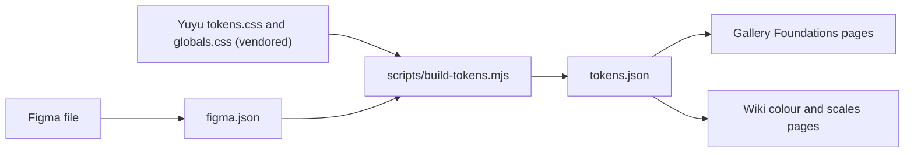

# Figma file map

Yuyu's visual reference is one Figma file, **Yuyu — Light screens**. This page maps the file: its pages, what each holds, how tokens are organised as Figma variables, the naming conventions, and how to bring Figma changes into code.

<a href="https://www.figma.com/design/oVuNh4VRXQ9fIpdnUCoZqt" target="_blank" rel="noreferrer">Open the file in Figma</a> (<code>oVuNh4VRXQ9fIpdnUCoZqt</code>)

::: tip What was read
The saved data (`library/src/foundations/figma.json`) was read from two pages, **Design system** and **Brand — Dot sign**, on 2026-11-17. The other four pages are listed below by name only. This page does not describe their contents, because they were not read into the saved data. Yuyu's `docs/DESIGN.md` refers to the pages "Light screens" and "Dark screens" as its visual reference.
:::

## Pages

| Page | What it holds |
| --- | --- |
| Design system | Foundations (colour, type and scales), the component families, and a showcase. Read |
| Brand — Dot sign | The brand kit, seven numbered sections. Read. `docs/DESIGN.md` gives this page the node id `111:292` |
| Landing page | Not read |
| Light screens | Not read. Named in `docs/DESIGN.md` as a visual reference |
| Dark screens | Not read. Named in `docs/DESIGN.md` as a visual reference |
| Claude artifacts | Not read |

### Design system

- **Foundations: Colour.** Colour tokens in Light and Dark modes, and the event accent presets. The Figma colour variables, merged with the tokens that exist only in code, give the 42 tokens on the [Colour reference](/design/colour).
- **Foundations: Type and scales.** 16 text styles, 11 spacing variables, 6 radius variables and 3 shadow styles. See [Scales](/design/scales).
- **Components.** 14 component families with 56 variants in all, listed below.
- **Showcase.** The components composed into screens, in light and in dark.

### Brand — Dot sign

| Section | Contents |
| --- | --- |
| 01 Logo suite | Four marks (Full grid, Bright only, On marigold, Mono) and three lockups (Horizontal, Stacked, Tagline) |
| 02 Dot faces | Ten moods: Happy, Cheering, Wink, Love, Done, Waiting, Surprised, Thinking, Sleepy, Sad |
| 03 Dot icons | Thirteen icons: Date, Venue, Guests, Time, Speaker, Check-in, Feedback, Certificate, Reminder, Done, Page, Lock, Code |
| 04 App icons and favicons | Three app icons: Ink, Light, Marigold |
| 05 Motion and live | Title only in the saved data |
| 06 In use | Title only in the saved data |
| 07 Usage rules | Construction, space and size, colours, and the don't list |

The files behind these sections are inventoried on [Brand assets](/design/brand-assets). The saved data holds the names for sections 01 to 04 and the rules in section 07. Sections 05 and 06 are known by title only.

## Tokens as Figma variables

The Design system page states how tokens are organised:

> Tokens are Figma variables: switch a frame between Light and Dark with the Color collection, and switch the event colour with the Event accent collection (Ember, Iris, Teal, Ink).

| Collection | Modes | Holds |
| --- | --- | --- |
| Color | Light, Dark | Surfaces, borders, text, primary and inverse, brand, status and the default accent tokens |
| Event accent | Ember, Iris, Teal, Ink | `accent`, `accent-soft` and `accent-text` per preset |

In code the same two switches are `data-color-mode` on `<html>` (light or dark) and the inline accent variables on an event page (see [Design tokens](/design/tokens#accent-colours-and-contrast)).

Variable names in Figma follow the CSS token names minus the `--yy-` prefix. For example `bg-canvas` is `--yy-bg-canvas` and `success-fg` is `--yy-success-fg`. Spacing and radius variables are `space-1` to `space-20` and `radius-sm` to `radius-full`.

## Component families

Fourteen families. The full variant lists and the prop mapping, with live renders, are on the gallery's [Figma component map](/library/index.html#/foundations/figma-components).

| Figma component | Variant properties | Variants | Code |
| --- | --- | --- | --- |
| Button | Style (Primary, Accent, Secondary, Quiet, Danger, Danger quiet, Inverse, Disabled) and Size (Small, Medium, Large) | 24 | `Button` |
| Chip | Kind (Success, Warning, Danger, Accent, Neutral, Filter off, Filter on) | 7 | `Chip`, `FilterChip` |
| Date block | State (Event, Draft) | 2 | `DateBlock` |
| Avatar | Kind (Person, User, Organisation) | 3 | `Avatar`, `OrgLogo` |
| Field | State (Default, Error, Read-only) | 3 | `Field` |
| Stat tile | none | 1 | `StatTile` |
| Callout | Kind (Warning, Empty state, Danger zone) | 3 | `Callout`, `EmptyState`, `DangerZone` |
| Tab | Selected (True, False) | 2 | `Tabs` |
| Segmented control | none | 1 | `SegmentedControl` |
| Sidebar item | Selected (True, False) | 2 | `NavItem` in `AppShell.tsx` |
| Event row | Status (Published, Draft) | 2 | Feature component in `HomeEventsPanel.tsx` |
| Registration card | State (Open, Registered) | 2 | `RegistrationCard` |
| Ticket | none | 1 | `LiveTicketCard` |
| Check-in result | State (Checked in, Waitlist, Invalid) | 3 | Inline panels in the check-in clients |

The first ten have gallery pages. The last four are feature components in Yuyu's `components` folder and are not in the gallery.

## Naming conventions

- **Component variants** are `Property=Value` pairs: `Style=Primary`, `Size=Small`, `State=Error`, `Selected=True`, `Kind=Filter on`. Each Button variant combines one value from the Style property with one from the Size property.
- **Text styles** are `Group/Name`: `Display/XL`, `Heading/H1`, `Text/Body`, `Text/Body UI Strong`, `Text/Button`, `Code/Mono`.
- **Shadow styles** are `Shadow/Raised`, `Shadow/Float` and `Shadow/Ticket`.
- **Variables** use the CSS token name without the prefix, with sizes like `space-4` and `radius-lg`.

Code names differ in a few places: the Figma `Danger quiet` style is the `dangerQuiet` variant, the `Medium` size is `md`, and a few Figma styles (`Text/Body UI Strong`, `Text/Button`) have no CSS class. The details are on [Scales](/design/scales#figma-vs-code) and the component map.

## Syncing tokens

The Figma file is not read live. Its values are saved in the repository, merged with Yuyu's CSS, and everything else is generated from that merge.

To change a token:

1. **Edit Figma.** Change the variable or style in the file.
2. **Update `library/src/foundations/figma.json`** with the new value (colours are under `colour.light` and `colour.dark`, type under `type`, and so on).
3. **Run `node scripts/build-tokens.mjs`.** It merges `figma.json` with the vendored `app/styles/tokens.css` and `app/globals.css` into `library/src/foundations/tokens.json`. It prints how many colours are Figma-only, code-only or mismatched, and lists each one. A mismatch means the same token has different values in Figma and code, so fix one side before shipping.
4. **Rebuild the gallery and wiki.** `npm run build` runs `build-tokens.mjs` itself.

After Yuyu's own code changes (a new token in `tokens.css`, a changed component), run `npm run library:sync` to re-vendor the components, CSS and brand assets from the Yuyu checkout, then run `node scripts/build-tokens.mjs` again. Set `YUYU_SRC` if Yuyu is not at `../yuyu`.

::: warning Code is the source of truth for tokens
A Figma-only token (the mint and lavender families) has no CSS variable until someone adds it to Yuyu's `tokens.css`. Changing `figma.json` updates this wiki and the gallery, not the app. Change `app/styles/tokens.css` in Yuyu, in both dark blocks, to change the product.
:::

::: tip No Code Connect
No Code Connect configuration (`figma.config.json` or `*.figma.tsx` files, or the `@figma/code-connect` package) exists in the Yuyu or wiki repositories. The Figma to code link is the manual mapping on the [Figma component map](/library/index.html#/foundations/figma-components) page, not an automated one.
:::

## Further reading

- [Colour reference](/design/colour), [Scales](/design/scales), [Design tokens](/design/tokens)
- [Brand and dot sign](/design/brand), [Brand assets](/design/brand-assets), [Components](/design/components)
- Gallery: [Figma component map](/library/index.html#/foundations/figma-components), [Component library](/library/index.html)
- [DESIGN.md](https://github.com/twilighty-abhi/yuyu/blob/main/docs/DESIGN.md)
