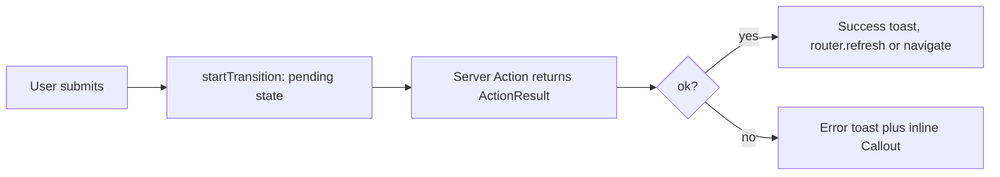

# UI patterns

Primitives are the parts. Patterns are how they are assembled for the jobs that recur across Yuyu: a form that saves, a table that scrolls, a dialog that confirms, an empty list, a loading screen, a tabbed dashboard, and an event page in the organiser's colour. Each section names the real files to copy from.

## Key files

| Path | Role |
| --- | --- |
| `app/actions/org.ts` | `ActionResult<T>` type returned by every Server Action core |
| `components/feedback/ToastProvider.tsx` | `ToastProvider` and `useToast` |
| `components/series/EditSeriesForm.tsx` | A complete form, with dirty guard and delete confirmation |
| `components/forms/useUnsavedChangesGuard.ts` | Warns before leaving a dirty form |
| `components/event-dashboard/EventDashboardTabs.tsx`, `SubTabs.tsx` | The event dashboard's tab system |
| `components/event-dashboard/PanelErrorBoundary.tsx` | Isolates a failing panel |
| `components/dashboard/home/DotCharts.tsx` | Small dot charts for dashboard home |
| `components/super-admin/Sparkline.tsx`, `Histogram.tsx` | Ink charts for super-admin pages |
| `app/dashboard/(home)/loading.tsx` | The loading-screen pattern |
| `components/dashboard/EventManageHeader.tsx`, `components/event/EventWebsiteShell.tsx` | Accent scope in use |

## Forms and ActionResult

Server Actions return a discriminated union, defined in `app/actions/org.ts`:

```ts
export type ActionResult<T = void> =
  | { ok: true; data?: T }
  | {
      ok: false;
      error: string;
      fieldErrors?: Record<string, string[]>;
      needsForce?: boolean;
      reauthRequired?: boolean;
      code?: ActionErrorCode;
    };
```

`error` is written to be UI-safe, so show it as is. `fieldErrors` maps field names to messages. How cores produce results is covered in [Mutation cores](/architecture/mutation-cores).



The pattern, from `components/series/EditSeriesForm.tsx`:

```tsx
const { showToast } = useToast();
const [error, setError] = useState<string | null>(null);
const [pending, startTransition] = useTransition();

onSubmit={(e) => {
  e.preventDefault();
  setError(null);
  const fd = new FormData(e.currentTarget);
  startTransition(async () => {
    const res = await updateEventSeriesMeta({ /* fields from fd */ });
    if (!res.ok) {
      setError(res.error);
      showToast(res.error, "error");
      return;
    }
    showToast("Series saved", "success");
    setDirty(false);
    router.refresh();
  });
}}
```

Rules:

- **Label above, one `Field` per control.** Use `optional` for optional fields. `Field` links helper and error text with `aria-describedby`.
- **One primary action per form.** Put `Button type="submit" variant="primary" loading={pending}` at the end. Keep the width while loading.
- **Pending state is required.** Disable the submit while pending and use `loading` so the label swaps for a spinner.
- **Show errors twice, in different places.** A toast reports the result and an inline `Callout tone="danger" role="alert"` stays visible near the form. Per-field problems go in `Field`'s `error` prop, using `fieldErrors`.
- **Refresh after success.** `router.refresh()` re-runs the server components, or navigate with `router.push`.
- **Warn before losing work.** `useUnsavedChangesGuard(dirty && !pending)` registers `beforeunload` and intercepts in-app link clicks while a form is dirty. Set `dirty` from `onChangeCapture` on the form and clear it after a successful save.
- **Name the action.** "Save", "Create event series", "Delete series". Not "Submit".
- **Use native types** (`type="datetime-local"`, `inputMode="numeric"`). Inputs are 16px so iOS doesn't zoom.

For instant settings, use `SwitchRow` and call the action on change, rather than a form with a Save button. For multi-field settings pages, use `SettingsRow` (label column on the left, fields on the right) with Save and Discard at the bottom right.

### Toasts

`useToast().showToast(message, severity, action, durationMs)`:

- Severities: `success`, `error`, `info` (the default) and `warning`. Errors use `role="alert"` and `aria-live="assertive"`, the rest are polite.
- One toast at a time, bottom-center on mobile, bottom-left from `md`. The default duration is 5000ms.
- An optional single action, such as Undo, is passed as `{ label, onClick }`. Destructive actions that can be undone should offer it. Email broadcasts use a visible 5-second countdown with Undo instead.
- Messages are plain sentences. Never put raw error objects or secrets in a toast.

## Tables

Use `Table` with `THead`, `TBody`, `TR`, `TH` and `TD`:

- Always pass `label` so an overflowing table is a focusable, named scroll region.
- A person cell is avatar, name, then email, never the email twice.
- Timestamps are relative for under 7 days ("2 min ago", "Yesterday"), otherwise "13 Oct 2026", through `lib/format/datetime.ts`.
- Undo actions in rows are `quiet` buttons, not coloured links.
- Lists are paged on the server and never capped in the browser. Choose between "Load more" (`useLoadMoreFocus` keeps focus on the first new row) and numbered pages (`PageNumberPager`), and show "Showing 1 to 50 of N".
- Filters belong in the address bar so back and bookmarks work. The Views menu (`components/event-dashboard/views/SavedViewsMenu.tsx`) builds on that.
- A table that is empty becomes an `EmptyState`, not an empty header row.

## Dialogs and confirmation

- **Confirm every consequential action** with `ConfirmDialog` (or its wrapper `ConfirmationDialog`). Destructive is the default: `danger` confirm button, label naming the action ("Delete series"), and a message that says what is lost and whether it can be undone.
- **Type to confirm** the worst cases. `confirmText` keeps the confirm button disabled until the exact text is typed (organisation deletion uses the name).
- **Forms in dialogs** use `Dialog`, `DialogContent`, `DialogHeader`, `DialogBody` and `DialogFooter`. Put an inline `Callout role="alert"` for errors inside `DialogBody`, as `CreateSeriesDialog` does. Dialogs are at most 480px by default, with `size` for larger editors.
- **Review before send** for irreversible bulk actions such as email broadcasts. The dialog summarises recipients and subject, requires a checkbox before the primary button enables, and confirming starts a 5-second undo window rather than acting at once.
- **Tests guard it.** `frontend-boundaries.test.ts` asserts that the series, feedback-question and event-page-content editors keep their confirmation titles.
- Open and close animations, and focus return, come from Radix. Don't build your own overlay.

## Empty states

`EmptyState` is a bordered card with a one-line title, one sentence of explanation and, whenever possible, a next step.

- Say what to do: "Copy the invite link above to bring in your team."
- On Yuyu's own screens add a `mood`: `sleepy` for empty lists, `sad` for errors and not-found. Organiser-facing public pages leave faces out.
- Success and error messages in a card use the same component.
- An empty dashboard list should not look broken. A short inline sentence in a card (as `WaitingForYou` does with "No one is waiting for approval.") is fine for quiet panels.

## Loading

| Situation | Use |
| --- | --- |
| Route transition | `loading.tsx` rendering `PageLoader` |
| Button action in flight | `Button loading` with a label such as "Saving…" |
| Inline content placeholder | `Skeleton` |
| Panel that may fail | `PanelErrorBoundary` around it |

```tsx
import { PageLoader } from "@/components/brand/DotLoader";

export default function Loading() {
  return <PageLoader />;
}
```

From `app/dashboard/(home)/loading.tsx`.

::: warning
Only add a `loading.tsx` below a layout that has already awaited the page's access check (`lib/dashboardGuards.ts`), and scope it with a route group such as `(overview)`. There is no root, dashboard-wide or organisation-wide `loading.tsx`, and `tests/unit/dashboard-loading-boundaries.test.ts` fails if one appears somewhere unreviewed. Details are on [Architecture overview](/architecture/overview#rendering-model).
:::

## Dashboard tabs

The event dashboard is a Radix `Tabs` set built by `EventDashboardTabs`:

- `EVENT_TABS` lists the tabs: Overview, Guests, Event page, Emails, Check-in, Judging, Feedback, Analytics and Settings. `hidden` drops tabs that do not apply (Judging is hidden on ordinary events), so most events show eight. A link to a hidden tab opens Overview.
- **Panels are server-rendered** and passed in as props. The client component only switches between them.
- **Deep links** use `?tab=` and `?sub=`. Switching writes the query with `history.replaceState`, drops a stale `?sub=` and clears list filters. Legacy ids (`details`, `registration`, `invites`) map to their new tab and sub-tab.
- **Badges** (`badges` prop) render a warning pill with an `sr-only` "need attention" suffix.
- **`openTab(tab, sub)`** switches from anywhere. `OpenTabButton` wraps it for server-rendered panels.
- **`SubTabs`** adds a segmented pill row inside a tab (Guests: People and Invites), honours `?sub=`, keeps the active pill in view on phones, and reacts to `openTab` requests aimed at it.
- **Each panel is wrapped in `PanelErrorBoundary`** so one failing panel doesn't take down the page.
- Never decide permissions in the tab component. Panels receive the capability object from the server ([Permissions](/architecture/permissions#capability-object-ui-parity)).

For plain route navigation (account tabs, the organisation workspace) use `NavTabs`, which is link-based and sets `aria-current="page"`.

## Event page accent theming

An event or organisation has an accent colour. Event-facing pages wrap their content in a root that applies it.

```tsx
<div style={accentStyle(event.page?.accentColor)} className="yy-accent-scope flex flex-col gap-6">
```

From `app/[orgSlug]/[eventSlug]/schedule/page.tsx`. `EventWebsiteShell`, `EventManageHeader`, the ticket, feedback, attend and submit pages use the same two pieces.

1. `accentStyle(hex)` returns eight inline variables: the accent, soft, on-accent and accent-text values for both light and dark.
2. `.yy-accent-scope` in `globals.css` assigns `--yy-accent`, `--yy-accent-soft`, `--yy-on-accent` and `--yy-accent-text` from the pair that matches the current colour mode, and sets `--yy-focus` to the accent text so focus rings follow the accent.
3. Everything inside uses the normal classes: `bg-accent text-on-accent` for the `accent` button, `bg-accent-soft text-accent-text` for accent chips, `text-accent-text` for accent text.

What the accent drives: the event title (display type), the Register button, the date-block header, the progress fill, the active section-nav underline, accent chips and speaker initials. `.yy-cover-placeholder` draws the cover when none is uploaded: solid accent with a soft dot grid, never a broken image.

Rules:

- Never put the raw accent on text. Use `text-accent-text`.
- Never use white text on the accent by hand. Use `text-on-accent`.
- Yuyu's chrome (app shell, marketing pages, auth) never takes an accent. In the dashboard, an event's accent appears only inside its own `yy-accent-scope` (its date block, header and progress bar). `DateBlock` accepts an explicit `color` (validated hex) for rows in a list.
- Validate the hex on the server. `accentStyle` already normalises through `normalizeAccentHex`, so unvalidated strings never reach CSS.
- Check the page in dark mode and with a pale accent such as yellow.

The derivation and contrast guarantees are on [Design tokens](/design/tokens#accent-colours-and-contrast).

## Stat tiles and charts

- **`StatTile`** is a label over a large number, with an optional hint and progress bar. `tone="attention"` gives the warm "needs you" variant. Pass `href` to make it a link. Every number comes from a real query. There are no invented scores.
- **Dot charts** (`DotColumns` in `components/dashboard/home/DotCharts.tsx`) are stacked dots per value on dashboard home. They are `aria-hidden` and always sit next to the number they illustrate. Tones are `ink`, `marigold`, `success` and `amber`.
- **Super-admin charts** (`SparklineCard`, `Histogram` in `components/super-admin`) are small ink charts. `SparklineCard` builds an accessible description from its points ("title: n points from a to b, total, peak, latest").
- **Funnels and bars** use `ProgressBar` or sized rounded bars, with the number beside the bar and a plain-language hint.

Rules: put the number in text, never only in a graphic. Keep colour meaning paired with a label. No colour moments in super-admin pages.

## Invariants

- **One result shape.** Handle `ActionResult` and show `error` as is. Don't invent a second error format in the UI.
- **Every async action has a pending state and visible feedback.**
- **Confirm before destroying.** And name the consequence.
- **Server decides, client reflects.** UI flags only hide controls. The Server Action re-checks.
- **Empty is a state to design**, not an absence.
- **Accent only inside `yy-accent-scope`.**

## Further reading

- [Components](/design/components), [Design tokens](/design/tokens), [Accessibility](/design/accessibility), [Brand and dot sign](/design/brand)
- [Frontend](/architecture/frontend), [Mutation cores](/architecture/mutation-cores), [Add a server action](/guides/add-a-server-action), [Add a page or route](/guides/add-a-page-or-route)
- [DESIGN.md](https://github.com/twilighty-abhi/yuyu/blob/main/docs/DESIGN.md), sections 4 and 5
