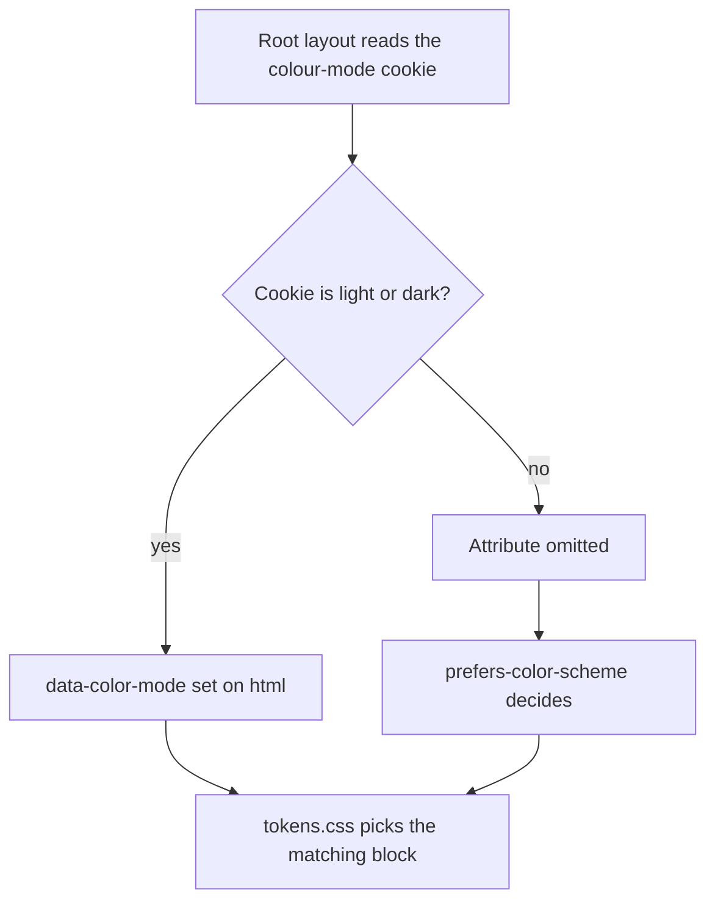

# Design tokens

Every colour, shadow and focus colour in Yuyu is a CSS custom property named `--yy-*`, declared once in `app/styles/tokens.css`. Tailwind 4 maps them to utility classes in `app/globals.css`, so components write `bg-canvas` or `text-ink-muted` and never a hex value. This page lists every token with its real value, explains the light and dark mechanism, and describes how organiser accent colours are derived.

## Key files

| Path | Role |
| --- | --- |
| `app/styles/tokens.css` | All `--yy-*` tokens: light under `:root`, dark under `:root[data-color-mode="dark"]`, `.yy-dark-band` and `prefers-color-scheme` |
| `app/globals.css` | `@theme inline` mapping to Tailwind, `.yy-accent-scope`, base styles, type scale, motion keyframes |
| `lib/theme/accent.ts` | Contrast-checked accent derivation (`getAccentTokens`, `accentStyle`) |
| `lib/colorMode.ts`, `components/providers.tsx` | Colour-mode cookie, storage key and the switch animation |
| `tests/unit/accent-tokens.test.ts` | Accent maths and contrast guarantees |

## Light and dark



- **Light** values are under `:root, :root[data-color-mode="light"]`.
- **Dark** values are under `:root[data-color-mode="dark"]` and `.yy-dark-band`, and are mirrored inside `@media (prefers-color-scheme: dark) { :root:not([data-color-mode]) }`. The mirror means the operating-system preference works with no cookie and no JavaScript.
- `.yy-dark-band` forces the dark tokens on one section of a light page, such as the landing page's "At the door" band and the closing call to action.
- The server sets `data-color-mode` from a cookie so there is no flash. The toggle (`ColorModeToggle`) is an `IconButton`.
- Tailwind's `dark:` variant is redefined in `globals.css` as `@custom-variant dark (&:where([data-color-mode="dark"], [data-color-mode="dark"] *))`. It follows the attribute only, not the OS media query. Prefer tokens, which handle both, over `dark:` classes.

::: warning
The dark block appears twice in `tokens.css` (the attribute selector and the media query). When you change a dark value, change both.
:::

## Neutrals

| Token | Tailwind | Light | Dark | Use |
| --- | --- | --- | --- | --- |
| `--yy-bg-canvas` | `bg-canvas` | `#ffffff` | `#111113` | Page background, cards |
| `--yy-bg-subtle` | `bg-subtle` | `#fafaf9` | `#18181b` | App sidebar, kiosk background, quiet panels |
| `--yy-bg-muted` | `bg-muted` | `#f4f4f2` | `#232326` | Neutral chips, stat fills, segmented-control track |
| `--yy-bg-emphasis` | `bg-emphasis` | `#efeeea` | `#2a2a2e` | Hover fills, disabled button fill, table row separators |
| `--yy-bg-track` | `bg-track` | `#f0efeb` | `#2a2a2e` | Progress-bar tracks |
| `--yy-border` | `border-line` | `#e7e6e2` | `#2a2a2e` | Card borders, dividers |
| `--yy-border-strong` | `border-line-strong` | `#d4d3ce` | `#3f3f46` | Inputs, secondary buttons, switch off-state |
| `--yy-text` | `text-ink` | `#18181b` | `#f4f4f5` | Primary text |
| `--yy-text-secondary` | `text-ink-secondary` | `#3f3f46` | `#d4d4d8` | Body copy under headings |
| `--yy-text-muted` | `text-ink-muted` | `#5f5e5a` | `#a1a1aa` | Meta, captions, helper text. The lightest allowed body text |
| `--yy-text-disabled` | `text-ink-disabled` | `#a1a09a` | `#71717a` | Placeholders and disabled labels only, never readable content |

## Yuyu primary ("ink")

Yuyu's own primary action is ink, not a hue. It inverts in dark mode.

| Token | Tailwind | Light | Dark |
| --- | --- | --- | --- |
| `--yy-primary` | `bg-primary`, `text-primary` | `#18181b` | `#f4f4f5` |
| `--yy-on-primary` | `text-on-primary` | `#ffffff` | `#18181b` |
| `--yy-inverse-surface` | `bg-inverse` | `#18181b` | `#1c1c1f` |
| `--yy-on-inverse` | `text-on-inverse`, `bg-on-inverse` | `#ffffff` | `#f4f4f5` |

`bg-inverse` is for feature bands, the kiosk camera, toasts and tooltips. The `inverse` button variant is `bg-on-inverse text-inverse`, for use on those bands.

## Brand

| Token | Tailwind | Light | Dark | Use |
| --- | --- | --- | --- | --- |
| `--yy-brand-marigold` | `bg-brand-marigold` | `#ffb547` | `#ffb547` | Lit dots |
| `--yy-brand-marigold-deep` | `bg-brand-marigold-deep` | `#e8930c` | `#e8930c` | Deep lit dots (letter `D` in patterns) |
| `--yy-brand-marigold-small` | not mapped | `#e8930c` | `#ffb547` | Lit dots under 32px: deep on light, standard on dark |
| `--yy-brand-dot-base` | `bg-brand-dot-base` | `#18181b` | `#f4f4f5` | The base dot, the foot of the Y |
| `--yy-brand-dot-off` | `bg-brand-dot-off` | `#e7e6e2` | `#2a2a2e` | Soft (unlit) dots |
| `--yy-highlight-peach` | `bg-highlight-peach` | `#fde7c8` | `#4a3418` | Highlighter mark, step circles, text selection |
| `--yy-tint-peach` | `bg-tint-peach` | `#fff4e5` | `#2a1f10` | Feature cards, sign-in panel |

Marigold is never used for text. Usage rules are on [Brand and dot sign](/design/brand).

## Status

Status always pairs a soft background with a strong foreground, plus an icon or a word.

| Status | `bg` light / dark | `fg` light / dark | `solid` (both modes) | Used for |
| --- | --- | --- | --- | --- |
| Success | `#dcfce7` / `#13301f` | `#166534` / `#86efac` | `#15803d` | Going, Published, Checked in, Verified |
| Warning | `#fef3c7` / `#33270b` | `#92400e` / `#fcd34d` | `#f59e0b` | Waitlist, Draft, Running late, Reminders |
| Danger | `#fee2e2` / `#3a1414` | `#b91c1c` / `#f87171` | `#b91c1c` | Delete, Invalid ticket, Cancelled, errors |

| Token | Tailwind | Light | Dark |
| --- | --- | --- | --- |
| `--yy-danger-border` | `border-danger-border` | `#fca5a5` | `#7f1d1d` |

Token names follow `--yy-{status}-bg`, `--yy-{status}-fg` and `--yy-{status}-solid`, mapped to `bg-success-bg`, `text-success-fg`, `bg-success-solid` and so on. The `solid` values do not change in dark mode, so solid panels (the check-in success and invalid panels) stay solid. "Neutral" status uses `bg-muted` with `text-ink-secondary`.

## Event accent

| Token | Tailwind | Default (`tokens.css`) | Dark override | Meaning |
| --- | --- | --- | --- | --- |
| `--yy-accent` | `bg-accent` | `#c2410c` | none | The organiser's colour |
| `--yy-accent-soft` | `bg-accent-soft` | `#faf0ec` | `#2a1812` | Tinted fill |
| `--yy-on-accent` | `text-on-accent` | `#ffffff` | none | Text on the accent |
| `--yy-accent-text` | `text-accent-text` | `#c2410c` | `#fb8a5b` | Accent-coloured text on canvas or soft |

These defaults are Ember, the default for new events. On event pages the values are overridden inline. See [Accent colours](#accent-colours-and-contrast) below.

## Focus

| Token | Value | Notes |
| --- | --- | --- |
| `--yy-focus` | `var(--yy-primary)` | The focus ring colour. `.yy-accent-scope` sets it to `var(--yy-accent-text)` |

`globals.css` applies one rule to everything: `:focus-visible { outline: 2px solid var(--yy-focus); outline-offset: 2px; }`.

## Radius

Radii are not `--yy-*` variables. They are Tailwind theme values in `@theme inline`.

| Class | Value | Use |
| --- | --- | --- |
| `rounded-sm` | 8px | Inline code buttons, tiny controls |
| `rounded-md` | 12px | Inputs, date block, nav items, menu items |
| `rounded-lg` | 16px | Cards, list rows, tables, stat tiles, menus, callouts |
| `rounded-xl` | 20px | Feature cards, registration card, cover image, option cards |
| `rounded-2xl` | 24px | Dialogs, hero panels, ticket, account cards |
| `rounded-3xl` | 28px | Largest hero panels and CTA bands |
| `rounded-full` | 999px | All buttons, chips, segmented controls, search fields, avatars |

Don't nest more than two rounded containers.

## Shadow

Flat by default: cards use a 1px `border-line` and no shadow.

| Token | Class | Light | Dark | Use |
| --- | --- | --- | --- | --- |
| `--yy-shadow-raised` | `shadow-raised` | `0 1px 2px rgba(24, 24, 27, 0.04), 0 12px 32px rgba(24, 24, 27, 0.06)` | `0 12px 32px rgba(0, 0, 0, 0.5)` | Event registration card, auth card |
| `--yy-shadow-float` | `shadow-float` | `0 1px 2px rgba(24, 24, 27, 0.04), 0 24px 48px rgba(24, 24, 27, 0.08)` | `0 24px 48px rgba(0, 0, 0, 0.5)` | Menus, popovers, dialogs, toasts |
| `--yy-shadow-ticket` | `shadow-ticket` | `0 1px 2px rgba(24, 24, 27, 0.06), 0 16px 40px rgba(24, 24, 27, 0.1)` | `0 1px 2px rgba(0, 0, 0, 0.5), 0 16px 40px rgba(0, 0, 0, 0.5)` | Ticket stub |
| `--yy-shadow-segment` | `shadow-segment` | `0 1px 3px rgba(24, 24, 27, 0.12)` | `0 1px 3px rgba(0, 0, 0, 0.5)` | Selected segment, switch thumb |

## Motion

Motion values are not tokens. The shared pieces are the easing utility and a few keyframes in `globals.css`.

| Item | Value |
| --- | --- |
| Easing | `--ease-yy: cubic-bezier(0.2, 0.8, 0.2, 1)`, used as `ease-yy` |
| Press | 120ms (`Checkbox`) |
| Hover and fade | 180ms (`duration-[180ms]` on buttons, tabs, inputs) |
| Panels and dialogs | 240ms (`yy-dialog-in`, `yy-toast-in`) |
| Success moments | 360ms (`yy-success-in`, a scale-in of the check icon; `ProgressBar` width) |
| Dialog overlay | 180ms fade (`yy-fade-in`) |
| Colour-mode switch | 720ms reveal, with a 420ms cross-fade fallback |

The reduced-motion rules are on [Accessibility](/design/accessibility#reduced-motion).

## How Tailwind maps the tokens

`@theme inline` in `app/globals.css` is the bridge. `inline` keeps utilities pointing at the live CSS variable, so light, dark and per-event accents switch without regenerating classes.

```css
@theme inline {
  --color-canvas: var(--yy-bg-canvas);
  --color-line: var(--yy-border);
  --color-ink: var(--yy-text);
  --color-accent: var(--yy-accent);
  --shadow-float: var(--yy-shadow-float);
  --ease-yy: cubic-bezier(0.2, 0.8, 0.2, 1);
}
```

Naming quirks to remember:

| Token family | Tailwind name | Example classes |
| --- | --- | --- |
| `--yy-bg-*` | `canvas`, `subtle`, `muted`, `emphasis`, `track` | `bg-subtle` |
| `--yy-border*` | `line`, `line-strong` | `border-line`, `divide-line-strong` |
| `--yy-text*` | `ink`, `ink-secondary`, `ink-muted`, `ink-disabled` | `text-ink-muted` |
| `--yy-inverse-surface` | `inverse` | `bg-inverse` |
| `--yy-brand-*`, `--yy-highlight-peach`, `--yy-tint-peach` | `brand-*`, `highlight-peach`, `tint-peach` | `bg-brand-marigold` |

`--yy-brand-marigold-small` is deliberately not mapped. It is read by `DotMark` through `var(--yy-brand-marigold-small)`.

The same block defines fonts (`font-display`, `font-sans`, `font-mono`), radii, breakpoints (`sm` 640px, `md` 960px, `lg` 1200px) and `ease-yy`. See [Typography and layout](/design/typography-and-layout).

`lib/cn.ts` wraps `clsx` and `tailwind-merge`. It registers the named type-scale classes (`text-h1`, `text-body-ui` and the rest) as font sizes so a later `text-ink` does not drop the type style. Add any new `text-*` scale class there too.

## Accent colours and contrast

Organisers can pick any colour, so every derived value is contrast-checked. `lib/theme/accent.ts` is a pure module with no DOM access.

| Export | Role |
| --- | --- |
| `DEFAULT_EVENT_ACCENT` | `#C2410C` (Ember) |
| `INK_ACCENT` | `#18181B` |
| `ACCENT_PRESETS` | Ember `#C2410C`, Iris `#4B3FA8`, Teal `#0F766E`, Ink `#18181B` |
| `normalizeAccentHex(value, fallback)` | Accepts `#RRGGBB` or `#RGB` (any case, trimmed) and returns upper-case six-digit hex. Anything else returns the fallback, so CSS can never receive an unvalidated string |
| `contrastRatio(a, b)` | WCAG relative-luminance contrast |
| `mix(a, b, weight)` | sRGB mix, `weight` of `a` into `b` |
| `getAccentTokens(value, scheme, fallback)` | The four tokens for `"light"` or `"dark"` |
| `accentStyle(value, fallback)` | Eight inline variables for the page root |

### Derivation

`getAccentTokens` computes, for a normalised accent:

| Token | Light | Dark |
| --- | --- | --- |
| `--yy-accent` | The accent | The accent (unchanged) |
| `--yy-accent-soft` | `mix(accent, #FFFFFF, 0.08)` | `mix(accent, #111113, 0.14)` |
| `--yy-on-accent` | `#FFFFFF` if contrast(accent, white) is at least 4.5, otherwise `#18181B` | Same rule |
| `--yy-accent-text` | Start at the accent. Move towards `#18181B` in 5% steps until contrast is at least 4.5 against both canvas (`#FFFFFF`) and the soft tint | Start at `mix(accent, #FFFFFF, 0.65)`. Move towards white in 5% steps until contrast is at least 4.5 against `#111113` and the soft tint |

If 20 steps are not enough, the target colour itself (ink or white) is returned. For Ember the light values are `#C2410C`, `#FAF0EC`, `#FFFFFF`, `#C2410C`, and the dark soft tint is `#2A1812`.

::: warning
Never put white text on a light accent, and never use the raw accent as text. Use `text-on-accent` on `bg-accent`, and `text-accent-text` for accent-coloured text. The unit test checks nine accents (including yellow `#FDE047`, white and black) in both schemes.
:::

### Applying it

Event pages set the eight `accentStyle` variables inline (`--yy-accent-light`, `--yy-accent-dark`, and the soft, on and text pairs) on a wrapper that also has the class `.yy-accent-scope`. The scope rules in `globals.css` copy the right pair into `--yy-accent`, `--yy-accent-soft`, `--yy-on-accent` and `--yy-accent-text` for the current mode, and set `--yy-focus` to the accent text colour. The walkthrough is in [UI patterns](/design/patterns#event-page-accent-theming).

## Invariants

- **Light and dark values are always added together**, in both dark blocks of `tokens.css`.
- **No hard-coded hex in components.** The few intentional exceptions are fixed materials that must not change with the theme: the QR plate, the badge, the About-page paper and the photo-editor stage.
- **`getAccentTokens` is the only place accent contrast is computed.** Don't re-implement it in a component.
- **Only validated hex reaches CSS.** Pass organiser input through `normalizeAccentHex` or `accentStyle`.
- **Muted text is the lightest text** allowed for readable content. `ink-disabled` is for placeholders and disabled labels.

## Further reading

- [Typography and layout](/design/typography-and-layout), [Brand and dot sign](/design/brand), [Accessibility](/design/accessibility), [Contribute to the design system](/design/contributing)
- [Frontend](/architecture/frontend#design-tokens-and-theming)
- [DESIGN.md](https://github.com/twilighty-abhi/yuyu/blob/main/docs/DESIGN.md), sections 2 and 8
