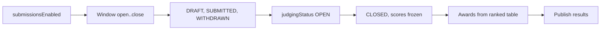

# Hackathon judging

One-off events in either registration mode can take project submissions, have judges score them against a rubric, and publish awards. An **entrant** is a team on `TEAM` events or a single RSVP otherwise, and only `CONFIRMED` entrants can submit. The cores live in `lib/core/judging.ts` (submissions, rubric, scoring, awards, results), `lib/core/judgingOps.ts` (automatic assignment and progress) and `lib/judgingScore.ts` (the pure scoring maths). The privacy rule throughout: judges see project content only, and scores and comments are never public.

## Key files

| Path | Role |
| --- | --- |
| `lib/core/judging.ts` | Entrant resolution, submission save/submit/withdraw, submission links, settings, rubric, awards, disqualification, conflict of interest, judging status, publish/unpublish results, judge workspace, organiser results, exports, public results and gallery |
| `lib/core/judgingOps.ts` | `setReviewsPerProject`, `previewAutoAssignment`, `applyAutoAssignment`, `loadJudgingProgress(Page)` |
| `lib/core/judgingEntrants.ts` | *Not submitted* entrants (`listUnsubmittedEntrants`) |
| `lib/core/submissionLifecycle.ts` | `retireSoloSubmissionForTeamTx`, `captureSubmissionSnapshotTx`, `restoreSubmissionSnapshotTx` |
| `lib/judgingScore.ts` | `judgeWeightedPercent`, `judgeScales`, `adjustedJudgeScore`, `computeJudgingResultsFromReviews`, `roundToOneDecimal` |
| `lib/judgingAssignment.ts` | `planAutoAssignment` (deterministic, pure), `planFingerprint` |
| `lib/judgingProgress.ts` | `findOutliers`, `isStaleReview`, `effectiveReviewTarget`, limits |
| `lib/judgingAccess.ts`, `lib/judgingPermissions.ts` | `resolveJudgeContext`, `resolveJudgingOrganiser`; `judgingPermissionsFor`, `hasNonJudgePermission` |
| `lib/judgingDto.ts`, `lib/judgingExport.ts`, `lib/judgingPaging.ts`, `lib/judgingOrganiserPaging.ts` | DTOs, CSV, keyset paging |
| `lib/submissionToken.ts`, `lib/hackathonEmails.ts`, `lib/publicJudgingPage.ts` | Submission link token and paths, opt-in email helpers, public page access |
| `app/actions/judging.ts`, `judging-admin.ts`, `judging-ops.ts`, `submissions.ts` | Server Action wrappers |
| `app/submit/[token]/page.tsx`, `app/[orgSlug]/[eventSlug]/projects/page.tsx`, `results/page.tsx` | Solo submission page, public gallery, public results |
| `app/api/exports/events/[eventId]/judging/route.ts` | Scores and submissions CSV (owner/admin) |

## How it works

### Lifecycle and locking



Event fields: `submissionsEnabled`, `submissionsOpenAt` / `submissionsCloseAt` (CHECK keeps close after open), `judgingStatus` (`NOT_STARTED`, `OPEN`, `CLOSED`), `judgesSeeAll`, `projectGalleryPublic`, `resultsPublishedAt`, `resultsAnnouncedAt`, `reviewsPerProject` (CHECK 1..20), `scoreNormalization` (`RAW` or `ZSCORE`), and the opt-in `emailEntrantsOnResults` and `emailSubmissionReceipts` (both default `false`).

Locking is deliberate: **entrant and judge writes take `FOR SHARE` on the `Event` row** (`lockEventShared`), **organiser changes take `FOR UPDATE`** (`lockEventForOrganiser`, scoped by `organisationId`). Closing the window, freezing the rubric or closing judging therefore serialises with in-flight submissions and scores. The window is compared with server time inside the write transaction (`isSubmissionWindowOpen`, which also requires `PUBLISHED`).

`setJudgingStatus` transitions:

| To | Allowed when |
| --- | --- |
| `OPEN` | Submissions on, results not published, at least one criterion |
| `CLOSED` | Currently `OPEN` |
| `NOT_STARTED` | No scores or reviews exist and results are not published |

The status is written with `updateMany({ where: { judgingStatus: from } })` and audited `JUDGING_STATUS_CHANGED` in the same transaction.

### Submissions and entrant authority

`Submission` has exactly one of `teamId` or `rsvpId` (CHECK, each unique). `SubmissionStatus` is `DRAFT`, `SUBMITTED`, `WITHDRAWN`, `DISQUALIFIED`. Entrant authority is an `EntrantAuth` re-verified inside every transaction:

| Kind | From |
| --- | --- |
| `team-token` | Leader's `/team/:manageToken` (hash compared) |
| `team-member` | Signed-in team member at `/account/submissions/:eventId` |
| `solo-owner` | Signed-in owner of a solo RSVP |
| `solo-link` | `/submit/:token`: 32 random bytes, SHA-256 stored in `SubmissionLink`, emailed only to the registration's address |

`requestSubmissionLink` replaces the row (retiring the old link) and refuses crew and unconfirmed registrations; the action applies the `invite` rate limit per RSVP. Holding a ticket alone never opens a submission. Joining a team calls `retireSoloSubmissionForTeamTx`: a `SUBMITTED` solo project blocks the move, drafts and withdrawn ones are discarded. `submission-received` receipts are queued only when `emailSubmissionReceipts` is on.

### Judges and conflict of interest

Judges are organisation owners/admins or collaborators with the `JUDGE` grant. A judge-only collaborator (`hasNonJudgePermission` false) sees only the judging workspace. `conflictKeysFor(tx, eventId, userIds)` collects the RSVP and team ids each judge's own account holds on the event; `hasConflictOfInterest` hides and refuses those entries at read and write, and automatic assignment never assigns them. With `judgesSeeAll = false`, judges see only `JudgeAssignment` rows.

`saveJudgeScores` writes `JudgeScore` (unique per submission, judge, criterion; integers 0..`maxScore`). `submitJudgeReview` sets `JudgeReview.submittedAt` once every criterion is scored. Refusal codes for the mobile API: `JUDGING_CLOSED`, `INCOMPLETE_SCORES`, `NOT_VISIBLE`.

### Result score

For judge $j$ and submission $s$, with criteria $c$ of weight $w_c$ (1..10) and maximum $M_c$ (1..10), and score $x_{j,s,c}$ clamped to $[0, M_c]$ (an unscored criterion counts as 0), `judgeWeightedPercent` computes:

$$
p_{j,s} = 100 \cdot \frac{\sum_c w_c \, x_{j,s,c} / M_c}{\sum_c w_c}
$$

The raw result is the mean over the set $J_s$ of counted judges (a submitted review, still able to judge the event, no conflict of interest), rounded half away from zero to one decimal:

$$
R_s = \operatorname{round}_1\!\left(\frac{1}{|J_s|} \sum_{j \in J_s} p_{j,s}\right)
$$

**Adjust for harsh/generous judges** (`ZSCORE`). For each judge, $\mu_j$ and $\sigma_j$ are the mean and **population** standard deviation of that judge's $p_{j,s}$ over their counted reviews. `adjustedJudgeScore` maps each score to:

$$
a_{j,s} = \min\!\left(100,\ \max\!\left(0,\ 50 + 15 \cdot \frac{p_{j,s} - \mu_j}{\sigma_j}\right)\right)
$$

A judge with fewer than 3 counted reviews (`ZSCORE_MIN_REVIEWS`) or $\sigma_j \le 10^{-9}$ keeps $a_{j,s} = p_{j,s}$. The adjusted result $A_s$ is the rounded mean of $a_{j,s}$ over $J_s$. Both $R_s$ and $A_s$ are always computed; `scoreNormalization` only picks which one ranks. Ranking is standard competition ranking on the rounded score (ties share a rank: 1, 1, 3); submissions without a counted review have no score and no rank.

`loadJudgingResults` reads counted reviews already aggregated per review in SQL and calls `computeJudgingResultsFromReviews`. `tests/integration/judging-results-equivalence.db.test.ts` checks this path against the earlier in-memory implementation.

### Operations

- **Automatic assignment**: `planAutoAssignment` gives each submitted project `perProject` judges from the chosen pool, never a conflicted judge, balancing load with a min-heap and breaking ties on a hash of judge and project ids, so the same input always yields the same plan. `applyAutoAssignment` recomputes the plan and compares `planFingerprint` with the preview's, refusing if anything changed.
- **Progress**: `findOutliers` flags a judge more than 2 population SD from the others' mean on a project (with 3 or more judges), or, with exactly two judges, more than 25 points apart. `isStaleReview` flags saved, unsubmitted scores older than 24 h. Sections page 25 at a time.
- **Disqualify / reinstate**: private reason stored on the submission, audited; a disqualified or withdrawn project loses its award places.

### Awards and results

`EventAward` and `EventAwardWinner` (unique per award and place, and per award and submission) are filled by hand; only submitted projects can win. `publishResults` requires `CLOSED`, is idempotent, and under the organiser lock sets `resultsPublishedAt`. When `emailEntrantsOnResults` is on, the first announcement queues one `results-published` email per confirmed registration (deduplicated by address) and sets `resultsAnnouncedAt`; when off, nothing is queued and `sendResultsAnnouncement` can send later under the same lock. Unpublish and republish never email an address twice. The public pages (`/results`, `/projects`) use `loadPublicResults` and `loadProjectGallery` and follow the event page's access rules, returning a real 404 otherwise. The gallery appears only when `isProjectGalleryVisible` (window closed and `projectGalleryPublic`).

## Invariants

- **Organiser `FOR UPDATE`, entrant and judge `FOR SHARE`.** New writes must take the right lock on the `Event` row so status changes serialise with in-flight work.
- **Re-scope every id.** Each id from a browser is re-read with its `eventId`, and the event with its `organisationId`. `tests/integration/judging.db.test.ts` re-scopes entrant, organiser and judge ids to other events and organisations.
- **Window checked against server time in the transaction**, never only in the UI.
- **Rubric frozen after `NOT_STARTED`; scores frozen after `OPEN`.**
- **Conflict of interest at read, write and assignment.** Use `conflictKeysFor` + `hasConflictOfInterest` in any new judge-facing query.
- **No private data in judge or public DTOs.** No emails, answers, tickets, scores, comments or disqualification reasons outside the organiser views. `tests/unit/judging-dto.test.ts` enforces it.
- **Hackathon emails are opt-in.** Never add an automatic send; both switches default to off and are copied on clone.
- **Scoring maths lives in `lib/judgingScore.ts` only.** Organiser tables, the CSV and the awards picker all use `computeJudgingResultsFromReviews`.
- **Crew are not entrants.** Submission and link cores filter `isCrew: false`.

## Making changes

**Change the scoring formula**

1. Edit `lib/judgingScore.ts` and keep `computeJudgingResults` and `computeJudgingResultsFromReviews` arithmetically identical.
2. Update `tests/unit/judging-score.test.ts` with fixed vectors, including ties and one-decimal rounding.
3. Run `tests/integration/judging-results-equivalence.db.test.ts`; update its reference implementation deliberately if the change is intended.
4. Update the formula in the in-app help and [HACKATHON.md](https://github.com/twilighty-abhi/yuyu/blob/main/docs/HACKATHON.md).

**Add a judging setting**: add the `Event` column (with a CHECK if bounded), extend the settings validator, write it in `updateJudgingSettings` under `lockEventForOrganiser` with an audit event, copy it in `cloneEvent`, and expose it in the setup DTO.

**Add a judge-side endpoint**: resolve with `resolveJudgeContext`, take `FOR SHARE`, apply visibility (`judgesSeeAll` or assignment, `SUBMITTED`, no conflict) and return a `JudgingRefusalCode` for refusals so the mobile API can map it.

## Testing

| Test | Covers |
| --- | --- |
| `tests/unit/judging-score.test.ts` | Formula, rounding, tie ranks |
| `tests/unit/judging-assignment.test.ts`, `judging-progress.test.ts`, `judging-validators.test.ts`, `judging-dto.test.ts`, `judging-permissions.test.ts`, `judging-outbox.test.ts` | Assignment, outliers, validation, DTO privacy, JUDGE grant, emails |
| `tests/unit/submission-actions.test.ts`, `submission-account.test.ts`, `judge-workspace.test.ts`, `hackathon-emails.test.ts`, `project-links.test.ts` | Entrant and judge surfaces |
| `tests/integration/judging.db.test.ts`, `judging-core.db.test.ts`, `judging-ops.db.test.ts`, `judging-results-equivalence.db.test.ts`, `judging-normalise-next.db.test.ts`, `judging-paging.db.test.ts`, `judging-organiser-paging.db.test.ts`, `hackathon-email-toggles.db.test.ts` | Database-backed rules and concurrency |
| `tests/e2e/judging.spec.ts`, `judging-ops.spec.ts`, `gallery.spec.ts` | Browser flows |

```bash
npx vitest run tests/unit/judging-score.test.ts tests/unit/judging-dto.test.ts
npm run test:integration -- tests/integration/judging.db.test.ts tests/integration/judging-results-equivalence.db.test.ts
npx playwright test tests/e2e/judging.spec.ts
```

## Further reading

- [HACKATHON.md](https://github.com/twilighty-abhi/yuyu/blob/main/docs/HACKATHON.md): the design contract
- [Teams](/features/teams) for team entrants
- [Permissions](/architecture/permissions) for the `JUDGE` grant
- [Mobile API](/api/mobile-api) for the judge workspace endpoints
