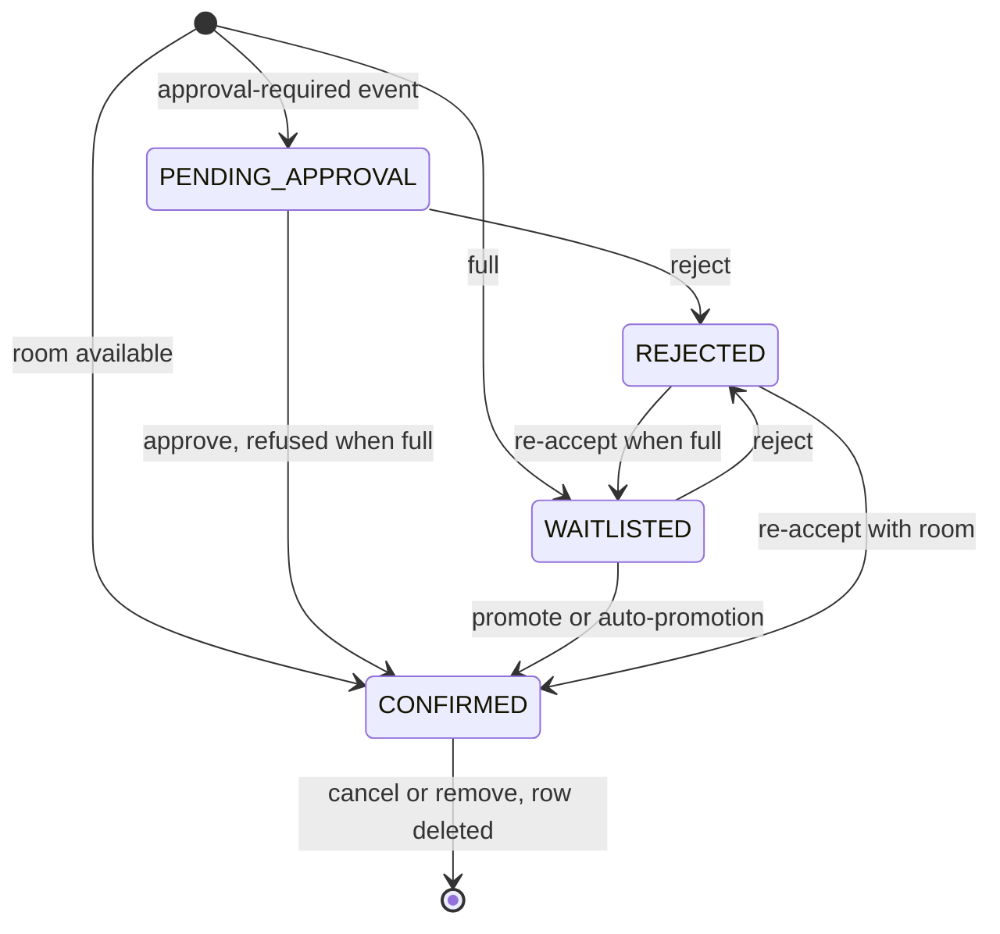
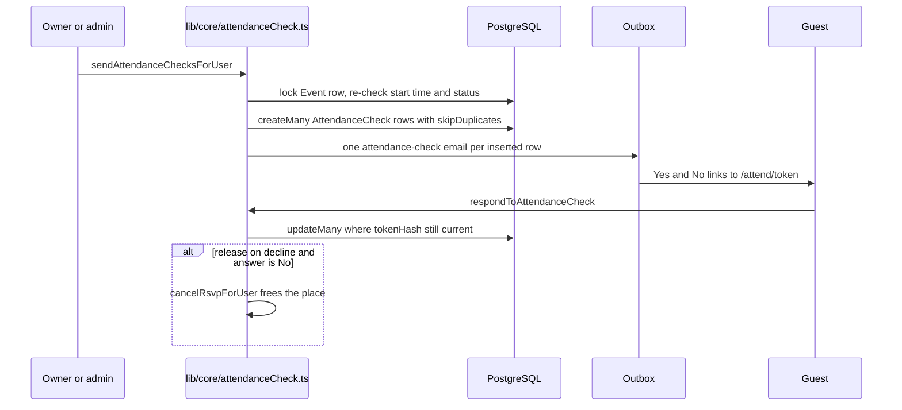

# Registration and RSVP

An `RSVP` row is a person's registration for a one-off event (`eventId`) or a series occurrence (`eventInstanceId`). This module decides whether someone gets a place, a waitlist spot or a pending request, keeps capacity exact under concurrency, validates custom form answers, and handles organiser transitions, cancellation, undo and the manual "Are you still coming?" check. Almost every bug here is a race or a bypassed lock, so the [Invariants](#invariants) section is the part to read before you change anything.

## Key files

| Path | Role |
| --- | --- |
| `lib/rsvpCore.ts` | `submitRsvpCore` (public and mobile), `submitManualGuestRsvpCore` (organiser add), `reserveRsvp` (the locked insert), `decideRsvpStatus`, `validateAndNormalizeAnswers` |
| `lib/rsvpCapacity.ts` | `confirmRsvpWithinCapacity` (approve, promote, re-accept), `hasCapacityToRestoreConfirmedRsvp` (undo), display counts |
| `lib/teamUnits.ts` | `takesCapacity`, `countConfirmedForCapacity`, `countConfirmedUnits`, `promoteOldestWaitlistedUnit` |
| `lib/core/rsvpLifecycle.ts` | `approveRsvpForUser`, `rejectRsvpForUser`, `promoteFromWaitlistForUser`, `reacceptRsvpForUser` |
| `lib/core/rsvpAdmin.ts` | `addManualRsvpForUser`, `updateRsvpRegistrationForUser`, `deleteRsvpForUser`, `restoreRsvpForUser` |
| `lib/core/rsvpCancel.ts` | `cancelRsvpForUser` (attendee self-cancel by session or ticket token) |
| `lib/core/attendanceCheck.ts` | Attendance confirmation: send, remind, share link, reply, release |
| `lib/attendanceCheck.ts`, `lib/attendanceToken.ts` | Pure rules (recipients, 12 h reminder, closed reasons) and the 256-bit token |
| `lib/registrationFields.ts` | Field types, `fieldSettingsSchema`, `generateFieldKey`, `visibleFieldKeys` (show-only-if logic) |
| `lib/registrationCutoff.ts`, `lib/core/registrationWindow.ts` | `isRegistrationClosed`; mobile close/reopen sign-ups |
| `app/api/rsvp/route.ts` | Public `POST /api/rsvp` (web form and embed) |
| `app/actions/rsvp*.ts`, `registration-form.ts`, `attendance-check.ts`, `guest-list.ts`, `invites.ts` | Thin Server Action wrappers |
| `lib/attendeeListQuery.ts` | Guests · People filters and keyset paging |
| `app/attend/[token]/page.tsx` | Guest's attendance reply form |

## How it works

### Entry points

| Surface | Path into the core |
| --- | --- |
| Public form and embed | `POST /api/rsvp` → `submitRsvpCore(body, { userId, team })` |
| Mobile app | `POST /api/mobile/v1/rsvp` → `submitRsvpCore` |
| Organiser manual add | `addManualRsvp` → `addManualRsvpForUser` → `submitManualGuestRsvpCore` |
| Team create/join | `submitRsvpCore` with a `team` intent, plus `lib/core/teams.ts` (see [Teams](/features/teams)) |
| Crew | `lib/core/crew.ts` (see [Crew](/features/crew)) |

`POST /api/rsvp` rate limits with the `rsvp` bucket (10/min) twice: per client IP and per hashed guest email. It parses the optional `team` intent with `teamRegistrationIntentSchema` before calling the core.

A registration is either a signed-in user (`userId`) or a guest (`guestName`, `guestEmail`). `attendeeKey` is `user:<id>` or `guest:<normalised email>`. Partial unique indexes on `(eventId, attendeeKey)` and `(eventInstanceId, attendeeKey)` are the final duplicate guard; `submitRsvpCore` maps a `P2002` from the insert to "You have already RSVP’d for this event."

### Status decision

```ts
// lib/rsvpCore.ts
export function decideRsvpStatus(params: {
  capacity: number | null;
  confirmedCount: number;
  privacyType: EventPrivacyType;
}): RsvpStatus {
  const { capacity, confirmedCount, privacyType } = params;
  const full = capacity != null && confirmedCount >= capacity;

  if (privacyType === EventPrivacyType.APPROVAL_REQUIRED) {
    return RsvpStatus.PENDING_APPROVAL;
  }
  if (full) {
    return RsvpStatus.WAITLISTED;
  }
  return RsvpStatus.CONFIRMED;
}
```

`RsvpStatus` has four values: `CONFIRMED`, `WAITLISTED`, `PENDING_APPROVAL`, `REJECTED`. There is no cancelled status: cancelling or removing a registration **deletes the row**.



### The capacity transaction: `reserveRsvp`

1. `SELECT "id" FROM "Event" WHERE "id" = $1 FOR UPDATE` (for an occurrence: `FOR UPDATE OF s, i` on the series and instance rows).
2. Re-read capacity, privacy, status, end time, cutoffs, team settings and `page.isPublished` **under the lock**.
3. Unless `enforceOpen === false` (organiser manual add only), throw `RsvpTargetClosedError` when the event is not `PUBLISHED`, the page is not released, the event has ended or `isRegistrationClosed` is true.
4. Count: individual events count `CONFIRMED` RSVPs with `...takesCapacity` (crew excluded); `TEAM` events use `countConfirmedUnits`.
5. `decideRsvpStatus`, create the RSVP, enqueue `rsvp-confirmation` through the outbox, and run `afterCreate` (answers, user name) in the same transaction.
6. After commit, `emitWebhookEvent({ type: "registration.created" })`.

`submitRsvpCore` performs the same open checks before the transaction for a fast refusal, plus the `INVITE_ONLY` allowlist check (an `EventInvite` row for the attendee's email) and answer validation, but the authoritative check is the one under the lock.

### Organiser transitions

All organiser actions resolve the caller with `canManageRegistrationsFor` (owner/admin or the `MANAGE_REGISTRATIONS` grant on the event or series) and re-scope the RSVP to the event and organisation.

| Action | Core | Locking and outcome |
| --- | --- | --- |
| Approve | `approveRsvpForUser` → `confirmRsvpWithinCapacity({ expectedStatuses: [PENDING_APPROVAL], requireOpen: true })` | Returns `"full"` when at capacity; the request stays pending |
| Promote | `promoteFromWaitlistForUser` → `confirmRsvpWithinCapacity` | Only `WAITLISTED` |
| Re-accept | `reacceptRsvpForUser` → `confirmRsvpWithinCapacity({ expectedStatuses: [REJECTED], whenFull: "waitlist" })` | Confirmed with room, else waitlisted; audited `RSVP_REACCEPTED` |
| Reject | `rejectRsvpForUser` | Conditional `updateMany` from `PENDING_APPROVAL` or `WAITLISTED` |
| Remove | `deleteRsvpForUser` | Locks the event, writes an `RsvpDeletionUndo` snapshot (5-minute TTL), deletes; on team events settles the team and promotes the oldest waitlisted unit if one was freed; emits `registration.status_changed` with status `REMOVED` |
| Undo remove | `restoreRsvpForUser` | Restores a confirmed RSVP only if `hasCapacityToRestoreConfirmedRsvp` passes under the lock |

`confirmRsvpWithinCapacity` locks the event (or series and instance), counts, and flips the status with `updateMany({ where: { id, status: { in: expectedStatuses } } })`. A concurrent change makes the update hit zero rows and the result is `"changed"`. On team events it adds `teamId: null` to the guard, and every lifecycle core refuses team members with code `TEAM_MEMBER`: teams move as a whole (see [Teams](/features/teams)).

### Cancellation and auto-promotion

`cancelRsvpForUser` accepts the signed-in owner or the ticket token. It refuses crew tickets and anyone already checked in, locks the event (or instance), deletes the RSVP and then:

- on a `TEAM` event, calls `settleTeamAfterMemberLeft` (leader handover or empty-team deletion) and, if a confirmed unit was freed, `promoteOldestWaitlistedUnit`;
- otherwise, if the cancelled RSVP was `CONFIRMED` and the event is not `APPROVAL_REQUIRED`, promotes the oldest `WAITLISTED` RSVP with a conditional update and queues its status email.

Webhooks (`registration.status_changed` for the promoted RSVP, team webhooks) are emitted after commit.

### Custom registration forms

`EventRegistrationForm` → `EventRegistrationField` → `RsvpAnswer`. Form edits require owner/admin (`requireOrgRole(organisationSlug, "ADMIN")` in `app/actions/registration-form.ts`). Field types are the `RegistrationFieldType` enum: `TEXT`, `TEXTAREA`, `EMAIL`, `PHONE`, `SELECT`, `MULTI_SELECT`, `RADIO`, `CHECKBOX`, `NUMBER`, `DATE`. Per-field `settings` JSON is validated by `fieldSettingsSchema` (length, number and date limits, max selections, "Other", show-only-if logic). Keys come from `generateFieldKey(label, taken)` and are never shown.

`validateAndNormalizeAnswers({ fields, answers })` runs on the server against the **current** field definitions. It computes `visibleFieldKeys` first and drops answers to questions hidden by logic, then enforces required fields, options and limits.

### Attendance confirmation

A manual, owner/admin-only "Are you still coming?" email for one-off events. **Nothing sends it automatically**: there is no schedule and the outbox worker never creates a question.



- Recipients: `{ eventId, status: CONFIRMED, isCrew: false, attendanceCheck: { is: null } }` (`unaskedWhere`). `AttendanceCheck.rsvpId` is unique, so a double send never asks anyone twice.
- Tokens: 32 random bytes, base64url; only the SHA-256 digest (`tokenHash`) is stored. Reminders (at most every 12 h per guest) and hand-shared links rotate the token, so older links 404.
- A No with `Event.attendanceCheckReleaseOnDecline` on goes through `cancelRsvpForUser`, so capacity, promotion and team rules apply unchanged. A checked-in guest keeps their place.
- Rate limits: `attendanceCheckSend` 10/h, `attendanceCheckLink` 60 per 10 min, `attendanceCheckReply` 10/min. Audits: `ATTENDANCE_CHECK_SENT`, `_REMINDED`, `_SETTINGS_UPDATED`, `_LINK_SHARED`, `_RELEASED`, never with the token.

### Guest lists and exports

Guests · People pages on the server with keyset cursors (`lib/attendeeListQuery.ts`, page size 50). Filters (`status`, `kind`, `team`, `attendance`, `q`) are allow-listed and live in the URL. CSV and email exports under `app/api/exports/events/[eventId]/attendees` and `attendee-emails` stream exactly the current filter.

## Invariants

- **Every capacity change takes the `Event` row lock first.** `reserveRsvp`, `confirmRsvpWithinCapacity`, `hasCapacityToRestoreConfirmedRsvp`, cancel, delete, restore, the capacity check in `updateEvent`, every team mutation and crew conversion all `SELECT ... FOR UPDATE` the event (or series and instance). A new path that changes who holds a place must do the same, then re-read state under the lock. Covered by `tests/integration/rsvpCapacity.db.test.ts` and `rsvp-lifecycle.db.test.ts` (final-slot races).
- **Crew never count against capacity.** Spread `takesCapacity` (`{ isCrew: false }`) into every count compared with `Event.capacity`, or use `countConfirmedForCapacity`.
- **Team events count units.** Use `countConfirmedForCapacity(tx, eventId, registrationMode)`, not a raw RSVP count.
- **Status flips are conditional.** Always `updateMany` with the expected previous status; treat zero rows as "changed by someone else".
- **Registration needs the publication switch.** Under the lock: `PUBLISHED`, released page, not ended, cutoff not passed. Only the organiser manual add passes `enforceOpen: false`.
- **The database is the last duplicate guard.** Keep the partial unique `attendeeKey` indexes and handle `P2002`.
- **Answers are validated server-side against current fields.** Never trust client-side logic for hidden questions.
- **Side effects after commit.** Emails go through the outbox inside the transaction; webhooks are emitted after it. Never wait for SMTP on the request path.
- **Attendance confirmation is never automatic.** Do not add a scheduled send; `tests/integration/attendance-check.db.test.ts` asserts scheduler ticks create nothing.

## Making changes

**Add a new organiser transition** (for example a bulk action)

1. Put the rule in `lib/core/rsvpLifecycle.ts` (or `rsvpAdmin.ts`) as a `...ForUser(actorUserId, input)` function so the mobile API can reuse it.
2. Gate with `canManageRegistrationsFor`, re-scope ids, refuse team members with `TEAM_MEMBER`.
3. Do the change through `confirmRsvpWithinCapacity` or your own locked transaction with a conditional `updateMany`.
4. Queue emails with the outbox helpers in the transaction, record an audit event, emit webhooks after commit.
5. Add a thin wrapper in `app/actions/rsvp-lifecycle.ts`. Test in `tests/integration/` against a real database. See [Add a server action](/guides/add-a-server-action).

**Add a registration field type**: extend `RegistrationFieldType` (migration plus rollback note), add its `FieldTypeMeta` in `lib/registrationFields.ts`, handle it in `settingsForType` and `validateAndNormalizeAnswers`, and add cases to `tests/unit/registration-answers.test.ts` and `registration-fields.test.ts`.

**Change what counts as "full"**: change `countConfirmedForCapacity` / `countConfirmedUnits` only, so every caller stays consistent, then run the capacity integration suites.

## Testing

| Test | Covers |
| --- | --- |
| `tests/unit/rsvpCapacity.test.ts`, `rsvp-status.test.ts`, `rsvp-route.test.ts`, `rsvp-reaccept.test.ts` | Status decision, route limits, re-accept |
| `tests/unit/registration-answers.test.ts`, `registration-fields.test.ts`, `registration-form-builder.test.ts`, `registrationCutoff.test.ts`, `registration-window.test.ts` | Forms, logic, cutoffs |
| `tests/unit/attendance-check.test.ts`, `attendance-guest-list.test.ts`, `attend-page.test.ts` | Attendance confirmation |
| `tests/unit/guest-list.test.ts`, `guest-paging.test.ts` | Guests · People |
| `tests/integration/rsvpCapacity.db.test.ts`, `rsvp-lifecycle.db.test.ts`, `rsvp-reaccept.db.test.ts` | No overselling, races, per-occurrence capacity |
| `tests/integration/attendance-check.db.test.ts`, `attendance-check-card.db.test.ts`, `guest-pagination.db.test.ts` | Attendance flow, paging |
| `tests/e2e/guest-reaccept.spec.ts`, `attendance-confirmation.spec.ts`, `pagination.spec.ts` | Browser flows |

```bash
npx vitest run tests/unit/rsvpCapacity.test.ts tests/unit/registration-answers.test.ts
npm run test:integration -- tests/integration/rsvpCapacity.db.test.ts tests/integration/rsvp-lifecycle.db.test.ts
npx playwright test tests/e2e/guest-reaccept.spec.ts
```

## Further reading

- [FEATURES.md](https://github.com/twilighty-abhi/yuyu/blob/main/docs/FEATURES.md) (registration and attendance confirmation sections)
- [Mutation cores](/architecture/mutation-cores) for the `...ForUser` pattern
- [Background jobs](/architecture/background-jobs) for the outbox
- [Teams](/features/teams), [Crew](/features/crew), [Tickets and check-in](/features/tickets-and-check-in)
- [Webhooks](/api/webhooks) for `registration.*` events
