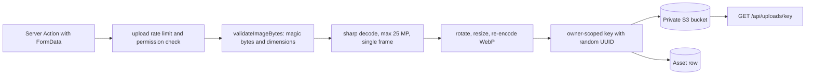

# Storage and media

Yuyu stores user-supplied images (event covers, organisation and event-page logos, speaker photos, sponsor logos, crew photos, certificate artwork and profile pictures) as re-encoded WebP derivatives. The original upload is never kept. Every image is validated, decoded under a hard pixel limit, rotated, resized, stripped of metadata and re-encoded, then written under an allow-listed, owner-scoped key. In production the bytes live in a **private** S3-compatible bucket and are served only through `GET /api/uploads/...`. In development they can live in PostgreSQL instead. An `Asset` row records every object for ownership checks and storage accounting.

## Key files

| Path | Role |
| --- | --- |
| `lib/storage/index.ts` | `uploadFile`, `downloadFile`, `getPublicUrl`, `isPublicDerivativeKey`, and the key patterns |
| `lib/imageValidation.ts` | Magic-byte and dimension checks, `createSafeWebpDerivative` (sharp) |
| `lib/uploadUrl.ts` | `isUploadedImageUrl`, `uploadKeyFromUrl`, `isOrganisationUploadUrl`, `isUserUploadUrl` (validate URLs saved on records) |
| `app/api/uploads/[...key]/route.ts` | Public delivery of derivatives |
| `app/actions/media.ts` | Organisation logo, event-page logo, profile image |
| `app/actions/event.ts` | Event cover upload |
| `app/actions/event-website.ts` | Speaker photo and sponsor logo uploads |
| `app/actions/crew.ts` | Crew photo upload |
| `app/actions/certificate.ts` | Certificate background and layer images |
| `scripts/migrate-assets-to-s3.mjs` | `npm run storage:migrate`: move database-stored assets to S3 |
| `app/super-admin/storage/page.tsx` | Instance storage breakdown |

## How it works



### Upload

Each upload is a Server Action. Bodies are capped at 6 MB by `serverActions.bodySizeLimit` in `next.config.ts`, and actions reject files over 5 MB. The action:

1. Checks the `upload` rate-limit bucket (60 per hour per user, shared by every image upload) and the caller's permission for that resource.
2. Calls `createSafeWebpDerivative(file, { width, height, fit, ... })`. This calls `validateImageBytes`, which reads the JPEG, PNG or WebP signature and header dimensions (including the WebP VP8, VP8L and VP8X variants) before any decode. sharp then decodes with `failOn: "warning"` and `limitInputPixels` of 25,000,000. The decoder's format must match the signature, the image must be a single frame, and the result is `.rotate()`d, resized and re-encoded with `.webp({ quality: 86, effort: 5 })`, or losslessly for certificate images. Re-encoding drops EXIF and other metadata.
3. Builds a key such as `` `organisations/${org.id}/event-covers/${crypto.randomUUID()}.webp` `` and calls `uploadFile({ key, body, contentType: "image/webp", organisationId })`.
4. Stores the URL from `getPublicUrl(key)` (`<NEXT_PUBLIC_BASE_URL>/api/uploads/<key>`) on the record. When that URL is saved later, it is checked with the `lib/uploadUrl.ts` helpers, so a record can only reference uploads from its own organisation or user.

| Category (key folder) | Uploaded by | Derivative size |
| --- | --- | --- |
| `event-covers` | `app/actions/event.ts` | Within 2400 × 2400 |
| `organisation-logos`, `event-page-logos` | `app/actions/media.ts` | Within 1200 × 1200 |
| `event-speakers` | `app/actions/event-website.ts` | 1200 × 1200 cover crop |
| `event-sponsors` | `app/actions/event-website.ts` | Within 1200 × 1200 |
| `event-crew` | `app/actions/crew.ts` | 1200 × 1200 cover crop, `attention` position |
| `certificate-backgrounds`, `certificate-assets` | `app/actions/certificate.ts` | Within 6000 or 3000 px, lossless |
| `users/<id>/profile-images` | `app/actions/media.ts` | Within 1200 × 1200 |

### Storage backends (`uploadFile`)

- `uploadFile` first checks that the key matches `ORGANISATION_DERIVATIVE_KEY` or `USER_DERIVATIVE_KEY`, that the id in the key equals the `organisationId` or `userId` passed in, and that `contentType` is `image/webp`. Otherwise it throws.
- With `S3_BUCKET` and `S3_REGION` set, it sends a `PutObjectCommand` with `Cache-Control: public, max-age=31536000, immutable` and upserts an `Asset` with `provider: "s3"`.
- Without S3 in production, it throws "Private object storage is not configured.". Startup also refuses to run without the S3 settings (`lib/env.ts`).
- Without S3 in development, it stores the bytes in `Asset.fileData` with `provider: "database"`.

### Delivery (`GET /api/uploads/[...key]`)

The route joins the path segments, rejects anything that is not `isPublicDerivativeKey` with a `404` (`Cache-Control: no-store`, `nosniff`), and calls `downloadFile`. That function loads the `Asset`, requires `contentType` to be `image/webp`, then reads from S3 or from `fileData`. Success responses are:

```http
Content-Type: image/webp
Content-Disposition: inline
Cross-Origin-Resource-Policy: same-site
X-Content-Type-Options: nosniff
Cache-Control: public, max-age=31536000, immutable
```

Keys contain a fresh UUID, so the immutable cache is safe: a replaced image always gets a new URL. Email and mobile responses make these URLs absolute against `NEXT_PUBLIC_BASE_URL`.

### Configuration

| Variable | Notes |
| --- | --- |
| `S3_BUCKET`, `S3_REGION` | Required in production |
| `S3_ENDPOINT` | Custom endpoint (R2, MinIO…). Must be `https:` in production |
| `S3_ACCESS_KEY_ID`, `S3_SECRET_ACCESS_KEY` | Set both, or neither to use an IAM role or workload identity |
| `S3_FORCE_PATH_STYLE=1` | For providers that need path-style addressing |

`npm run production:check` enforces the same rules. To move development or legacy database blobs to S3, run `npm run storage:migrate`. It copies `provider: "database"` rows 25 at a time, then sets `provider: "s3"` and clears `fileData`.

## Invariants

- **Only derivatives are stored.** Never write an uploaded file's original bytes. Always go through `createSafeWebpDerivative`.
- **Keys are allow-listed and owner-bound.** `uploadFile` refuses any key outside the two patterns, or one whose id does not match the caller-supplied owner. New categories must be added to `ORGANISATION_DERIVATIVE_KEY` deliberately.
- **The bucket stays private.** Objects are served only by `/api/uploads`, which re-checks the key pattern and the `Asset` content type. Do not hand out presigned or direct bucket URLs.
- **Validate before decoding.** Header dimensions are checked before sharp touches the bytes, and sharp has a hard `limitInputPixels`, to defend against decompression bombs.
- **Content is always `image/webp` with `nosniff`**, so a crafted upload cannot be served as HTML or script.
- **Every upload is rate limited (`upload`) and permission checked** in its Server Action, before any decoding work.

## Making changes

To add an image upload for a new kind of resource:

1. Pick a category name and add it to the alternation in `ORGANISATION_DERIVATIVE_KEY` in `lib/storage/index.ts`. User-scoped images use `USER_DERIVATIVE_KEY`.
2. In the Server Action: authenticate, check `isActionRateLimited("upload", userId)`, check the permission, enforce the 5 MB cap, call `createSafeWebpDerivative` with sizes that suit the display, build `` `organisations/${orgId}/<category>/${crypto.randomUUID()}.webp` ``, call `uploadFile`, and return `getPublicUrl(key)`. Record an audit event where the resource is organisation-visible, for example `ORGANISATION_LOGO_UPLOADED`.
3. Where the URL is saved on a record, validate it with `isOrganisationUploadUrl(value, orgId, "<category>")`.
4. Add cases to `tests/unit/storage-key.test.ts` and, if delivery changes, `tests/unit/upload-route.test.ts`.

## Testing

| File | Covers |
| --- | --- |
| `tests/unit/image-validation.test.ts` | Signatures, header dimensions, pixel limit, single frame |
| `tests/unit/storage-key.test.ts` | Key patterns, traversal and non-WebP rejection |
| `tests/unit/upload-route.test.ts` | Delivery headers and `404`s |

```bash
npx vitest run tests/unit/image-validation.test.ts tests/unit/storage-key.test.ts tests/unit/upload-route.test.ts
```

## Further reading

- [docs/SECURITY.md](https://github.com/twilighty-abhi/yuyu/blob/main/docs/SECURITY.md)
- [docs/CONFIGURATION.md](https://github.com/twilighty-abhi/yuyu/blob/main/docs/CONFIGURATION.md)
- [Configuration reference](/reference/configuration)
- [Deployment](/reference/deployment)
- [Feedback, certificates and reports](/features/feedback-certificates-reports)
