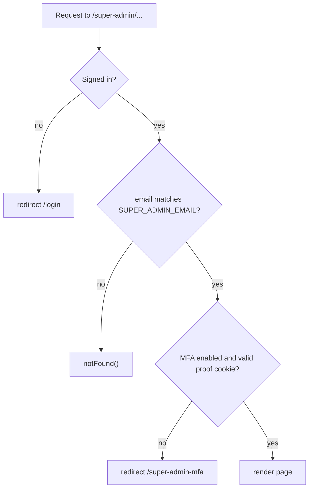

# Super admin

The super-admin area (`/super-admin`) is the instance operator's console. It is separate from any organisation, has its own top bar instead of the dashboard sidebar, and is open to exactly one account: the user whose email matches `SUPER_ADMIN_EMAIL`, after a fresh TOTP step-up. It holds instance settings (account-creation switch, SMTP, Google SSO, backup posture, an alerts webhook), read-only insights across every organisation, operations controls for the outbox and retention, monitoring, and the audit log. This page also covers the operational alerts pipeline and the health endpoints that sit beside it.

## Key files

| Path | Role |
| --- | --- |
| `app/super-admin/layout.tsx` | Layout. Calls `requireSuperAdminMfa`, renders `SuperAdminTopBar` |
| `app/super-admin/*/page.tsx` | One page per area, and each calls `requireSuperAdminMfa` itself |
| `lib/permissions.ts` | `requireSuperAdmin`, `requireSuperAdminMfa` |
| `lib/superAdminMfa.ts` | Signed step-up cookie `yuyu.super-admin-mfa.v1` (10 minutes) |
| `app/actions/super-admin-mfa.ts` | `verifySuperAdminMfa` |
| `lib/instanceSettings.ts` | `InstanceSetting` readers: `getEmailSettings`, `getGoogleSsoSettings`, `isNewUserRegistrationEnabled`, `resolveBackupPosture` |
| `lib/instanceConfigSecrets.ts` | AES-GCM encryption of instance secrets |
| `app/actions/instance-settings.ts` | Save settings, account-creation switch, test email, alerts webhook and test |
| `app/actions/instance.ts` | Maintenance: deliver outbox now, purge expired tokens, retry failed email, record restore verification |
| `lib/superAdminData.ts`, `lib/superAdminInsights.ts` | Parameterised aggregate queries and pure formatting helpers |
| `lib/opsAlerts.ts` | Operational alerts: redaction, de-duplication, rate cap, delivery |
| `instrumentation.ts` | Installs alert forwarding and `onRequestError` |
| `app/api/client-errors/route.ts` | Browser crash reports into ops alerts |
| `app/api/health/route.ts`, `app/api/health/db/route.ts`, `app/api/internal/outbox/route.ts` | Liveness, readiness, scheduler trigger |
| `scripts/check-instance-secrets.mjs` | Checks that the current key decrypts every stored secret, without printing them |

## How it works

### Access



- `requireSuperAdmin` compares the signed-in user's email with `SUPER_ADMIN_EMAIL` case-insensitively and calls `notFound()` on a mismatch, so the panel's existence does not leak.
- `requireSuperAdminMfa` also requires `mfaEnabledAt` and a valid proof cookie. The proof is `base64url(JSON { userId, sessionVersion, expiresAt }).signature`, where the signature is HMAC-SHA256 under `AUTH_SECRET` over `super-admin-mfa:<payload>` and is compared in constant time. It is bound to `sessionVersion`, so "sign out everywhere", a password change or an MFA change revokes it at once.
- `verifySuperAdminMfa` uses the `auth` rate-limit bucket and consumes a one-time TOTP code (`consumeMfaCode`).
- Layouts do not re-run on client navigation, so **every page and every super-admin Server Action calls `requireSuperAdminMfa` itself**. The exception is `verifySuperAdminMfa`, which uses `requireSuperAdmin` because it creates the proof. `tests/unit/super-admin-page-guards.test.ts` enforces this for pages.

### Pages

| Path | Shows |
| --- | --- |
| `/super-admin` | Overview: 30-day activity sparklines, queue and API client summaries |
| `/activity` | Daily signups, organisations, events, RSVPs, check-ins, feedback, broadcasts |
| `/audit` | Searchable audit log with sensitive values redacted |
| `/auth` | Account-creation switch, sign-in accounts, sessions, verification tokens |
| `/email` | Outbox volume by kind and status. Never recipients or contents |
| `/events`, `/orgs`, `/orgs/[orgId]`, `/users`, `/users/[userId]`, `/invites` | Instance-wide directories |
| `/monitoring` | Database health, configuration checks, per-process API route stats (`withApiMonitoring`) |
| `/operations` | Backup posture, queue health, retention, maintenance buttons |
| `/security` | MFA adoption, admins without MFA, unverified accounts, sign-in methods, sensitive audits (`SECURITY_AUDIT_ACTIONS`), API client lifecycle |
| `/settings` | Instance service settings and alerts webhook |
| `/storage` | Database size, largest tables, per-organisation footprint |

Insights are read-only, parameterised and capped. Search input is limited to 120 characters (`ADMIN_SEARCH_MAX_LENGTH`) and paging to 1000 pages (`ADMIN_MAX_PAGE`). Queries select aggregates and display fields, never tokens, hashes, answers, storage keys or message bodies.

### Instance settings

The singleton `InstanceSetting` row (`id = "global"`, `INSTANCE_SETTINGS_ID`) holds:

| Group | Fields | Notes |
| --- | --- | --- |
| Account creation | `allowNewUserSignups` | Turns off password and Google sign-up. Existing users can still sign in |
| SMTP | `emailFrom`, `smtpService`, `smtpHost`, `smtpPort`, `smtpSecure`, `smtpUser`, `smtpPasswordEncrypted`, `smtpAllowUnauthenticated` | Once saved, replaces the `SMTP_*` env values **as a whole** |
| Google SSO | `googleClientId`, `googleClientSecretEncrypted` | |
| Backup posture | `backupProvider`, `backupLastSuccessAt`, `backupRetentionDays` | Display only. Yuyu does not run backups |
| Alerts webhook | `opsWebhookUrlEncrypted`, `opsWebhookEnabled`, `opsWebhookIncludeWarnings` | Only the URL's host is ever shown |

Settings are read from PostgreSQL at send or sign-in time, so they apply on every replica without a restart. Secrets are write-only in the UI and encrypted with AES-256-GCM under a key derived from `MFA_ENCRYPTION_KEY` by HKDF with the label `yuyu-instance-service-settings-v1`. A secret that cannot be decrypted raises `InstanceSecretUnreadableError`.

Changes are audited: `NEW_USER_REGISTRATION_SETTING_UPDATED`, `INSTANCE_SERVICE_SETTINGS_UPDATED`, `INSTANCE_TEST_EMAIL_SENT`, `OPS_WEBHOOK_SETTINGS_UPDATED` and `OPS_WEBHOOK_TEST_SENT`.

### Maintenance actions (`app/actions/instance.ts`)

All run through `runMaintenance`, which requires `requireSuperAdminMfa` and the `action` rate-limit bucket.

| Action | Effect | Audit |
| --- | --- | --- |
| `deliverInstanceOutbox` | Runs an outbox delivery pass now | `INSTANCE_OUTBOX_DELIVERED` |
| `purgeExpiredVerificationTokens` | Deletes expired verification tokens | `EXPIRED_VERIFICATION_TOKENS_PURGED` |
| `retryFailedOutboxMessages` | Requeues `FAILED` messages created in the last 7 days. Older failures are left for retention, so stale broadcasts are never resent | `FAILED_OUTBOX_MESSAGES_REQUEUED` |
| `recordBackupRestoreVerification` | Records a restore drill | `BACKUP_RESTORE_VERIFIED` |

### Operational alerts (`lib/opsAlerts.ts`)

When the alerts webhook is enabled, each app process posts `{ text }` to a Mattermost- or Slack-compatible incoming webhook for:

- uncaught server errors (`onRequestError` in `instrumentation.ts`), reported with the route pattern rather than the path
- server `console.error` lines, plus `console.warn` lines when **Include warnings** is on (`installOpsAlertForwarding`)
- Auth.js sign-in failures and outbox email delivery failures (a retried failure is a warning, a permanent one an error)
- browser crashes via `POST /api/client-errors`, which is same-origin only, size-capped, uses the `clientError` bucket (10 per minute per IP) and always returns an empty `204`
- an "Instance started" note at boot

| Control | Value |
| --- | --- |
| Settings cache per process | 60 s |
| De-duplication window | 5 minutes, then a repeat count |
| Rate cap | 30 alerts per minute per process |
| Request timeout | 5 s |
| Text cap | 600 characters, after `redactAlertText` removes URLs, connection strings, emails, bearer values, `token=` parameters and long opaque strings |
| URL rule | `parseOpsWebhookUrl`: `https:` in production, no user info |

Alerting is best effort. It never throws into the request that raised it, and work done to deliver an alert is marked so its own logs cannot re-alert.

### Health and scheduler endpoints

| Endpoint | Protection | Purpose |
| --- | --- | --- |
| `GET /api/health` | Public. Excluded from the proxy rate limit | Liveness with no database or Redis dependency |
| `GET /api/health/db` | `Authorization: Bearer $HEALTHCHECK_SECRET` | Database readiness |
| `POST /api/internal/outbox` | `Authorization: Bearer $CRON_SECRET` | Outbox, webhooks and retention pass |

Secrets are checked with `bearerSecretMatches`. A wrong or missing secret gets a plain `404`.

## Invariants

- **Every super-admin page and action calls `requireSuperAdminMfa`.** The layout check alone is not enough, because client navigation skips it.
- **A mismatch is `notFound()`, never `403`.** Do not reveal the panel to other users.
- **Insights never select secrets or content.** No tokens, hashes, answers, storage keys, email recipients or bodies. Keep queries parameterised (`Prisma.sql`) and capped.
- **Instance secrets are write-only.** Never send a decrypted secret to the browser. Show only presence, or the host for the webhook URL.
- **`MFA_ENCRYPTION_KEY` must be identical on every replica and job.** A replica with a different key stays healthy but cannot send email, use Google sign-in, post alerts or verify TOTP. Run `node scripts/check-instance-secrets.mjs` before rotating or deploying (Helm `migration.checkInstanceSecrets=true`).
- **Alert text leaves the instance**, so it must go through `redactAlertText`. Never put request paths, query strings or payloads into an alert.
- **Health liveness must not depend on Redis or the database.**

## Making changes

- **Add an instance setting.** Follow [Add config](/guides/add-config). Add the column to `InstanceSetting` with a migration, a reader in `lib/instanceSettings.ts` (encrypt secrets with `encryptInstanceConfigSecret`), a field in the settings form and `saveInstanceServiceSettings`, and an audit action. Keep reads at use time, with no module-level cache.
- **Add an insights panel.** Put the SQL in `lib/superAdminData.ts` (aggregates only, with the `utcTimestamp` helper for day buckets) and the formatting in `lib/superAdminInsights.ts`, and call `requireSuperAdminMfa()` at the top of the page. Add guard coverage to `tests/unit/super-admin-page-guards.test.ts`.
- **Add a maintenance action.** Wrap it in `runMaintenance` in `app/actions/instance.ts`, record an audit event, and test in `tests/unit/super-admin-maintenance-actions.test.ts`.
- **Raise a new alert.** Call `reportOpsAlert({ level, source, title, error, context })`. It never throws.

## Testing

| File | Covers |
| --- | --- |
| `tests/unit/super-admin-page-guards.test.ts`, `super-admin-permissions.test.ts` | Every page guarded, email matching, `notFound` |
| `tests/unit/super-admin-mfa.test.ts`, `super-admin-mfa-action.test.ts` | Proof signing, expiry, session-version binding |
| `tests/unit/super-admin-data.test.ts`, `super-admin-insights.test.ts` | Queries and formatting |
| `tests/unit/super-admin-maintenance-actions.test.ts`, `instance-admin-actions.test.ts` | Maintenance and settings actions |
| `tests/unit/instance-settings.test.ts`, `instance-config-secrets.test.ts` | Settings resolution, encryption |
| `tests/unit/ops-alerts.test.ts`, `tests/integration/ops-alerts.db.test.ts` | Redaction, de-duplication, delivery |
| `tests/unit/operations-routes.test.ts`, `bearer-secret.test.ts` | Health and internal endpoints |

```bash
npx vitest run tests/unit/super-admin-page-guards.test.ts tests/unit/super-admin-mfa.test.ts tests/unit/ops-alerts.test.ts
```

## Further reading

- [docs/production-operations.md](https://github.com/twilighty-abhi/yuyu/blob/main/docs/production-operations.md)
- [docs/SECURITY.md](https://github.com/twilighty-abhi/yuyu/blob/main/docs/SECURITY.md)
- [docs/CONFIGURATION.md](https://github.com/twilighty-abhi/yuyu/blob/main/docs/CONFIGURATION.md)
- [Auth and sessions](/architecture/auth-and-sessions)
- [Background jobs](/architecture/background-jobs)
- [Email and broadcasts](/features/email-and-broadcasts)
- [Configuration reference](/reference/configuration)
