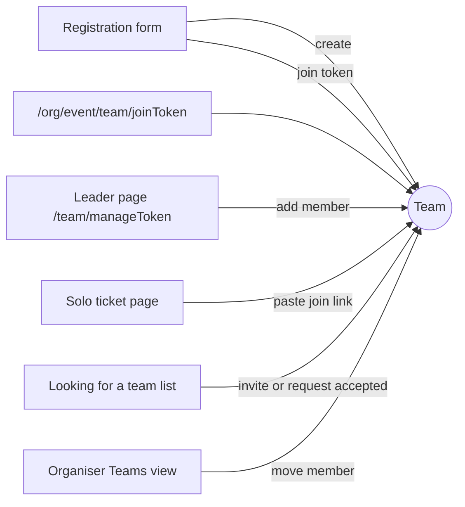

# Teams

Team registration lets a one-off event (hackathon, game jam, competition) register people in teams. It is layered on the normal RSVP model: each member still has their own `RSVP` and ticket, and a `Team` row groups them. Two ideas carry the whole design: in `TEAM` mode capacity counts **units** (a team or a solo registrant is one unit), and **every member's RSVP status equals the team's status**. All team mutations live in `lib/core/teams.ts` and take the same `Event` row lock as every other capacity change.

## Key files

| Path | Role |
| --- | --- |
| `lib/core/teams.ts` | All team cores: create/join, leader actions, matching, organiser transitions, move, delete and undo, DTOs, paging |
| `lib/teamUnits.ts` | `countConfirmedUnits`, `countConfirmedForCapacity`, `setTeamStatusTx`, `promoteOldestWaitlistedUnit`, `assignTeamLeaderTx`, `settleTeamAfterMemberLeft`, `emitTeamWebhooks` |
| `lib/core/teamOrganiser.ts` | `teamOrganiserGate`, `transitionTeamStatusForUser` (shared with the mobile API) |
| `lib/teamToken.ts` | Join and management tokens, `hashTeamManageToken`, `joinTokenFromInput` (pasted links) |
| `lib/rsvpCore.ts` | `reserveRsvp` handles the `team` intent (`solo`, `create`, `join`) under the event lock |
| `app/actions/teams.ts` | Leader (by manage token or signed-in leader) and ticket-holder actions |
| `app/actions/team-admin.ts` | Organiser actions: `approveTeam`, `rejectTeam`, `promoteTeam`, `renameTeamAsOrganiser`, `moveTeamMember`, `deleteTeam`, `loadTeamsPage`, `searchMoveTargets` |
| `lib/core/submissionLifecycle.ts` | `retireSoloSubmissionForTeamTx`, submission snapshots for team delete and undo |
| `lib/teamCapacityDisplay.ts`, `lib/publicTeamConfig.ts`, `lib/teamExport.ts`, `lib/organiserTeamFilters.ts` | Display strings, public form config, CSV, filters |
| `app/team/[token]/page.tsx` | Leader's team page (management token) |
| `app/[orgSlug]/[eventSlug]/team/[joinToken]/page.tsx` | Public join page |

## How it works

### Event settings

| Field | Meaning |
| --- | --- |
| `registrationMode` | `INDIVIDUAL` (default) or `TEAM`. Cannot change once the event has any RSVP (`updateEvent` checks under the lock) |
| `teamMinSize` | Teams below it are *Incomplete* and cannot be approved |
| `teamMaxSize` | Required in `TEAM` mode; joins beyond it fail; cannot drop below the largest team |
| `soloPolicy` | `TEAMS_ONLY`, `SOLO_ALLOWED` (default), `SOLO_WITH_MATCHING` |

Database CHECK constraints keep `1 <= teamMinSize <= teamMaxSize`, `teamMaxSize >= 2`, and require `teamMaxSize` in `TEAM` mode. Series validators refuse team settings.

### Units and status

```ts
// lib/teamUnits.ts
export const takesCapacity = { isCrew: false } as const satisfies Prisma.RSVPWhereInput;

/** Confirmed units: confirmed teams plus confirmed solo RSVPs (no team, not crew). */
export async function countConfirmedUnits(tx: Prisma.TransactionClient, eventId: string): Promise<number> {
  const teams = await tx.team.count({ where: { eventId, status: RsvpStatus.CONFIRMED } });
  const solo = await tx.rSVP.count({ where: { eventId, teamId: null, status: RsvpStatus.CONFIRMED, ...takesCapacity } });
  return teams + solo;
}
```

`Team.status` reuses `RsvpStatus`. `setTeamStatusTx` is the only way to change it: a conditional `team.updateMany` guarded by the expected `from` statuses, then `rSVP.updateMany` for every member in the same transaction, one status email per member (for confirm and reject), and one `registration.status_changed` webhook per member returned for emission after commit. Rejecting a team also cancels its pending join requests.

- **Create** (`reserveRsvp` with `{ mode: "create" }`): checks the case-insensitive `nameKey`, decides the status with `decideRsvpStatus` on units, creates the team with a join token and a hashed management token, makes the registrant leader and queues `team-created`.
- **Join** (`{ mode: "join", joinToken }`): never changes capacity; the RSVP takes the team's status. `REJECTED` and full teams are refused.
- **Organiser transitions** (`transitionTeamStatus`): approve needs `PENDING_APPROVAL`, an open event and `teamMinSize` members (code `TEAM_INCOMPLETE`); approve and promote need a free unit (code `CAPACITY_FULL`); reject works from `PENDING_APPROVAL` or `WAITLISTED`. Individual RSVP transitions on a team member return `TEAM_MEMBER` (see [Registration and RSVP](/features/registration-and-rsvp)).
- **Freeing a unit** (a confirmed team disbanded, deleted or emptied, a confirmed solo registrant cancelled or moved into a team) calls `promoteOldestWaitlistedUnit`, which picks the older of the oldest waitlisted team and the oldest waitlisted solo RSVP, unless the event is `APPROVAL_REQUIRED`.

### Ways into a team



- `addTeamMemberByLeader` creates a guest RSVP and emails that member their own ticket (`team-member-added`). Refused on invite-only events (`INVITE_ONLY_ADD_REFUSED`).
- `joinTeamWithExistingRsvp` moves an existing solo RSVP (same row, same ticket) into the team after re-checking publication and the team. A submitted solo project blocks the move until it is withdrawn (`retireSoloSubmissionForTeamTx`).
- Matching (`SOLO_WITH_MATCHING`): `TeamSeekerProfile` (headline, up to 8 skills) and `TeamJoinRequest` (`INVITE` or `REQUEST`, at most one `PENDING` per team and RSVP via a partial unique index). DTOs (`seekerListDto`, `joinPageTeamDto`) expose display name, headline and skills only. Lists page 20 at a time (`TEAM_MATCHING_PAGE_SIZE`).
- `cancelRsvpForUser` is also "leave team": `settleTeamAfterMemberLeft` hands leadership to the longest-standing member (rotating the management token and emailing them) or deletes the empty team.

### Capabilities

| Token | Storage | Grants |
| --- | --- | --- |
| Join token | `Team.joinToken`, 32 random bytes base64url, stored as-is | Joining; the join page shows team name, size and max size only |
| Management token | `Team.manageTokenHash` (hex SHA-256), raw value emailed once | Leader actions at `/team/:token` |
| Ticket token | `RSVP.checkInToken` | Leave team, seeker profile, join with a link; never team management |

A signed-in leader can also act through `resolveLeaderForUser` (`TeamRef` is `{ manageToken }` or `{ teamId }` in `app/actions/teams.ts`). `lockedLeaderTeam` re-verifies the hash or the leader's user id inside every transaction.

### Organiser tools

`resolveOrganiserEvent` (owner/admin or `MANAGE_REGISTRATIONS`) gates the Teams view: whole-team approve/reject/promote, rename, move a member (`organiserMoveMember`), delete with undo (`organiserDeleteTeam` writes an `RsvpDeletionUndo` snapshot that includes the submission via `captureSubmissionSnapshotTx`), keyset-paged lists of 50 with filters, and the Teams CSV.

## Invariants

- **Member status equals team status.** Only `setTeamStatusTx` changes a team's status, and it moves every member in the same transaction. `tests/integration/teams.db.test.ts` asserts this after every mutation.
- **Lock first.** Every team mutation goes through `lockEvent` (`SELECT ... FOR UPDATE` on `Event`) inside `teamTransaction`, so teams serialise with RSVPs, cancellations and crew changes.
- **Capacity counts units on team events.** Use `countConfirmedUnits` / `countConfirmedForCapacity`; team members never consume extra units, and crew are never counted.
- **Joining never changes capacity.** The new member inherits the team status.
- **Whole-team transitions only.** Individual approve/reject/promote on a team member is refused with `TEAM_MEMBER`.
- **Teams are scoped by `(id, eventId)`.** Every lookup includes `eventId`, and the event is checked against the organisation. Cross-event and cross-organisation ids are "not found".
- **Webhooks after commit.** `teamTransaction` collects emissions and calls `emitTeamWebhooks` only once the transaction has committed.
- **Capability emails are not kept.** `team-created` and `team-member-added` carry tokens; the outbox deletes them after delivery (`containsCapability` in `lib/outbox.ts`).
- **Crew are not team members.** Team cores filter `isCrew: false`, and the `RSVP_crew_shape` CHECK forbids a crew RSVP with a `teamId`.

## Making changes

**Add a leader action**

1. Write the core in `lib/core/teams.ts` taking `TeamLeaderAuth`; inside `teamTransaction`, call `lockEvent`, then `lockedLeaderTeam` to re-verify authority.
2. Refuse it for `REJECTED` teams if it changes membership or links (rename, link resets, transfer and "looking" are refused today).
3. If it changes status or frees a unit, use `setTeamStatusTx` and `promoteOldestWaitlistedUnit`, pushing their webhooks into the collected list.
4. Expose it in `app/actions/teams.ts` via the existing `TeamRef` resolution, and add cases to `tests/integration/teams.db.test.ts`.

**Expose more team data publicly**: add fields to the DTO functions only, and extend `tests/unit/team-dto.test.ts`, which fails on forbidden fields (member names, emails, answers, tickets).

**Change unit counting**: edit `countConfirmedUnits` only; it is used by `reserveRsvp`, `confirmRsvpWithinCapacity`, restore, `updateEvent` and the team cores.

## Testing

| Test | Covers |
| --- | --- |
| `tests/unit/team-validators.test.ts`, `team-units.test.ts`, `team-token.test.ts`, `team-dto.test.ts`, `team-outbox.test.ts` | Settings, unit counting and promotion, tokens, DTOs, emails |
| `tests/unit/team-organiser.test.ts`, `team-list-actions.test.ts`, `team-paging.test.ts`, `team-capacity-display.test.ts`, `guest-list-teams.test.ts` | Organiser views and paging |
| `tests/integration/teams.db.test.ts` | Concurrent creation and joins, atomic approval, promotion, cross-tenant ids, undo, the status invariant |
| `tests/integration/mobile-teams-judging.db.test.ts` | Mobile team endpoints |
| `tests/e2e/teams.spec.ts` | Serial team story, header checks on `/team/:token` and the join page |

```bash
npx vitest run tests/unit/team-units.test.ts tests/unit/team-dto.test.ts
npm run test:integration -- tests/integration/teams.db.test.ts
npx playwright test tests/e2e/teams.spec.ts
```

## Further reading

- [TEAMS.md](https://github.com/twilighty-abhi/yuyu/blob/main/docs/TEAMS.md): the design contract
- [Registration and RSVP](/features/registration-and-rsvp) for `reserveRsvp` and the capacity lock
- [Hackathon judging](/features/hackathon-judging): entrants are teams on team events
- [Mobile API](/api/mobile-api): organisers can approve, reject or promote teams; creation stays on the web
