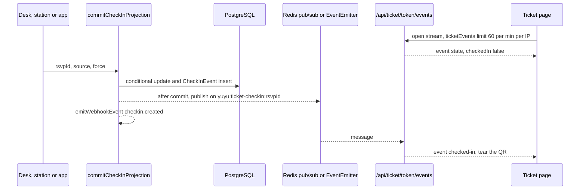

# Tickets and check-in

Every RSVP carries an opaque `checkInToken` that serves as the attendee's QR ticket. Check-in sets `RSVP.checkedInAt` (the projection) and appends an immutable `CheckInEvent` row (the history), from one of five sources: the organiser desk, an offline replay, a PIN-locked door station, or the mobile app (scan or manual). An open ticket page "tears" its QR stub live when that happens. This page covers that write path, the realtime fan-out, offline mode, stations, custom check-in lists and badge printing. The one rule to remember: **all entry check-ins go through `commitCheckInProjection`**.

## Key files

| Path | Role |
| --- | --- |
| `lib/checkInMutations.ts` | `commitCheckInProjection`, `commitUndoCheckInProjection`: the only writers of `RSVP.checkedInAt` |
| `lib/core/checkin.ts` | Desk cores: `previewCheckInByTokenForUser`, `checkInByTokenForUser`, `...ByRsvpIdForUser`, `undoCheckInForUser`, `lookupAttendeesForCheckInForUser`, `downloadOfflineCheckInRosterForUser`, `syncOfflineCheckInsForUser`, `loadRecentCheckInsForUser` |
| `lib/checkIn.ts` | `parseCheckInPayload` (QR or pasted ticket URL), `gateCheckInForStatus` (eligibility rules shown to the desk) |
| `lib/ticketCheckInEvents.ts` | `publishTicketCheckedIn`, `subscribeTicketCheckedIn`: Redis pub/sub or in-process `EventEmitter` |
| `lib/ticketCheckInState.ts` | Token shape check, `findTicketCheckIn`, the minimal `{ checkedIn, checkedInAt }` state |
| `app/api/ticket/[token]/events/route.ts`, `status/route.ts`, `download/route.tsx` | SSE stream, status poll, printable ticket (`sharp` + `qrcode`) |
| `components/ticket/ticketCheckInWatcher.ts` | Client watcher behind `useTicketCheckIn`: SSE with backoff, polling fallback |
| `lib/offline-checkin.client.ts` | IndexedDB roster and queue (`yuyu-offline-checkin`, stores `rosters` and `queue`) |
| `lib/checkInStation.ts`, `lib/stationPin.ts` | Station PIN hash and encryption, signed proof cookie, open window; PIN digit normalisation |
| `app/actions/checkin-station.ts`, `app/api/check-in/station/route.ts` | Set, rotate, reveal and disable the PIN; the station API |
| `lib/checkInListMutations.ts`, `lib/core/checkinLists.ts`, `lib/checkInLists.ts` | Custom lists: `commitListCheckIn`, `commitUndoListCheckIn`, list cores and gate |
| `lib/idCardPrint.ts` | Badge layout maths, paper presets, templates, merge fields |
| `app/ticket/[token]/page.tsx` | Attendee ticket page |
| `app/[orgSlug]/[eventSlug]/check-in/page.tsx` | Public PIN-locked station page |
| `components/checkin/*` | Desk UI (`EventCheckInClient`, `CheckInQrScanner`, `CheckInListDesk`, `IdCardPrintDialog`, ...) |

## How it works

### The single write path

```ts
// lib/checkInMutations.ts
const allowedStatuses = params.force
  ? ["CONFIRMED", "WAITLISTED", "PENDING_APPROVAL"] as const
  : ["CONFIRMED"] as const;
const updated = await tx.rSVP.updateMany({
  where: { id: params.rsvpId, checkedInAt: null, status: { in: [...allowedStatuses] } },
  data: { checkedInAt: params.checkedInAt },
});
if (updated.count === 1) {
  await tx.checkInEvent.create({
    data: {
      rsvpId: params.rsvpId,
      actorUserId: params.actorUserId,
      action: "CHECKED_IN",
      source: params.source,
      occurredAt: params.checkedInAt,
    },
  });
  return { state: "checked-in", checkedInAt: params.checkedInAt };
}
```

Eligibility lives **inside** the conditional write, so a status change or cancellation that races the scan can never be admitted from a stale preview. Zero rows updated means the core re-reads and returns `already-checked-in`, `ineligible` or `missing`. Only on a real transition, after commit, it calls `publishTicketCheckedIn` and `emitWebhookEvent({ type: "checkin.created" })`. `commitUndoCheckInProjection` mirrors this: conditional clear, a `CHECK_IN_UNDONE` history row, then `checkin.undone`.

`CheckInSource` is `"online" | "offline-sync" | "venue-station" | "mobile-scan" | "mobile-manual"` and must match the `CheckInEvent_known_source` CHECK constraint.

Callers apply `gateCheckInForStatus(status, force)` first to give the desk a useful message: `CONFIRMED` passes, `WAITLISTED` needs Override (`force`), `PENDING_APPROVAL` and `REJECTED` are blocked. The commit's `force` list is the database-level backstop.

### Desk

`/dashboard/:orgSlug/event/:eventId/check-in` uses the cores in `lib/core/checkin.ts`, which require organisation owner/admin or the exact `CHECK_IN` grant (`canAccessEvent(..., EventPermission.CHECK_IN)`) and apply the `checkin` rate limit. Preview then confirm (`previewCheckInByTokenForUser` → `checkInByTokenForUser`) keeps scanning fast while the commit re-checks everything. Recent check-ins are keyset-paged.

### Live ticket tear



- Channels are `yuyu:ticket-checkin:` + RSVP id. The ticket token never enters Redis, its monitoring or logs.
- With `REDIS_URL`, one lazily created subscriber connection per process is shared with per-channel reference counting. Without Redis, an `EventEmitter` stored on `globalThis` under `Symbol.for("yuyu.ticketCheckInEmitter")` is used, which only reaches viewers on the same instance.
- Publishing is fire-and-forget and never throws; a failed Redis publish falls back to local dispatch.
- The SSE route sends a `: ping` every 25 s, closes after 10 minutes, and sets `X-Accel-Buffering: no`. The client watcher re-checks `/status` every 15 s while the stream is open and polls every 4 s when SSE is unavailable.
- `/status` returns only `{ checkedIn, checkedInAt }` (`ticketStatus`, 120/min per IP); malformed or unknown tokens get an empty 404.

### Offline mode

`downloadOfflineCheckInRosterForUser` returns the full roster, including ticket tokens, to `CHECK_IN` holders only. `lib/offline-checkin.client.ts` keeps the roster and a queue of pending check-ins in IndexedDB. `syncOfflineCheckInsForUser` replays the queue through `commitCheckInProjection` with source `offline-sync`, refusing duplicates in the batch, RSVPs from another event, and times outside the event window (from 24 h before the start to the earlier of now + 5 min and 1 h after the end).

### PIN-locked door stations

`/:orgSlug/:eventSlug/check-in` lets volunteers without an account check people in.

- `createOrRotateCheckInStation`, `revealCheckInStationPin` and `disableCheckInStation` require a recent sign-in (`hasRecentAuthentication`). PINs are 8 digits from `crypto.randomInt`, stored as a bcrypt hash (`checkInStationPinHash`) plus an AES-256-GCM copy (`checkInStationPinEncrypted`, `v2` format with a domain-separated key) so admins can reveal it.
- `POST /api/check-in/station` verifies the PIN under the `checkinStationPin` limit (5/min per IP and event) and sets an HMAC-signed proof cookie (`yuyu.check-in-station.v2`) bound to event id, `checkInStationSecretVersion` and expiry. Rotating or disabling bumps the version and invalidates every proof.
- A station opens 24 h before the start and closes 1 h after the end (`isCheckInStationOpen`). It commits with source `venue-station` and `actorUserId: null`.
- `normalizeStationPin` accepts ASCII, Arabic-Indic, Extended Arabic-Indic and Devanagari digits and keeps the first eight.

### Custom check-in lists

Lists such as "Swag" or "Lunch – Day 1" use separate models: `CheckInList`, `CheckInListRecord` (unique per list and RSVP) and `CheckInListEvent` history. `commitListCheckIn` locks the RSVP row `FOR UPDATE`, share-locks the list `FOR SHARE` (so it cannot be archived mid-scan), applies `gateListCheckIn` (the entry gate plus an optional `requiresEntryCheckIn`) and writes record and history. It **never** touches `RSVP.checkedInAt`, `CheckInEvent` or the realtime channel. Setting up lists needs `EDIT_DETAILS`; scanning into them needs `CHECK_IN` (`lib/core/checkinLists.ts`).

### Badge printing

`lib/idCardPrint.ts` holds the print model: templates (Classic, Bold, Minimal), `ID_CARD_PAPER_PRESETS` (A6 and other stocks), `fitTextSizePt` for shrinking long names, `normalizeIdCardPrintSettings`, and the `{{team}}` merge field (`ID_CARD_TEAM_MERGE_FIELD`). Designs are stored in the browser per event; the QR is generated locally.

## Invariants

- **One entry write path.** Every write to `RSVP.checkedInAt` goes through `commitCheckInProjection` / `commitUndoCheckInProjection`. Never `update` the column directly. Covered by `tests/integration/check-in.db.test.ts` (one history entry for concurrent scans and undo, eligibility in the write) and `tests/unit/ticket-check-in-publish.test.ts`.
- **Eligibility in the `WHERE` clause.** Do not move the status check into a prior read.
- **New sources need the constraint.** Add a value to `CheckInSource` and to `CheckInEvent_known_source` in a migration, together.
- **Publish after commit, best effort.** A realtime or webhook failure must never fail a check-in.
- **Channels keyed by RSVP id.** Ticket tokens are bearer capabilities: never log them, never use them as channel names, and return only check-in state from `/status` and `/events`.
- **Rosters with tokens only for `CHECK_IN` holders.** Stations never receive rosters, exports, PINs or proofs.
- **Lists are independent of entry.** List check-ins never change entry state, and entry check-in never writes list records.
- **Shared singletons on `globalThis`.** The in-process emitter must be shared between the Server Action and route-handler bundles, so it lives under a `Symbol.for` key.

## Making changes

**Add a new check-in surface** (for example a kiosk API)

1. Authenticate and authorise (or verify a capability) at the boundary, and resolve the RSVP scoped to the event.
2. Call `gateCheckInForStatus` for a user-facing message.
3. Commit with `commitCheckInProjection({ rsvpId, actorUserId, source, checkedInAt, force })`.
4. If you need a new `source`, extend `CheckInSource` and the CHECK constraint in one migration (see [Change the schema](/guides/change-the-schema)).
5. Add tests mirroring `tests/unit/check-in-station-route.test.ts` and an integration case in `check-in.db.test.ts`.

**Show more on the live ticket**: don't. The SSE payload is deliberately `{ checkedInAt }`. Render extra data server-side on reload instead.

**Add a list feature**: change `gateListCheckIn` in `lib/checkInLists.ts` and keep the lock order in `commitListCheckIn` (RSVP `FOR UPDATE`, then list `FOR SHARE`).

## Testing

| Test | Covers |
| --- | --- |
| `tests/unit/ticket-check-in-events.test.ts`, `ticket-check-in-publish.test.ts`, `ticket-check-in-routes.test.ts`, `ticket-check-in-watcher.test.ts`, `use-ticket-check-in.test.ts` | Live ticket |
| `tests/unit/check-in-station.test.ts`, `check-in-station-actions.test.ts`, `check-in-station-route.test.ts`, `station-pin.test.ts` | Stations |
| `tests/unit/check-in-lists.test.ts`, `check-in-details.test.ts`, `check-in-refresh.test.ts`, `id-card-print.test.ts` | Lists, desk details, badges |
| `tests/integration/check-in.db.test.ts`, `check-in-lists.db.test.ts` | Concurrency and eligibility against PostgreSQL |
| `tests/e2e/check-in-lists.spec.ts`, `public-smoke.spec.ts` | Desk and ticket flows |

```bash
npx vitest run tests/unit/ticket-check-in-publish.test.ts tests/unit/check-in-station-route.test.ts
npm run test:integration -- tests/integration/check-in.db.test.ts tests/integration/check-in-lists.db.test.ts
npx playwright test tests/e2e/check-in-lists.spec.ts
```

Release testing should exercise the live tear with and without Redis and behind the production reverse proxy (nginx needs `proxy_buffering off` for `text/event-stream`).

## Further reading

- [FEATURES.md](https://github.com/twilighty-abhi/yuyu/blob/main/docs/FEATURES.md) (tickets and check-in) and [TESTING.md](https://github.com/twilighty-abhi/yuyu/blob/main/docs/TESTING.md)
- [Realtime](/architecture/realtime) for the SSE and Redis details
- [Permissions](/architecture/permissions) for `CHECK_IN` and `EDIT_DETAILS`
- [Registration and RSVP](/features/registration-and-rsvp), [Crew](/features/crew)
