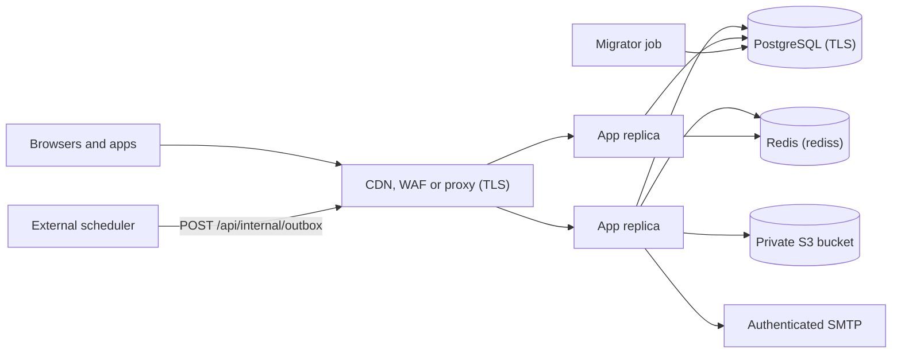

# Deployment

Yuyu ships as two Docker images built from one `Dockerfile`: an application image (`runner` target) and a one-shot migration image (`migrator` target). On a single host you run them with `docker run`. On Kubernetes, the Helm chart in `charts/yuyu/` runs them. The application image contains only the Next.js standalone server. You provide PostgreSQL, Redis, S3-compatible storage, SMTP and TLS termination yourself.

## Key files

| Path | Role |
| --- | --- |
| `Dockerfile` | Multi-stage build: `deps`, `migrator`, `builder`, `runner` |
| `docker-compose.yml` | Local development PostgreSQL only |
| `compose.staging.yml`, `.env.staging.example` | Disposable staging stack. Uses the insecure CI exceptions, so it is not for production |
| `charts/yuyu/` | Helm chart: Deployment, Service, Ingress, HPA, PDB, migration Job |
| `.github/workflows/publish-images.yml` | Builds and pushes both images to Docker Hub after a green Quality gate on `main` |
| `scripts/check-production-env.mjs` | `npm run production:check` preflight |
| `scripts/verify-production-schema.mjs` | `npm run db:verify` schema contract check |
| `scripts/check-instance-secrets.mjs` | Checks that `MFA_ENCRYPTION_KEY` can decrypt panel secrets |
| `scripts/db-backup.mjs`, `scripts/db-restore.mjs`, `scripts/db-backup-lib.mjs` | `npm run db:backup` / `npm run db:restore` |
| `scripts/prepare-standalone.mjs` | Copies `public/` and `.next/static` into `.next/standalone` for local production runs |

## Production topology



- Every application process runs its own outbox worker once a minute. There is no separate worker container. Row claims make several workers safe.
- App processes need outbound access to PostgreSQL, Redis, storage, SMTP (typically 465/587), the alert webhook (HTTPS 443), organisation webhook receivers (443 and 8443), and the Google endpoints when Google SSO or mobile Google sign-in is used.
- Keep the container port private. Expose it only through a proxy that overwrites the header named in `TRUSTED_PROXY_IP_HEADER`.

## Docker image

| Stage | Base | What it does |
| --- | --- | --- |
| `deps` | `node:22-alpine` | `npm ci`. Copies `prisma/schema.prisma` first so the Prisma `postinstall` works |
| `migrator` | `deps` | Adds `prisma/` and the `verify-production-schema.mjs` and `check-instance-secrets.mjs` scripts. `CMD npx prisma migrate deploy` |
| `builder` | `node:22-alpine` | `ARG NEXT_PUBLIC_BASE_URL`, `prisma generate`, `npm run build`. The Server Actions key comes from a BuildKit secret mount (`required=true`) |
| `runner` | `node:22-alpine` | `NODE_ENV=production`, `font-dejavu` (for Sharp-rendered tickets and certificates), non-root user `nextjs` (uid 1001), standalone output, `.env*` files deleted, `HEALTHCHECK` on `/api/health`, `CMD node server.js` on port 3000 |

```bash
docker build --target migrator -t registry.example.com/yuyu-migrator:VERSION .
docker build --target runner \
  --secret id=NEXT_SERVER_ACTIONS_ENCRYPTION_KEY,env=NEXT_SERVER_ACTIONS_ENCRYPTION_KEY \
  --build-arg NEXT_PUBLIC_BASE_URL="$NEXT_PUBLIC_BASE_URL" \
  -t registry.example.com/yuyu:VERSION .
```

Rules for building:

- Build both images from the same commit and give them the same immutable tag. Never deploy `latest`.
- `NEXT_PUBLIC_BASE_URL` is the only build-visible setting. Changing it means a rebuild.
- The runtime needs the same `NEXT_SERVER_ACTIONS_ENCRYPTION_KEY` that the build used.
- The `runner` image has neither the Prisma CLI nor the ops scripts. Run `storage:migrate`, `db:backup` and `db:restore` from a trusted checkout.

### Docker Hub publishing

`publish-images.yml` triggers on `workflow_run` of **Quality gate**. It publishes only when that run succeeded, was a `push` to `main`, and came from this repository, never from a fork. It validates its settings, builds `linux/amd64` and `linux/arm64`, and pushes:

- `<namespace>/yuyu-migrator:sha-<commit>-<run id>-<attempt>`
- `<namespace>/yuyu:sha-<commit>-<run id>-<attempt>`

The job summary records both digests. It needs the repository variables `DOCKERHUB_USERNAME`, `DOCKERHUB_NAMESPACE` and `NEXT_PUBLIC_BASE_URL` (an HTTPS origin with no trailing slash), and the secrets `DOCKERHUB_TOKEN` and `NEXT_SERVER_ACTIONS_ENCRYPTION_KEY`.

## Compose files

| File | Use | Notes |
| --- | --- | --- |
| `docker-compose.yml` | Local development | Only `postgres:16-alpine` (`yuyu` / `yuyu_dev`) on 5432 |
| `compose.staging.yml` | Isolated staging VM | PostgreSQL, Redis, MinIO (and `minio-init`, which creates a private bucket), Mailpit, `migrate` (migrator target), and `app` on `127.0.0.1:3001`. `app` waits for `migrate` to complete. Both read `.env.staging`, which sets `CI=true` and `ALLOW_INSECURE_PRODUCTION_TESTS=1` |

::: warning
The repository has no production Compose stack. Do not use either file for real attendee data.
:::

## Helm chart

`charts/yuyu` (chart `0.1.0`, `kubeVersion >=1.25.0-0`).

| Value | Default | Notes |
| --- | --- | --- |
| `replicaCount` | `1` | Omitted from the Deployment when `autoscaling.enabled` is set (the HPA owns it) |
| `updateStrategy` | `RollingUpdate`, `maxUnavailable: 0`, `maxSurge: 1` | Use `Recreate` (and `rollingUpdate: null`) for a release whose notes forbid old and new running side by side |
| `image.repository` / `image.tag` | `ghcr.io/your-org/yuyu` / `""` (falls back to `appVersion`) | Set to your immutable tag |
| `existingSecret` | `yuyu-runtime` | Created outside Helm. Mounted with `envFrom` on app pods **and** the migration Job, so they share one `MFA_ENCRYPTION_KEY` |
| `ingress.*` | Disabled, no annotations | Add unbuffered-streaming annotations (below) |
| `resources` | Requests 500m CPU, 1Gi memory. Limits 2 CPU, 4Gi memory | |
| `autoscaling.*` | Off. 2 to 6 replicas, 70% CPU, 75% memory | Needs a shared `REDIS_URL` |
| `podDisruptionBudget.*` | Off, `minAvailable: 1` | |
| `migration.enabled` | `true` | Pre-install and pre-upgrade hook Job |
| `migration.image.*` | `ghcr.io/your-org/yuyu-migrator` | Same tag as the app |
| `migration.backoffLimit` / `activeDeadlineSeconds` | `1` / `300` | |
| `migration.checkInstanceSecrets` | `false` | When `true`, the Job runs `npx prisma migrate deploy && node scripts/check-instance-secrets.mjs` |

### Migration job

`templates/migration-job.yaml` has the hook annotations `pre-install,pre-upgrade`, weight `-5`, and deletion policy `before-hook-creation,hook-succeeded`. It runs as uid 1001 with all capabilities dropped. A failed migration blocks the rollout. The Job needs only PostgreSQL and DNS egress.

### Probes

| Probe | Check |
| --- | --- |
| Startup | `GET /api/health`, 30 attempts 5 s apart |
| Liveness | `GET /api/health` (dependency-free) |
| Readiness | `exec` probe: `node -e` fetches `/api/health/db` with `Authorization: Bearer` set to `HEALTHCHECK_SECRET`. A failing pod leaves the Service without restarting |

```bash
helm lint charts/yuyu
helm upgrade --install yuyu charts/yuyu --namespace yuyu --create-namespace \
  --values /secure/path/values-production.yaml --wait --timeout 10m
```

## Release and upgrade procedure

1. Complete the checklist in `docs/PRODUCTION_RELEASE.md`. Deploy a commit whose Quality gate run is green.
2. Read the migration notes in `docs/production-operations.md` ("Recent schema migrations" and the lock checklist). For migrations that alter `Event` or `RSVP`, deploy at low traffic, end long transactions, and consider adding `options=-c lock_timeout=5s` (URL-encoded) to the **migrator's** `DATABASE_URL` only.
3. Take and verify a backup (`npm run db:backup`). Record the current image.
4. Run `npm run production:check` with the production environment.
5. Run the new migrator once (Helm runs it as a hook). Then run `node scripts/verify-production-schema.mjs` and `node scripts/check-instance-secrets.mjs` in the same image and environment.
6. Replace the application. On Docker, stop and rename the old container, then start the new one. On Helm, `helm upgrade`.
7. Check liveness, authenticated readiness, a fresh outbox heartbeat, email delivery (**Send test email**), Redis health and the error rate.

::: warning Old and new releases side by side
The previous release's outbox worker marks unknown email kinds `FAILED`. Add new kinds to `OUTBOX_KINDS_ADDED_AFTER_1_0` (`lib/outbox.ts`) so the new release requeues them once. For an upgrade whose notes forbid overlap, use `--set updateStrategy.type=Recreate --set updateStrategy.rollingUpdate=null`.
:::

**Rollback.** Reverting the image does not reverse a migration. Migrations must stay backward compatible. Once rows use new enum values (for example the `CREW` page section or the `JUDGE` grant), the old release cannot read them, and the rollback path is restoring the pre-upgrade backup. `docs/PRODUCTION_RELEASE.md` records these values in its rollback notes.

Also configure an independent scheduler to call `POST /api/internal/outbox` every minute with `Authorization: Bearer $CRON_SECRET`, with an HTTP timeout of at least 60 s.

## Scaling notes

| Concern | Rule |
| --- | --- |
| Multiple replicas | All replicas must share one `REDIS_URL` (`rediss://`). Rate limits and live check-in pub/sub go through it. Without Redis, the in-process fallback reaches only tickets on the same instance |
| Server Actions | Every replica uses the same `NEXT_SERVER_ACTIONS_ENCRYPTION_KEY` as the build |
| MFA key | `MFA_ENCRYPTION_KEY` is identical on every pod and job. After rotating the Secret, restart all pods together (`kubectl rollout restart`), because `envFrom` is read only at pod start |
| SSE proxy buffering | `GET /api/ticket/:token/events` is a long-lived `text/event-stream`. It sends `X-Accel-Buffering: no` and a heartbeat every 25 s. The proxy must not buffer it and must allow idle reads of at least 30 s. For ingress-nginx, use `nginx.ingress.kubernetes.io/proxy-buffering: "off"` and `proxy-read-timeout: "60"`. Otherwise the ticket tear waits for the 15 s status poll |
| Panel settings | Need nothing extra. Each request reads them from PostgreSQL |
| Outbox throughput | Each pass sends at most one batch of 20 emails (`OUTBOX_DRAIN_BATCH`, `OUTBOX_DRAIN_MAX_BATCHES` in `lib/outboxWorker.ts`). This is deliberately gentle, because providers such as Gmail refuse rapid SMTP logins. Transactional kinds are claimed before `BULK_OUTBOX_KINDS` |
| Egress | The chart creates no NetworkPolicy. Under default-deny egress, allow the destinations listed in [Production topology](#production-topology) |

## Backup and restore

`npm run db:backup` and `npm run db:restore` run from a trusted operational host that has PostgreSQL client tools (`psql`, `pg_dump`, `pg_restore`) compatible with the server.

| Command | Behaviour |
| --- | --- |
| `npm run db:backup` | Loads `.env` if present (injected values win). Reads only `DATABASE_URL` and requires its TLS setting. Checks free space (database size plus 20% plus 256 MiB). Writes a compressed custom-format archive and a SHA-256 sidecar to the git-ignored `backups/` directory, keeping the newest seven pairs |
| `npm run db:backup -- --s3-bucket ... --s3-region ... [--s3-endpoint ...] --s3-access-key-id ... --s3-secret-access-key ... --s3-prefix ...` | Also uploads to a dedicated private backup bucket. Add `--s3-force-path-style` if the provider needs it |
| `npm run db:restore -- --file backups/<archive>.dump --production --confirm-database <name>` | Destructive. Refuses development, test and localhost targets. Takes a local safety backup first, then runs migration status and the schema check |
| `npm run db:restore -- --s3-key <prefix>/<archive>.dump <same S3 flags> --production --confirm-database <name>` | Downloads, verifies the checksum, restores, and removes the temporary copy |
| `--via-local-tunnel` | Lets a restore go through a local proxy or SSH tunnel. Development and test database names are still refused |

Run a restore drill at least quarterly. The backup fields in Super admin → Settings are display-only. They do not trigger or retain backups.

## Further reading

- [docs/DEPLOYMENT_DOCKER.md](https://github.com/twilighty-abhi/yuyu/blob/main/docs/DEPLOYMENT_DOCKER.md), [docs/DEPLOYMENT_STAGING.md](https://github.com/twilighty-abhi/yuyu/blob/main/docs/DEPLOYMENT_STAGING.md), [docs/DOCKERHUB_ACTIONS.md](https://github.com/twilighty-abhi/yuyu/blob/main/docs/DOCKERHUB_ACTIONS.md)
- [docs/PRODUCTION_RELEASE.md](https://github.com/twilighty-abhi/yuyu/blob/main/docs/PRODUCTION_RELEASE.md), [docs/production-operations.md](https://github.com/twilighty-abhi/yuyu/blob/main/docs/production-operations.md)
- `charts/yuyu/README.md` in the repo
- [Configuration](/reference/configuration), [Background jobs](/architecture/background-jobs), [Realtime](/architecture/realtime), [Change the schema](/guides/change-the-schema)
