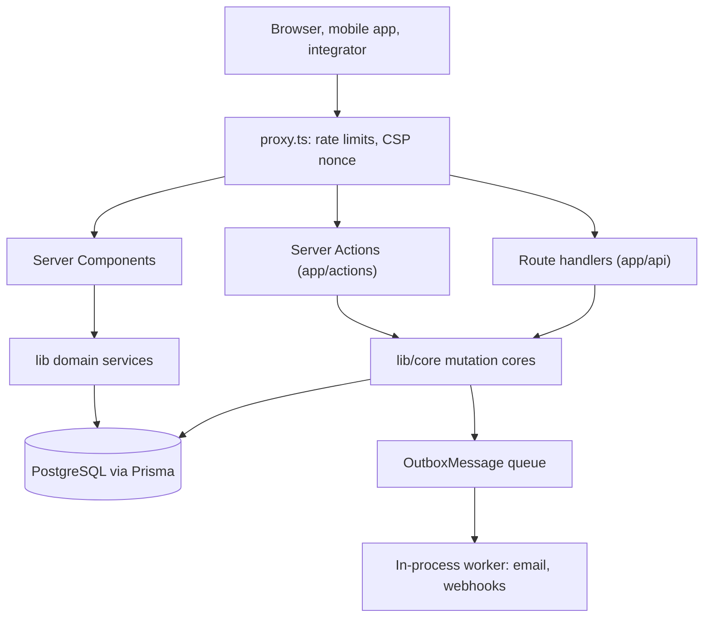

# Yuyu for developers

Yuyu is a self-hosted, multi-tenant platform for creating, running and following up on **free** events. An `Organisation` is the tenant boundary, and every event, series, invitation, asset and audit record resolves through one. The repository treats the app as a production system: tenant isolation, privacy and secure operations are core behaviour, and `AGENTS.md` and `docs/SECURITY.md` set rules that the code must follow. Yuyu has no payments, ticket sales, refunds, ads or third-party trackers, and contributions that add them are not accepted.

## What the product covers

| Area | What exists today | Wiki page |
| --- | --- | --- |
| Events | Public, hidden-link, invite-only and approval-required events, RRULE series, short links, embeds, Discover | [Events and websites](/features/events-and-websites) |
| Event websites | Programme tracks, speakers, venues, sponsors, FAQs, resources | [Events and websites](/features/events-and-websites) |
| Registration | Custom forms, capacity, waitlist, approvals, manual attendance confirmation | [Registration and RSVP](/features/registration-and-rsvp) |
| Tickets and check-in | QR tickets with live check-in over SSE, offline desk, PIN door stations, custom check-in lists, badges | [Tickets and check-in](/features/tickets-and-check-in) |
| Teams and hackathons | Team registration measured in capacity units, submissions, rubric judging, awards, results | [Teams](/features/teams), [Hackathon judging](/features/hackathon-judging) |
| Crew | Crew tickets that never take a guest's place | [Crew](/features/crew) |
| Email | Outbox-queued transactional email and designed broadcasts | [Email and broadcasts](/features/email-and-broadcasts) |
| Feedback | Feedback forms, layered certificates, PDF reports, exports, saved views | [Feedback, certificates, reports](/features/feedback-certificates-reports) |
| Integrations | Machine API (`/api/v1`), mobile API (`/api/mobile/v1`), signed organisation webhooks | [Machine API](/api/machine-api), [Mobile API](/api/mobile-api), [Webhooks](/api/webhooks) |
| Operations | Super-admin area with TOTP step-up, instance settings, alerts webhook, health endpoints | [Super admin](/features/super-admin) |

The end-user guide is the in-app help centre at `/help`, written as MDX in `content/help/`. Keep an article accurate when you change the feature it describes.

## Stack

| Layer | Technology (from `package.json`) |
| --- | --- |
| Framework | Next.js 16 App Router (`next` ^16.4), React 19.2, TypeScript 5 |
| Database | PostgreSQL 16 (local and CI images), Prisma 6.19 |
| Auth | Auth.js v5 (`next-auth` beta) with `@auth/prisma-adapter`, `bcryptjs`, `otpauth` for TOTP, `jose` for mobile Google ID tokens |
| UI | Tailwind CSS 4, Radix UI primitives, `lucide-react`, `framer-motion`, Tiptap, self-hosted Fontsource fonts |
| Services | Redis via `ioredis` (rate limits, pub/sub), S3-compatible storage via `@aws-sdk/client-s3`, SMTP via `nodemailer` |
| Media | `sharp` (images, certificates), `pdf-lib` (reports), `qrcode`, `react-qr-code`, `html5-qrcode` |
| Validation and dates | `zod` v4, `rrule` |
| Help centre | `@next/mdx`, `remark-gfm` |
| Tests | Vitest 4 (unit, integration, coverage), Playwright (e2e, help screenshots) |
| Deploy | Standalone Next.js output, multi-stage `Dockerfile`, Helm chart in `charts/yuyu/` |

::: warning This is Next.js 16
The framework has breaking changes compared with older releases. `AGENTS.md` requires you to read the relevant guide in `node_modules/next/dist/docs/` before changing routing, caching or rendering, `proxy.ts`, Server Actions, metadata or configuration.
:::

## Mental model

- **Reads** happen in Server Components, which call `lib/` loaders after an auth and permission check.
- **Dashboard writes** are Server Actions in `app/actions/`. Public RSVP, feedback and search use JSON route handlers in `app/api/`.
- **Shared mutation logic** lives in `lib/core/`, so a Server Action and the matching `/api/mobile/v1` endpoint run the same validation, transaction, rate limit and audit. Change behaviour there, not in one surface. See [Mutation cores](/architecture/mutation-cores).
- **Side effects** (email, webhooks) are written to queue tables in the same transaction and delivered by a one-minute in-process worker started from `instrumentation.ts`. Request paths never wait for SMTP.
- **`prisma/schema.prisma` is authoritative** for fields, constraints and cascades. Don't infer them from a component.

## The non-negotiables

These rules come from `AGENTS.md`. Breaking one is a review blocker.

| Rule | Why or how it is enforced |
| --- | --- |
| Every dashboard read or mutation resolves the organisation server-side and checks membership plus the `OWNER`/`ADMIN`/`MEMBER` role | `Organisation` is the tenant boundary. Hiding a control in the UI is not authorisation |
| Server Actions authenticate, authorise, validate with the existing Zod validators, rate limit and audit before they mutate | Public route handlers need the same protections |
| Super-admin pages each call `await requireSuperAdminMfa()` | Layout checks don't re-run on client navigation. `tests/unit/super-admin-page-guards.test.ts` fails if a page omits it |
| Publishing sets `Event.status = PUBLISHED` and `EventPage.isPublished` together, in one transaction | Public pages, RSVP and short links require both |
| Capacity, waitlist and duplicate-RSVP rules use Prisma transactions and database constraints | The database is the final integrity layer, not a prior UI check |
| Realtime check-in publishes only through `commitCheckInProjection`, on channels keyed by RSVP id | Ticket tokens are bearer capabilities and never become channel names |
| Ticket, certificate, invite, password-reset, MFA, scheduler and readiness values are secrets | Never log them or put them in URLs, diagnostics, analytics or audit metadata |
| Email goes through `OutboxMessage`. A new kind may need `BULK_OUTBOX_KINDS` and `OUTBOX_KINDS_ADDED_AFTER_1_0` | The previous release's worker fails unknown kinds while both releases run |
| Webhooks are emitted only after commit, through `emitWebhookEvent`, and every target is SSRF-checked | Payloads are strict DTOs with no emails, answers or tokens |
| Schema changes are reviewed Prisma migrations, additive where possible. Never `db:push` for deployable changes | Production runs `npm run db:deploy` as a separate release step |
| Never read, print, commit or copy `.env` values | Use `.env.example` for names. Advise rotation if a credential leaks |
| Don't loosen CSP nonces, security headers, trusted proxy-IP handling, Server Action origins, Redis fail-closed behaviour or production TLS checks | These need a documented security and deployment change |

The full list, with mechanisms, is on the [Security checklist](/reference/security-checklist).

## Where to go next

1. [Local setup](/start/local-setup): get a running app with a signed-in user and super-admin access.
2. [Codebase tour](/start/codebase-tour): where things live and how files are named.
3. [Workflow](/start/workflow): branches, pull requests, local checks and CI.
4. [Architecture overview](/architecture/overview): request lifecycle and runtime topology.

## Further reading

- [AGENTS.md](https://github.com/twilighty-abhi/yuyu/blob/main/AGENTS.md): canonical contributor and agent guidance
- [docs/ARCHITECTURE.md](https://github.com/twilighty-abhi/yuyu/blob/main/docs/ARCHITECTURE.md)
- [docs/FEATURES.md](https://github.com/twilighty-abhi/yuyu/blob/main/docs/FEATURES.md)
- [docs/SECURITY.md](https://github.com/twilighty-abhi/yuyu/blob/main/docs/SECURITY.md)
- [Glossary](/reference/glossary)
